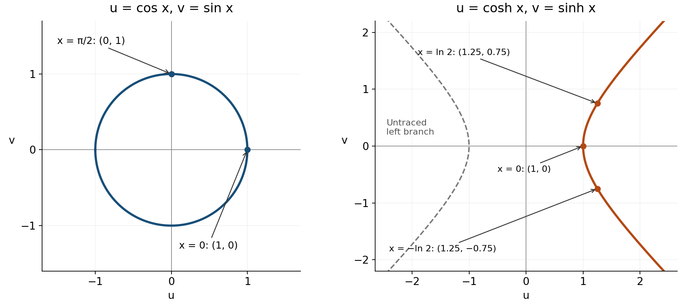

Lecture 7 — hyperbolic functions and Exam 1 review

This lesson reconstructs the mathematics in MIT 18.01, Fall 2006, Lecture 7, “Continuation and Exam Review.” The aim is to choose differentiation rules from the structure of an expression, recover the standard formulas from earlier facts, and state where each result applies. The original lecture is an exam review, not a supplied examination paper; the practice below is labelled accordingly.

Read the explanation in order, pause at P1–P5, then use P6 as a later mixed check. [Hints](hints.md) are grouped separately from [complete solutions](solutions.md). You can return from each help item to its prompt. The figure is part of the explanation. The source link at the end provides provenance; the lesson supplies the facts needed here.

We use real variables. A prime means differentiation with respect to the displayed independent variable: $`y'=dy/dx`$ when $`y=y(x)`$. The derivative is a tangent gradient or local rate of change. The starting toolkit is ordinary algebra, functions and inverses, radians, exponential and logarithm laws, and the product and chain rules. The particular facts needed from that toolkit are recalled at their use. Numerical success alone is not the target: show which operation licenses each consequential step.

<a id="hyperbolic"></a>

1. Hyperbolic sine and cosine: reconstruct the signs

The definitions, valid for every real $`x`$, are

```math
\sinh x=\frac{e^x-e^{-x}}2,
\qquad
\cosh x=\frac{e^x+e^{-x}}2.
```

The names are read “hyperbolic sine” (often “sinsh”) and “hyperbolic cosine” (“cosh”). Each is an ordinary real function built from exponentials. The argument follows the function name: $`\cosh(2x)`$ means first double $`x`$, then apply $`\cosh`$. A superscript two on a function value denotes its square: $`\cosh^2 x=(\cosh x)^2`$.

Recall that $`(e^x)'=e^x`$. For a composite exponential, the chain rule gives $`(e^{g(x)})'=e^{g(x)}g'(x)`$: keep the exponential, then multiply by the derivative of its whole exponent. Thus $`(e^{-x})'=-e^{-x}`$. Differentiating the definitions gives

```math
\frac d{dx}\sinh x
=\frac{e^x-(-e^{-x})}{2}
=\frac{e^x+e^{-x}}2
=\cosh x,
```

```math
\frac d{dx}\cosh x
=\frac{e^x+(-e^{-x})}{2}
=\frac{e^x-e^{-x}}2
=\sinh x.
```

The two minus signs cancel in the first calculation, not the second. Hyperbolic cosine differentiates to positive hyperbolic sine; the circular formula $`(\cos x)'=-\sin x`$ belongs to a different function.

<a id="p1"></a>

P1 — generated application. From the definitions above, differentiate $`q(x)=\cosh(2x)`$. Show the inner derivative and the sign of the $`e^{-2x}`$ contribution. Find $`q'(0)`$, and explain why the ordinary cosine derivative does not supply the sign here. A complete response has the derivative, its value at zero and the sign explanation. [Hint P1](hints.md#h1) · [Solution P1](solutions.md#s1)

The identity behind the name is

```math
\cosh^2 x-\sinh^2 x=1.
```

To derive it without memorising a sign, use $`a=e^x`$ and $`b=e^{-x}`$. Then $`ab=1`$, and the difference of the squared definitions is

```math
\frac{(a+b)^2-(a-b)^2}{4}
=\frac{4ab}{4}=1.
```

Here the squares are of entire function values, so their denominators are $`2^2=4`$. This is the lecture's expansion compressed into a difference-of-squares calculation.

Set $`u=\cosh x`$ and $`v=\sinh x`$. These are coordinates of a point whose parameter is $`x`$. They obey $`u^2-v^2=1`$, the hyperbola in the right panel below. Since $`e^x`$ and $`e^{-x}`$ are positive, $`u\gt 0`$; the identity then gives $`u\ge1`$. The parametrization therefore traces the right branch only. By comparison, $`u=\cos x`$ and $`v=\sin x`$ obey $`u^2+v^2=1`$, the unit circle. In that circular parametrization $`x`$ is an angle in radians; the hyperbolic parameter here is not being identified with the ordinary geometric angle of the point.



Figure 1. Coordinate constraints explain the names. At $`x=0`$, both parametrizations give $`(u,v)=(1,0)`$. For the hyperbola, $`x=\ln2`$ gives $`e^x=2`$ and $`e^{-x}=1/2`$, hence $`(u,v)=(5/4,3/4)`$; replacing $`x`$ by $`-\ln2`$ reverses $`v`$ but leaves $`u`$ unchanged. These are the three marked orange points. The displayed curves continue beyond the plot window. The equations, rather than an apparent resemblance of the graphs, distinguish the two constructions.

<a id="rules"></a>

2. Read the outer operation before choosing a rule

Let $`u=u(x)`$ and $`v=v(x)`$ be differentiable, and let $`c`$ be constant. The lecture's general rules are

```math
(u+v)'=u'+v',\qquad (cu)'=cu',
\qquad (uv)'=u'v+uv',
```

```math
\left(\frac uv\right)'=\frac{u'v-uv'}{v^2}\quad(v\ne0),
\qquad
\frac d{dx}f(u(x))=f'(u(x))u'(x).
```

For the chain rule, $`f'`$ means differentiate the outer function with respect to its own input, then evaluate that derivative at $`u(x)`$. For example, if $`f(t)=t^3`$ and $`u(x)=1+x^2`$, then $`f'(t)=3t^2`$ and

```math
\frac d{dx}(1+x^2)^3=3(1+x^2)^2(2x).
```

The whole $`1+x^2`$ occupies the input slot. Multiplication and composition can occur in the same expression: first recognise the outer operation, then differentiate its constituent functions as needed. The rules require differentiability at the relevant inputs; a formula cannot create a derivative for an undefined original function.

The quotient rule can be recovered from the product and chain rules. For $`v\ne0`$, rewrite $`u/v=uv^{-1}`$. Since $`(v^{-1})'=-v^{-2}v'`$,

```math
(uv^{-1})'=u'v^{-1}-uv^{-2}v'
=\frac{u'v-uv'}{v^2}.
```

This explains both the minus sign and the squared denominator. It is an alternative way to derive the rule, not a different result to memorise.

<a id="p2"></a>

P2 — generated practice. Differentiate $`F(x)=\sin x/(1+\cos x)`$. Choose and name a rule, simplify your result, and state the real inputs excluded by the original function. Explain why simplifying the derivative does not remove those exclusions. A complete response includes the rule's numerator before simplification, the simplified derivative and the original domain restriction. [Hint P2](hints.md#h2) · [Solution P2](solutions.md#s2)

<a id="implicit"></a>

3. Differentiate a relation without first solving it for y

An equation involving $`x`$ and $`y`$ can describe a curve implicitly. On a part of the curve where $`y`$ is a differentiable function of $`x`$, differentiate both sides while remembering that $`y`$ changes with $`x`$. For instance, $`(y^3)'=3y^2y'`$, by the chain rule. This does not treat $`y`$ as a constant or assume the curve is one function globally.

The lecture's example is

```math
y^3+3xy^2=8.
```

The second term is a product of $`3x`$ and $`y^2`$. The first factor differentiates to $`3`$, and the second to $`2yy'`$. Therefore

```math
3y^2y'+3y^2+6xyy'=0,
\qquad
(3y^2+6xy)y'=-3y^2.
```

Where the coefficient $`3y^2+6xy`$ is nonzero, divide to obtain the lecture's answer:

```math
y'=-\frac{3y^2}{3y^2+6xy}.
```

It is normal for an implicit derivative to contain both coordinates: a point on the curve supplies their values. At $`(0,2)`$, the original equation gives $`8=8`$, the denominator is $`12`$, and the slope is $`-1`$. The tangent there is $`y-2=-x`$.

The denominator check matters. If the coefficient of $`y'`$ vanishes, the displayed division is unavailable; the differentiated equation must be examined before making any claim about a finite slope. It does not license cancelling zero. This calculation is conditional on a local differentiable branch, as in the source. It does not claim that the whole curve is a single function of $`x`$. No global solution for $`y`$ is needed.

<a id="p3"></a>

P3 — generated practice adapting the implicit method to a changed relation. The curve $`x^2+xy+y^2=7`$ passes through $`(1,2)`$. Find $`dy/dx`$ there and write the tangent line. Show how differentiation of $`xy`$ treats both factors, and check the coefficient you divide by at the stated point. A complete response gives the differentiated relation, the slope, the nonzero-division check and the tangent equation. [Hint P3](hints.md#h3) · [Solution P3](solutions.md#s3)

<a id="trig"></a>

4. Recover the circular derivatives from their foundations

The lecture asks for the formulas and for the ability to deduce them from previous information. Here the first-principles starting point is the definition

```math
f'(x)=\lim_{h\to0}\frac{f(x+h)-f(x)}h.
```

The input $`x`$ stays fixed during this limit; $`h`$ is a nonzero increment tending to zero. The quotient is the slope between two points. We simplify for nonzero $`h`$ before taking its limit, rather than substituting zero into a zero denominator.

For the trigonometric derivations use radians and the two given limits

```math
\lim_{h\to0}\frac{\sin h}{h}=1,
\qquad
\lim_{h\to0}\frac{\cos h-1}{h}=0.
```

These are starting facts for this review, as in the lecture, not conclusions to be obtained from the derivatives we are trying to prove. The angle-addition identities are

```math
\sin(x+h)=\sin x\cos h+\cos x\sin h,
\qquad
\cos(x+h)=\cos x\cos h-\sin x\sin h.
```

For sine, insert its addition identity in the difference quotient and group the terms by their dependence on $`h`$:

```math
\frac{\sin(x+h)-\sin x}{h}
=\sin x\frac{\cos h-1}{h}
+\cos x\frac{\sin h}{h}.
```

At a fixed $`x`$, sine and cosine of $`x`$ are constant factors. Both limits on the right exist, so the limit of the sum is the sum of the limits:

```math
\frac d{dx}\sin x=\sin x\,(0)+\cos x\,(1)=\cos x.
```

The cosine calculation uses the other addition identity and gives $`(\cos x)'=-\sin x`$. P4 asks you to construct that calculation, with the full reasoned derivation available in its solution.

<a id="p4"></a>

P4 — adapted from the lecture's exam-review demand. Derive $`d(\cos x)/dx`$ from the difference quotient, not by quoting the derivative. Use radians, the cosine addition identity and the two limits just supplied. Show the two terms whose limits you take and explain which quantities remain fixed during that limit. A complete response preserves the minus sign and explains why it is legal to pull $`\sin x`$ and $`\cos x`$ outside the limit. [Hint P4](hints.md#h4) · [Solution P4](solutions.md#s4)

The definitions $`\tan x=\sin x/\cos x`$ and $`\sec x=1/\cos x`$ now give two more formulas, on intervals where $`\cos x\ne0`$. For tangent, the quotient rule gives

```math
\frac d{dx}\tan x
=\frac{\cos^2x+\sin^2x}{\cos^2x}
=\frac1{\cos^2x}=\sec^2x.
```

The numerator uses $`\sin^2x+\cos^2x=1`$. For secant, the lecture's worked deduction is

```math
\frac d{dx}\sec x
=\frac d{dx}(\cos x)^{-1}
=-(\cos x)^{-2}(-\sin x)
=\frac{\sin x}{\cos^2x}
=\tan x\sec x.
```

Its positive sign comes from the negative power derivative multiplied by the negative cosine derivative. A denominator zero still excludes the original function even if an intermediate expression appears simpler.

<a id="inverse"></a>

5. Inverse functions: the branch determines the sign

The source writes $`\sin^{-1}x`$ and $`\tan^{-1}x`$ for the inverse functions arcsine and arctangent, not reciprocals. We use $`\arcsin x`$ and $`\arctan x`$ for the same functions. The reciprocal of sine is $`1/\sin x`$.

For $`y=\arcsin x`$, the defining relation is $`\sin y=x`$, with $`-\pi/2\le y\le\pi/2`$ and $`-1\le x\le1`$. This restricted interval makes sine one-to-one and selects a unique inverse. In the interior, $`-1\lt x\lt 1`$, implicit differentiation gives

```math
(\cos y)y'=1,\qquad y'=\frac1{\cos y}.
```

The identity $`\cos^2y=1-\sin^2y=1-x^2`$ determines the magnitude of cosine. Its sign comes from the inverse branch: inside $`(-\pi/2,\pi/2)`$ cosine is positive. Therefore

```math
\cos y=\sqrt{1-x^2},
\qquad
\frac d{dx}\arcsin x=\frac1{\sqrt{1-x^2}}\quad(-1\lt x\lt 1).
```

The positive square root is not obtained merely by taking square roots of the squared identity; the branch justifies it. Arcsine is defined at $`x=\pm1`$, but this formula does not give a finite derivative there. The function's domain and the domain of its finite derivative are different.

For $`y=\arctan x`$, use $`\tan y=x`$ and $`-\pi/2\lt y\lt \pi/2`$. On this interval tangent is one-to-one with all real outputs and nonzero cosine. Differentiating and using $`\sec^2 y=1+\tan^2 y`$ gives

```math
(\sec^2 y)y'=1,
\qquad
\frac d{dx}\arctan x=\frac1{\sec^2 y}
=\frac1{1+x^2}.
```

This derivative is finite for every real $`x`$, since $`1+x^2`$ is positive. P6(a) will use the same inverse reasoning when the input is itself a function.

<a id="powers"></a>

6. Powers, exponentials and logarithms: identify what stays constant

The basic fact $`(e^x)'=e^x`$ is already in the starting toolkit; it characterises the natural exponential used throughout this review. Its inverse satisfies $`y=\ln x`$ exactly when $`e^y=x`$, with $`x\gt 0`$. Differentiating the inverse relation gives $`e^y y'=1`$, hence

```math
\frac d{dx}\ln x=\frac1{e^y}=\frac1x\quad(x\gt 0).
```

This recovers the logarithm derivative from the exponential derivative and the chain rule. We do not claim to prove the exponential derivative from that logarithm formula in turn; that would make the justification circular.

The familiar power rule for a constant exponent is $`(x^n)'=nx^{n-1}`$ where the function and derivative exist. One route for positive integers is the binomial expansion. For $`n\ge2`$,

```math
\frac{(x+h)^n-x^n}{h}
=nx^{n-1}+\sum_{k=2}^n\binom nk x^{n-k}h^{k-1}.
```

Every term after the first contains a positive power of $`h`$ and tends to zero, so the limit is $`nx^{n-1}`$. For $`n=1`$ the quotient is exactly 1; the constant function 1 has derivative zero. Negative integer powers follow by differentiating a reciprocal on $`x\ne0`$. For example, for a positive integer $`m`$,

```math
\frac d{dx}x^{-m}
=\frac d{dx}\frac1{x^m}
=-\frac{mx^{m-1}}{x^{2m}}
=-mx^{-m-1}.
```

For a rational constant $`r=p/q`$ with integer $`p`$ and positive integer $`q`$, take $`x\gt 0`$ and $`y=x^{p/q}\gt 0`$. Then $`y^q=x^p`$; implicit differentiation gives $`qy^{q-1}y'=px^{p-1}`$. Division is allowed because $`q y^{q-1}\ne0`$, and substitution yields

```math
y'=\frac pq x^{p-1-(p/q)(q-1)}
=\frac pq x^{p/q-1}.
```

This recovers the rational power rule on positive inputs from integer powers. The source's remaining question is what to do when the constant exponent is any real number, such as $`\sqrt2`$.

For any real constant $`r`$ and $`x\gt 0`$, the real-power representation is $`x^r=e^{r\ln x}`$. It agrees with the usual exponent laws and makes the needed calculus explicit. Method 1, used in the lecture, differentiates that representation directly:

```math
\frac d{dx}x^r
=\frac d{dx}e^{r\ln x}
=e^{r\ln x}\frac r x
=rx^{r-1}.
```

The inner derivative is $`r/x`$ because $`r`$ remains constant. This argument establishes the general real-power rule on positive inputs. It does not define every real power at a negative input. Individual integer or rational powers may have larger domains; those cases require their own domain check. At exponent zero the derivative is zero directly.

Method 2 is logarithmic differentiation. For a positive differentiable function $`f=f(x)`$, the chain rule gives $`(\ln f)'=f'/f`$. Take $`f=x^r`$ on $`x\gt 0`$:

```math
\ln f=r\ln x,
\qquad
\frac{f'}f=\frac r x,
\qquad
f'=f\frac r x=rx^{r-1}.
```

Multiplication by $`f`$ recovers the derivative of the original function from the derivative of its logarithm. The positivity condition makes the real logarithm meaningful. For example, $`(x^{\sqrt2})'=\sqrt2\,x^{\sqrt2-1}`$ for $`x\gt 0`$, since $`\sqrt2`$ is a constant even though it is not rational.

<a id="p5"></a>

P5 — generated transfer practice. For $`x\gt 0`$, find the derivative of $`y=x^x`$. Explain why inserting $`r=x`$ into the constant-power rule $`(x^r)'=rx^{r-1}`$ is not justified. A complete response states a representation or logarithmic equation that keeps the varying exponent visible, differentiates it, and gives the derivative in terms of $`x`$. [Hint P5](hints.md#h5) · [Solution P5](solutions.md#s5)

<a id="combined"></a>

7. Put the rules together: the lecture's final example

The expression $`e^{x\arctan x}`$ means the exponential of the whole product $`x\arctan x`$. It is not $`e^x`$ multiplied by $`\arctan x`$. To build it, first find $`v=\arctan x`$, multiply by $`u=x`$, and use $`uv`$ as the exponent. To differentiate it, read these operations from the outside inward.

The outer exponential calls for the chain rule. Its exponent is a product, so that inner derivative calls for the product rule:

```math
\frac d{dx}e^{uv}=e^{uv}(uv)'
=e^{uv}(u'v+uv').
```

Here $`u'=1`$ and $`v'=1/(1+x^2)`$. Substituting into the whole expression gives the source's final result:

```math
\frac d{dx}e^{x\arctan x}
=e^{x\arctan x}\left(\arctan x+\frac{x}{1+x^2}\right).
```

Both terms inside the brackets are necessary: one differentiates $`x`$ and the other differentiates $`\arctan x`$. All components and their derivatives are defined for every real $`x`$. As a quick check, at $`x=0`$ the bracket is zero, so the derivative is zero. This check can catch some errors, but it would not by itself detect every omitted term; the two-term derivation is the justification.

The lecture's informal promise of differentiating “anything” illustrates combining familiar rules. It does not mean every function is differentiable. For example, the baseline difference quotient for $`|x|`$ at zero is 1 for positive increments and $`-1`$ for negative increments, so no single derivative exists there. Always establish the expression and its conditions before applying a rule.

<a id="p6"></a>

P6 — generated mixed applications. Return to this task after studying the lesson, ideally in a later study session; the timing is an adjustable suggestion. Before each calculation, state the outer operation and which inner expression must also be differentiated.

(a) Differentiate $`A(x)=\arcsin(2x)`$. State both the real domain of $`A`$ and the open interval on which your formula gives a finite derivative. Explain the sign chosen when eliminating cosine from the inverse relation.

(b) Differentiate $`B(x)=e^{x^2\arctan x}`$, then evaluate $`B'(1)`$. Identify the two contributions from differentiating its exponent and use $`\arctan1=\pi/4`$.

A complete response separates function and derivative domains in (a), and shows both factors from the product in the exponent in (b). State any recalled derivative rules before checking the lesson, then distinguish successful recall from the new combinations you had to construct. [Hint P6](hints.md#h6) · [Solution P6](solutions.md#s6)

Source and scope

The required source is MIT OpenCourseWare, 18.01 Single Variable Calculus, Fall 2006, [Lecture 7: Continuation and Exam Review](https://ocw.mit.edu/courses/18-01-single-variable-calculus-fall-2006/a30756fe9d577184f205b09bc6d6d005_lec7.pdf), four numbered teaching pages preceded by the OCW cover. This lesson covers its hyperbolic definitions and identity, general rules, implicit and inverse differentiation, the listed elementary derivatives and their deductions, both real-power methods, and the final nested exponential example. The branch/domain conditions and the figure make implicit conditions visible. Practice P1–P3 and P5–P6 is generated; P4 adapts the source's stated first-principles review demand. The source does not provide a separate set of exam questions or an exam marking scheme.

[Go to the hints](hints.md) · [Go to the complete solutions](solutions.md)
