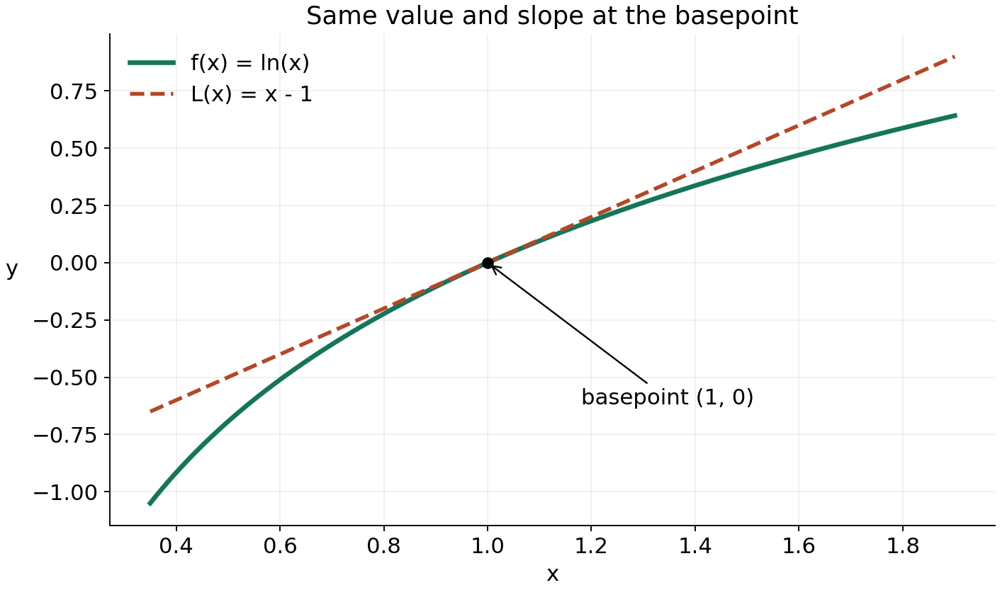
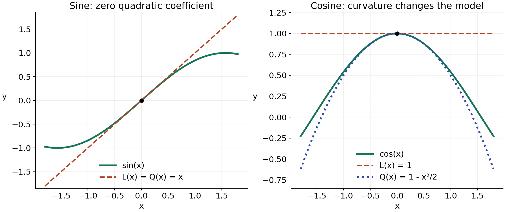
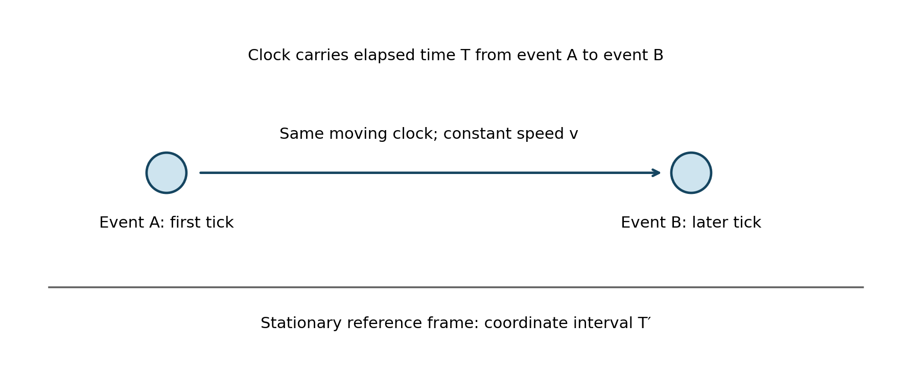

Linear and quadratic approximations

MIT 18.01, Fall 2006, Lecture 9 — a standalone study route

A derivative tells you how a function changes near one known input. This lesson turns that information into a simpler function you can evaluate, combine with other approximations, or use to interpret a limit. A second derivative supplies the next correction. The objective is to choose and construct an appropriate local model and to explain what its accuracy does, and does not, mean.

Read sections A–F in order and pause at the exercises. The exercises are collected in [Practice](practice.md); the links below identify when each is ready. [Hints](hints.md) are grouped separately from [Solutions](solutions.md), so you can obtain help without immediately seeing a complete answer. Section G is a later return. The calculus rules used here are the ordinary derivative, tangent, product and chain rules; trigonometric inputs are in radians. No previous university lecture is required.

A. A tangent is a local model

Choose a basepoint $`x_0`$: a nearby input where the function and its derivative are easy to calculate. Let $`h=x-x_0`$ be the displacement from that point. The tangent line has the same height and slope as the function there:

```math
L(x)=f(x_0)+f'(x_0)(x-x_0),
\qquad f(x)\approx L(x)\quad\text{near }x_0.
```

Here $`f'(x_0)`$ is one fixed number, the derivative evaluated at the basepoint; it does not mean the whole varying function $`f'(x)`$. The first term is the starting height and the second is slope times horizontal displacement. Reading $`L(x_0+h)=f(x_0)+f'(x_0)h`$ makes this construction especially direct. At $`h=0`$ it returns the starting height. Differentiating $`L`$ gives the required constant slope. If the derivative is zero, this first-order model is a horizontal line.

The approximation sign does not assert equality of the curve and line away from their contact. The derivative definition gives a precise local justification. Define the remainder, or error left over, by $`R_1(h)=f(x_0+h)-f(x_0)-f'(x_0)h`$. If the derivative at $`x_0`$ exists, then

```math
\frac{R_1(h)}{h}
=\frac{f(x_0+h)-f(x_0)}{h}-f'(x_0)\longrightarrow0
\quad\text{as }h\to0,\quad h\ne0.
```

Thus the omitted error becomes small even compared with the displacement, as the displacement tends to zero. This is a statement about sufficiently nearby inputs. It neither gives a numerical error bound at an arbitrary input nor says error must increase monotonically as you move farther away. A line itself, for example, is represented exactly by its tangent everywhere.

Worked example: $`f(x)=\ln x`$ near $`x_0=1`$. The domain is $`x\gt 0`$, and $`f(1)=0`$, $`f'(x)=1/x`$, $`f'(1)=1`$. Therefore

```math
L(x)=0+1(x-1)=x-1,
\qquad \ln(1.02)\approx0.02.
```



Figure 1. The green curve and dashed line meet at $`(1,0)`$ with the same slope. Moving a short horizontal distance from that point gives almost the same vertical change in each. Their visible separation farther away shows why the basepoint matters.

To write the same approximation with basepoint zero, set $`u=x-1`$, so $`x=1+u`$. The input $`x=1`$ now corresponds to $`u=0`$, and the very same statement is

```math
\ln(1+u)\approx u\quad\text{for small }|u|,\qquad u\gt -1.
```

The new letter measures a displacement; changing it has not changed the logarithm rule. Choose a basepoint for convenience and proximity, rather than replacing every basepoint by zero without changing the input.

Try E1 in [Practice](practice.md#e1). It checks the construction at a nonzero basepoint before we combine approximations.

B. Five reusable first-order forms

For each form below the basepoint is zero and the variable $`u`$ is small in magnitude. The notation $`|u|\ll1`$ means “much smaller than one”; it is a scale instruction, not a specified accuracy guarantee. With fixed exponent $`r`$, use positive $`1+u`$ for a general real power. For the logarithm the same positivity is required. Sine and cosine require radians.

```math
\sin u\approx u,\qquad \cos u\approx1,\qquad e^u\approx1+u,
```

```math
\ln(1+u)\approx u,\qquad (1+u)^r\approx1+ru.
```

These all come from value plus slope times displacement. Sine has value zero and derivative $`\cos0=1`$ at zero. Cosine has value one and derivative $`-\sin0=0`$. Exponential has both value and derivative one. The logarithm was obtained above. Finally,

```math
f(u)=(1+u)^r,\qquad f(0)=1,\qquad f'(u)=r(1+u)^{r-1},\qquad f'(0)=r.
```

So its tangent polynomial is exactly $`1+ru`$; the original power is only approximately equal to that polynomial. Keeping $`r`$ fixed matters: a large coefficient can make even a numerically small displacement unsuitable for a requested tolerance.

Worked example: combine these forms for the source's function

```math
f(x)=\frac{e^{-2x}}{\sqrt{1+x}}=e^{-2x}(1+x)^{-1/2},\qquad x\gt -1.
```

The inner input of the exponential is $`u=-2x`$; the power uses $`u=x`$ and $`r=-1/2`$. Near zero both inputs are small, giving

```math
e^{-2x}\approx1-2x,\qquad (1+x)^{-1/2}\approx1-\frac{x}{2}.
```

Multiplying the two polynomials gives an exact algebraic identity:

```math
(1-2x)\left(1-\frac{x}{2}\right)=1-\frac52x+x^2.
```

For a linear approximation retain the constant and first-power terms, obtaining $`f(x)\approx1-5x/2`$. The $`x^2`$ product is not the complete quadratic contribution to $`f`$: each original factor also has its own second-order term, which we have not yet included. Dropping it is consistent accounting, not a claim that $`x^2=0`$.

Why is this accounting legitimate? The basic smooth functions here have the power expansions supplied by their derivatives (or by the familiar Maclaurin series). Omitted terms begin at second order or later; multiplying by factors with finite values near zero cannot produce a new constant or linear term. In a quotient, first check that the denominator stays away from zero locally. This is why rewriting the reciprocal as a power is useful here. One may instead approximate $`\sqrt{1+x}\approx1+x/2`$, then use $`(1+u)^{-1}\approx1-u`$ with $`u=x/2`$; the same linear polynomial results.

The coefficients identify $`f(0)=1`$ and $`f'(0)=-5/2`$. This inference uses an established local first-order expansion, including its negligible remainder relative to $`x`$, rather than any rough numerical fit. As an independent check, the product and chain rules give

```math
f'(0)=(-2)(1)+(1)\left(-\frac12\right)=-\frac52.
```

Try E2 in [Practice](practice.md#e2). The changed signs and inner inputs test how the construction works.

C. Turning local behaviour into an exact limit

The source example is

```math
\lim_{x\to0}\frac{(1+2x)^{10}-1}{x}.
```

Set $`f(x)=(1+2x)^{10}`$. Since $`f(0)=1`$, this quotient has exactly the derivative-definition form at zero. The chain rule gives $`f'(x)=20(1+2x)^9`$, so the limit is $`f'(0)=20`$.

The approximation route says the same thing with the error exposed. From the first-order result, write

```math
(1+2x)^{10}=1+20x+R_1(x),\qquad \frac{R_1(x)}{x}\to0.
```

For $`x\ne0`$, subtract one and divide by $`x`$:

```math
\frac{(1+2x)^{10}-1}{x}=20+\frac{R_1(x)}{x}\longrightarrow20.
```

A bare approximation sign without an error condition would not justify this exact conclusion: division by a small input can magnify an omitted error. Here the derivative definition supplies precisely the needed condition. Try E3 in [Practice](practice.md#e3).

D. Curvature supplies the quadratic correction

A tangent captures height and slope. To capture how the slope itself changes, also match the second derivative. Write a polynomial in the displacement $`h=x-x_0`$ as $`Q(x)=A+Bh+Ch^2`$, with constants $`A,B,C`$. Because $`dh/dx=1`$, its first derivative is $`B+2Ch`$ and its second derivative is $`2C`$. At the basepoint $`h=0`$, matching the value, first derivative and second derivative requires

```math
A=f(x_0),\qquad B=f'(x_0),\qquad 2C=f''(x_0).
```

Consequently,

```math
Q(x)=f(x_0)+f'(x_0)(x-x_0)+\frac{f''(x_0)}2(x-x_0)^2,
\qquad f(x)\approx Q(x)\quad\text{near }x_0.
```

The factor one-half compensates for the factor two from differentiating the square twice. For any quadratic function this construction reproduces it exactly. For other functions it is a local approximation. “Quadratic approximation” means keeping terms through degree two; a coefficient may be zero, so the result need not actually be a parabola. When it is a parabola, its local derivative matching is the meaning of “best fit” here; it is not a least-squares fit over an interval.

A sufficient regularity condition is that $`f''`$ exists and is continuous throughout an interval around $`x_0`$. Continuity here says nearby inputs give second-derivative values arbitrarily close to $`f''(x_0)`$. Under that condition a local calculus result is

```math
f(x_0+h)=Q(x_0+h)+R_2(h),\qquad \frac{R_2(h)}{h^2}\to0.
```

One justification uses the fundamental theorem of calculus twice: subtract $`Q`$ from $`f`$ to obtain a difference with zero value and slope at the basepoint. Its second derivative is $`f''(x_0+h)-f''(x_0)`$. If that difference has magnitude at most $`M`$ between zero and $`h`$, two integrations bound $`|R_2(h)|`$ by $`Mh^2/2`$. Continuity lets $`M`$ tend to zero as the interval shrinks, which yields the displayed limit. The elementary functions used below meet this condition in their stated domains. This result gives local error behaviour, not a numerical tolerance without further information about the function on the interval.

Worked example: $`f(x)=\cos x`$ at zero. Its derivatives are $`f'(x)=-\sin x`$ and $`f''(x)=-\cos x`$. Their values give

```math
Q(x)=1+0x-\frac{x^2}{2}=1-\frac{x^2}{2}.
```

The negative second derivative bends the graph downward, whereas the linear approximation $`L(x)=1`$ stays horizontal. At $`x=0.2`$, the linear and quadratic estimates are 1 and 0.98. The reference value $`\cos(0.2)\approx0.9800665778`$ gives absolute errors about 0.0199334 and 0.0000666 respectively. Here the extra term gives a substantial improvement.



Figure 2. On the left, sine and its line have the same value, slope and second derivative at zero: sine's quadratic coefficient is zero. On the right, the dotted cosine parabola also matches the second derivative; the dashed horizontal line only matches height and slope. Axes show actual function values, with trigonometric inputs in radians. The agreement is local, not global.

At zero the five quadratic forms are

```math
\sin u\approx u,\qquad \cos u\approx1-\frac{u^2}{2},\qquad
 e^u\approx1+u+\frac{u^2}{2},
```

```math
\ln(1+u)\approx u-\frac{u^2}{2},\qquad
(1+u)^r\approx1+ru+\frac{r(r-1)}2u^2.
```

They have the same small-input and domain restrictions as before. To construct them rather than memorise them, use second derivatives. For sine, $`-\sin0=0`$; for exponential, $`e^0=1`$. For the logarithm,

```math
f'(u)=\frac1{1+u},\qquad f''(u)=-\frac1{(1+u)^2},\qquad
f(0)=0,\quad f'(0)=1,\quad f''(0)=-1.
```

For the power, $`f''(u)=r(r-1)(1+u)^{r-2}`$, which gives $`f''(0)=r(r-1)`$. These substitutions produce each coefficient above. Try E4 in [Practice](practice.md#e4).

E. Combining all the second-order contributions

Return to $`f(x)=e^{-2x}(1+x)^{-1/2}`$. Substitute into the quadratic forms, keeping the square of the whole inner input:

```math
e^{-2x}\approx1-2x+\frac{(-2x)^2}{2}=1-2x+2x^2,
```

```math
(1+x)^{-1/2}\approx1-\frac{x}{2}
+\frac{(-1/2)(-3/2)}2x^2
=1-\frac{x}{2}+\frac38x^2.
```

When multiplying, a term's total degree is the sum of the powers selected from the two factors. Degree two can arise from constant times quadratic, quadratic times constant, or linear times linear. Thus its coefficient is

```math
1\left(\frac38\right)+2(1)+(-2)\left(-\frac12\right)
=\frac38+2+1=\frac{27}{8}.
```

The constant and linear terms remain 1 and $`-5x/2`$, so

```math
f(x)\approx1-\frac52x+\frac{27}{8}x^2.
```

Products of degrees one and two produce degree three; two and two produce degree four. Those are outside the chosen degree-two approximation, and omitted higher terms of the original factors also affect those degrees. Retaining isolated such products would not give a complete higher-order model. The coefficient of the square is $`f''(0)/2`$, so this result predicts $`f''(0)=27/4`$. Checking directly with the twice-applied product rule gives $`4+2(-2)(-1/2)+3/4=27/4`$.

Try E5 in [Practice](practice.md#e5). It reconnects the earlier first-order task with the complete second-order calculation.

F. Planet Quirk: choosing the small quantity

The source uses a moving satellite clock as an application. Use a simplified physical premise: gravity is neglected and the clock travels at constant velocity relative to an inertial frame, a reference system in which freely moving objects have constant velocities. Choose two events on that clock, such as its first and later ticks. Let $`T`$ be its own elapsed time, and $`T'`$ the elapsed coordinate time assigned to those same events by synchronized clocks at rest in the reference frame. Special relativity supplies

```math
T'=\frac{T}{\sqrt{1-v^2/c^2}},\qquad 0\le v\lt c,
```

where $`v`$ is speed and $`c`$ is light speed. The prime is part of the time's name, not differentiation. This is an introduced physical law; calculus will approximate it, not establish the law. It compares time coordinates, rather than the delay between receiving two light signals. See [OpenStax, Time Dilation](https://openstax.org/books/university-physics-volume-3/pages/5-3-time-dilation), equations 5.1–5.2 and the proper-time definition.



Figure 3. The same clock carries the interval $`T`$ from event A to B. The reference frame assigns interval $`T'`$ between the events at different positions. The diagram represents the constant-velocity idealisation; it is not an orbital trajectory or a radio-signal timing diagram.

Introduce the dimensionless small parameter $`\epsilon=v^2/c^2`$. The power formula uses $`u=-\epsilon`$ and $`r=-1/2`$, so

```math
\frac{T'}{T}=(1-\epsilon)^{-1/2}
\approx1+\frac{\epsilon}{2},
\qquad T'\approx T\left(1+\frac{\epsilon}{2}\right).
```

The two negative signs in $`ru`$ give a positive correction. A moving clock records less elapsed time than the reference coordinate interval: $`T'\gt T`$ for positive speed and positive $`T`$. The multiplier is dimensionless; multiplying it by $`T`$ is essential to obtain a time. At zero speed the exact and approximate expressions both give $`T'=T`$.

Using the source's illustrative $`v=4\ \mathrm{km/s}`$ and $`c=3\times10^5\ \mathrm{km/s}`$ gives

```math
\epsilon=\left(\frac4{3\times10^5}\right)^2
\approx1.7778\times10^{-10},\qquad
\frac{T'-T}{T}\approx\frac{\epsilon}{2}
\approx8.8889\times10^{-11}.
```

This is a fractional time difference, not a time in seconds. For a carried-clock interval $`T=86400\ \mathrm{s}`$, the first-order difference is about $`7.68\times10^{-6}\ \mathrm{s}`$, or 7.68 microseconds. A tiny fraction can matter when a timing system needs microsecond precision.

Through degree two in $`\epsilon`$, the next term is

```math
\frac{(-1/2)(-3/2)}2(-\epsilon)^2=\frac38\epsilon^2,
\qquad T'\approx T\left(1+\frac{\epsilon}{2}+\frac38\epsilon^2\right).
```

For these numbers it contributes about $`1.1852\times10^{-20}`$ to the ratio, or $`1.024\times10^{-15}\ \mathrm{s}`$ over the stated interval. The leading omitted binomial term is $`5\epsilon^3/16`$ in the ratio. These sizes show the hierarchy here. Choosing to neglect a term still depends on the required accuracy and the physical model; smallness alone is not an absolute claim about what any clock can measure.

“Linear” above means linear in $`\epsilon`$, so it is already quadratic in the speed ratio $`v/c`$. The next term is fourth degree in $`v/c`$. Always name the small variable when describing the order.

Real GPS also accounts for gravitational effects and other system effects. The motion-only formula does not predict its full clock correction. [NIST's explanation](https://www.nist.gov/atomic-clocks/a-powerful-tool-for-science/putting-einstein-test) describes both motion and gravitational contributions and the need to correct satellite timing. The 2006 lecture's comment about the precision of the best atomic clocks is historical context, not a universal mathematical restriction on using quadratic approximations.

For numerical work, identify the small input, choose a degree, retain all terms through that degree, and compare the error with the required tolerance using a bound or a sufficiently accurate reference value. Merely obtaining more digits in a polynomial evaluation does not establish more accuracy. Try E6 in [Practice](practice.md#e6).

G. A later return

After a break, use E7 in [Practice](practice.md#e7) to reconstruct the formulas before looking back, then use the changed basepoint and derivative data. A later day is one reasonable adjustable study interval. Reconstructing a familiar formula checks recall; applying it to the new stationary-point case checks a different use. Neither activity by itself establishes lasting mastery.

Source and notation notes

The route covers all seven PDF pages of [MIT 18.01, Fall 2006, Lecture 9: Linear and Quadratic Approximations](https://ocw.mit.edu/courses/18-01-single-variable-calculus-fall-2006/40cb41807e6d67373f3299ce87c4d9b3_lec9.pdf), including its four figures, five standard forms and five examples. PDF page 1 is the cover; printed lecture pages 1–6 are PDF pages 2–7. Figures here are newly drawn from the functions and the stated clock model. E1–E7 are newly constructed practice, not past exam questions. The displayed limit in section C is the lecture's example, which the source describes as an earlier exam calculation.

The source sometimes prints an equality where the statement concerns an approximation; here equality is reserved for exact relations. Its printed page 4 clock expansion also loses the factor $`T`$ on the approximate side and shows a power-template exponent 4 where the substitution needs $`r=-1/2`$. The ratio and dimensionally consistent time expression in section F make those corrections explicit. The local accuracy claims and the meaning of the quadratic fit are qualified in sections A and D.

[Practice](practice.md) · [Hints](hints.md) · [Solutions](solutions.md)
