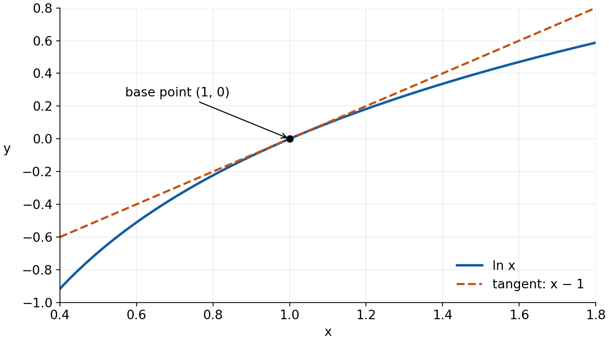
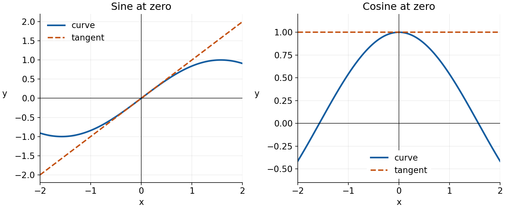
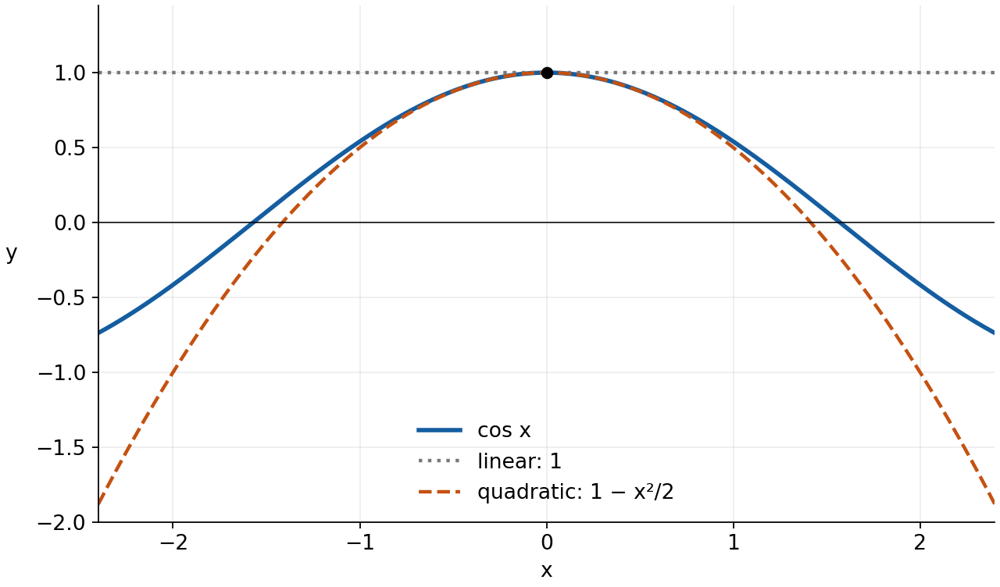
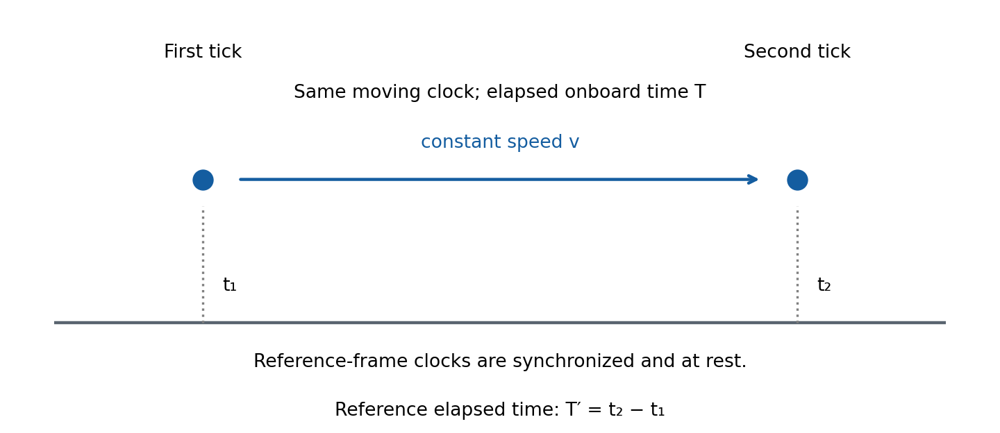

<a id="d008-r31-main-start"></a>

Linear and quadratic approximations

MIT 18.01, Lecture 9 — a standalone study route

A complicated function can be easy to estimate near a point where its value and derivatives are known. The aim here is to construct that estimate, combine estimates consistently, and decide what they do and do not establish. We will also connect the size of an omitted term to the quantity actually being estimated.

Read sections 1–7 in order. Try P1 and P2 where they occur, then P3–P5 after the relevant examples. P6 is a later return to the ideas: a break before it can make it useful retrieval practice, but choose the timing to suit your study. All six are newly written practice. The [hints](hints.md#d008-r31-hints-start) are grouped separately from the [complete solutions](solutions.md#d008-r31-solutions-start); each has a link back to its prompt. The figures are part of the explanation, with their relationships described beside them.

The route uses familiar algebra, differentiation, tangent equations and elementary integration. Existing small-angle and Maclaurin expansions will be connected to a general construction, rather than assumed to justify every use of the approximation sign. All trigonometric inputs below are in radians.

1. Use the tangent as a local model

Choose a base point $`a`$: a fixed input near the value you want. Write the actual input as $`x=a+h`$, so $`h=x-a`$ is its signed displacement from the base point. The function value there is $`f(a+h)`$. If the derivative at the base point exists, the tangent has height $`f(a)`$ and gradient $`f'(a)`$. Its value at the new input is

```math
L(a+h)=f(a)+f'(a)h,
\qquad L(x)=f(a)+f'(a)(x-a).
```

The first term is the known starting height. The second is tangent gradient times horizontal displacement: the predicted change in height. Constructing the formula means choosing the base point, evaluating its height and gradient, then multiplying that fixed gradient by the displacement. Reading the formula reverses those steps. The course uses $`x_0`$ for the base point; here $`a=x_0`$.

The equation defining $`L`$ is exact. The claim $`f(a+h)\approx L(a+h)`$ is an approximation. Its basis comes directly from the derivative definition. For nonzero $`h`$, define the error $`R_1(h)=f(a+h)-f(a)-f'(a)h`$. Then

```math
\frac{R_1(h)}{h}
=\frac{f(a+h)-f(a)}{h}-f'(a)
\longrightarrow 0 \quad\text{as }h\longrightarrow 0.
```

Thus the error becomes small compared with the input displacement, not merely small by itself. This statement concerns a limit; it does not say the error is zero at a nearby nonzero input. Nor does it supply a numerical error tolerance for a chosen input. How close is close enough depends on the function and the required accuracy. A distant input has no guarantee from this local construction, and errors need not grow monotonically with distance for every function.

For example, estimate a logarithm near 1. For $`f(x)=\ln x`$, defined for $`x\gt 0`$, the easy base point is $`a=1`$. Its value is zero and its derivative is $`f'(x)=1/x`$, so the slope at 1 is 1. Therefore

```math
L(x)=0+1(x-1)=x-1,
\qquad \ln(1.02)\approx 0.02.
```

The requested input 1.02 is displaced by 0.02; we have not substituted 1.02 for the displacement. The graph shows how the tangent and logarithm agree in height and slope at 1.



Figure 1. The solid curve is $`y=\ln x`$ and the dashed line is $`y=x-1`$. At the same horizontal coordinate, their vertical separation is the approximation error in magnitude. They meet at the marked base point. The dashed line lies above the curve here, consistent with the decreasing slope $`1/x`$. The graph is an illustration of this function, not an accuracy guarantee for every tangent approximation.

<a id="d008-r31-main-p1"></a>

P1. Approximate the positive square root of 4.08 using a tangent at the nearby base point 4. Write the input displacement, the tangent formula and the estimate. Explain why the resulting number is an approximation rather than an exact identity. A complete response connects the chosen base point and derivative to the estimate.

[Hint P1](hints.md#d008-r31-hint-p1) · [Solution P1](solutions.md#d008-r31-solution-p1)

2. A reusable list, with the small input identified

Replace $`x`$ in the logarithm example by $`1+u`$. The old base point 1 becomes the new base point $`u=0`$, and the displacement is exactly $`u`$. We obtain $`\ln(1+u)\approx u`$. This is a change of input variable, not a different logarithm law.

At base point zero, the tangent construction gives the following five approximations for $`u`$ near zero:

```math
\sin u\approx u,\qquad
\cos u\approx 1,\qquad
e^u\approx 1+u,
```

```math
\ln(1+u)\approx u,\qquad
(1+u)^r\approx 1+ru.
```

Here $`r`$ is a fixed real exponent. Use $`1+u\gt 0`$ for the logarithm and for a real power with arbitrary real exponent. This is satisfied in a sufficiently small interval around zero. For the trigonometric and exponential functions there is no real-domain restriction, but the approximations remain local. The notation $`|u|\ll 1`$ means much smaller than one; it is a scale description, not a universal numerical cutoff.

Each formula comes from a value and derivative at zero. Sine has value 0 and derivative cosine with value 1, so its tangent is $`0+1u`$. Cosine has value 1 and derivative negative sine with value 0, so its tangent is the horizontal line 1. The exponential and its derivative both have value 1. The logarithm has value 0 and derivative $`1/(1+u)`$, with value 1 at zero. Finally, the derivative of $`(1+u)^r`$ is $`r(1+u)^{r-1}`$, giving value 1 and slope $`r`$ at zero.

A “linear approximation” allows a polynomial of degree at most one: its slope can be zero. It does not assert that sine is equal to its tangent, or that every power function is exactly linear.



Figure 2. In the left panel the tangent to sine is $`y=x`$; in the right panel the tangent to cosine is $`y=1`$. Both match their curve at zero. Cosine's zero slope means that its linear model misses the first visible bending; a quadratic term will capture that later.

A substitution must preserve the small input. For $`e^{-2x}`$ it is $`u=-2x`$, so the linear approximation is $`1-2x`$. For $`(1+2x)^{10}`$ it is $`u=2x`$, with exponent 10, so the linear approximation is $`1+20x`$. The fixed coefficient matters for numerical accuracy: an input called “small” may cease to be small after multiplication by a very large constant.

3. Combine approximations without inventing coefficients

Consider the lecture's composite example, defined for $`x\gt -1`$:

```math
F(x)=\frac{e^{-2x}}{\sqrt{1+x}}
=e^{-2x}(1+x)^{-1/2}.
```

The reciprocal square root has become a power, making the basic list usable directly. Near zero its two factors have linear approximations

```math
e^{-2x}\approx 1-2x,
\qquad (1+x)^{-1/2}\approx 1-\frac{x}{2}.
```

Multiplying these polynomials gives

```math
(1-2x)\left(1-\frac{x}{2}\right)
=1-\frac{5}{2}x+x^2.
```

The first equality is exact polynomial algebra. But the original factors were approximated only through degree one. Their unrecorded quadratic contributions can change the product's quadratic coefficient. Keeping the displayed $`x^2`$ and calling it the original function's quadratic term would be unjustified. For the requested linear result, keep only constant and linear terms:

```math
F(x)\approx 1-\frac{5}{2}x.
```

Why does multiplying the approximations preserve those terms? Write the actual factors as $`1-2x+r(x)`$ and $`1-x/2+s(x)`$, where $`r(x)/x\to0`$ and $`s(x)/x\to0`$. After multiplication, each extra term divided by $`x`$ tends to zero: the factors multiplying either remainder stay bounded: their magnitudes remain below some fixed finite number near zero, because the factors approach 1. Meanwhile, the displayed $`x^2/x=x`$ tends to zero. Thus the product really has an error small compared with $`x`$. This reasoning needs the stated remainder behavior; an unexplained approximation sign alone would not license it.

We can now read exact information from a justified local linear model: $`F(0)=1`$ and $`F'(0)=-5/2`$. The exact derivative check, using the product and chain rules, is

```math
F'(0)=(-2)(1)+(1)\left(-\frac12\right)=-\frac52.
```

One alternative is to approximate the square root by $`1+x/2`$, then use the reciprocal approximation on that result. The power form above reaches the same first-order result with fewer intermediate steps. In either route the denominator stays nonzero in a small interval around zero; dividing by a factor that approaches zero needs separate error analysis.

<a id="d008-r31-main-p2"></a>

P2. For $`g(x)=e^{3x}/(1-2x)`$, find its linear approximation about $`x=0`$ by combining basic approximations. State a neighborhood in which the original expression is defined. Identify the small inputs used in the exponential and reciprocal expansions. A proposed calculation multiplies the two linear factors and reports its $`x^2`$ term as $`g`$'s quadratic coefficient. Explain why that coefficient is not established by this calculation. A complete response supplies the linear polynomial and the reason the extra coefficient is unreliable.

[Hint P2](hints.md#d008-r31-hint-p2) · [Solution P2](solutions.md#d008-r31-solution-p2)

4. Use an approximation in a limit only with its error

The lecture asks for

```math
\lim_{x\to0}\frac{(1+2x)^{10}-1}{x}.
```

Let $`f(x)=(1+2x)^{10}`$. Since $`f(0)=1`$, the quotient is the derivative quotient at zero. Differentiation gives $`f'(x)=20(1+2x)^9`$, so the limit is 20.

The approximation route says the same thing more compactly, provided we preserve its warrant. Write

```math
(1+2x)^{10}=1+20x+R_1(x),
\qquad \frac{R_1(x)}{x}\longrightarrow0.
```

Subtract 1 and divide by nonzero $`x`$:

```math
\frac{(1+2x)^{10}-1}{x}
=20+\frac{R_1(x)}{x}\longrightarrow20.
```

The discarded contribution tends to zero in this quotient; it is not zero for each finite input. If we also subtracted the linear term and divided by $`x^2`$, the condition above would not suffice. A function can have an error small compared with $`x`$ that is not small compared with $`x^2`$. For example, $`x^2/x\to0`$ but $`x^2/x^2=1`$. The denominator tells us what error control the limit needs.

5. Match bending as well as height and slope

To capture more local behavior, construct a polynomial of degree at most two in the displacement:

```math
Q(x)=A+B(x-a)+C(x-a)^2.
```

Here $`A,B,C`$ are fixed coefficients to choose. At the base point, the polynomial's value, first derivative and second derivative are respectively $`A`$, $`B`$ and $`2C`$. Matching these to the corresponding quantities for $`f`$ forces

```math
A=f(a),\qquad B=f'(a),\qquad C=\frac{f''(a)}{2}.
```

Thus the quadratic approximation is

```math
Q(x)=f(a)+f'(a)(x-a)+\frac{f''(a)}{2}(x-a)^2.
```

The factor one-half compensates for differentiating a square twice. In particular, if the original function is a quadratic polynomial, this construction reproduces it exactly. For a general function it matches local derivatives, not a least-squares fit over an interval. If the second derivative vanishes at the base point, the quadratic coefficient vanishes too.

A useful sufficient condition for this approximation is that $`f`$ has a continuous second derivative on an open interval containing the base point. This constrains the derivative function $`f''`$: it must be defined throughout the interval and its nearby values must approach its value at every point there. There are no jumps or singularities of that derivative in the interval. Familiar continuous elementary expressions can be checked using their domains: for $`f(x)=\ln x`$, the second derivative $`-1/x^2`$ is continuous on an interval of positive inputs around 1 or 2, because its denominator never vanishes there. Having a function value at the base point alone is insufficient.

Under that condition, the quadratic error $`R_2(h)=f(a+h)-Q(a+h)`$ satisfies

```math
\frac{R_2(h)}{h^2}\longrightarrow0
\quad\text{as }h\longrightarrow0.
```

Here is why the condition licenses this conclusion. Subtract the polynomial from the function and call the difference $`E(x)=f(x)-Q(x)`$. By construction $`E(a)=E'(a)=E''(a)=0`$. Continuity makes $`|E''|`$ smaller than any chosen positive number $`\varepsilon`$ throughout a sufficiently short interval about $`a`$. Integrating that bound from the base point once bounds the change of slope: the area under a function of magnitude at most the bound cannot exceed that bound times the interval length in magnitude. Integrating the resulting triangular bound on the slope then bounds the change of height. With $`t`$ denoting an intermediate signed displacement, this gives

```math
|E'(a+t)|\le\varepsilon|t|,
\qquad |E(a+h)|\le\frac{\varepsilon h^2}{2}.
```

These bounds hold for positive or negative displacements within that interval; absolute values account for reversing integration direction. After division by $`h^2`$, the magnitude of the error ratio is at most $`\varepsilon/2`$. Since we can make that positive bound arbitrarily small by staying close enough to the base point, the ratio tends to zero. This is a local justification, not a claimed error tolerance at an arbitrary fixed input. The fundamental theorem of calculus connects each derivative to the integral of the next one in this argument.

For cosine at zero, the required values are

```math
f(0)=1,\qquad f'(0)=-\sin0=0,\qquad f''(0)=-\cos0=-1.
```

So $`\cos x\approx1-x^2/2`$. At $`x=0.1`$, the linear estimate is 1 and the quadratic estimate is 0.995. The added negative term captures the bending away from a horizontal tangent.



Figure 3. The solid cosine curve and dashed parabola share their height, slope and second derivative at zero. The dotted line is the linear approximation. The parabola follows the local bending, while neither polynomial reproduces cosine's global oscillation. The figure therefore supports a local comparison, not a promise of accuracy far from zero.

At zero the five basic quadratic approximations are

```math
\sin u\approx u,\qquad
\cos u\approx1-\frac{u^2}{2},\qquad
e^u\approx1+u+\frac{u^2}{2},
```

```math
\ln(1+u)\approx u-\frac{u^2}{2},
\qquad
(1+u)^r\approx1+ru+\frac{r(r-1)}{2}u^2.
```

The same real-domain and small-input conditions as before apply, with fixed $`r`$. Sine's second derivative at zero is zero, so its quadratic approximation still has no square term. Exponential's second derivative at zero is 1. For the logarithm, successive derivatives are $`1/(1+u)`$ and $`-1/(1+u)^2`$, giving second derivative −1 at zero. For the power, differentiating twice gives $`r(r-1)(1+u)^{r-2}`$, giving $`r(r-1)`$ at zero. These values supply each coefficient; they also agree with the first terms of the familiar Maclaurin expansions.

For a quick worked numerical comparison, the logarithm example now gives

```math
\ln(1.02)\approx0.02-\frac{(0.02)^2}{2}=0.0198.
```

The numerical value is approximately 0.0198026273. At this input the linear estimate errs by about 0.000197373, while the quadratic estimate errs by about 0.0000026273. This measured comparison shows improvement here; the polynomial's degree alone is not a certificate of any specified numerical accuracy elsewhere.

<a id="d008-r31-main-p3"></a>

P3. For $`f(x)=\ln x`$, construct its linear and quadratic approximations about $`a=2`$ and use both to estimate $`\ln(2.04)`$. For the numerical evaluation, use $`\ln2\approx0.69314718`$. The comparison value $`\ln(2.04)\approx0.71294981`$ is supplied only for checking the estimates. Compare their absolute errors at the shown precision and explain the role of $`(x-2)^2`$ in the quadratic formula. A complete response derives the coefficients from $`f(2)`$, $`f'(2)`$, $`f''(2)`$ and interprets the comparison.

[Hint P3](hints.md#d008-r31-hint-p3) · [Solution P3](solutions.md#d008-r31-solution-p3)

<a id="d008-r31-main-p4"></a>

P4. Determine the limit as $`x`$ tends to 0 of $`(e^x-1-x)/x^2`$. Explain why the linear approximation alone does not determine this limit, and state an error condition that makes the quadratic approximation sufficient. A complete response identifies the surviving coefficient and justifies what happens to the omitted term after division by $`x^2`$.

[Hint P4](hints.md#d008-r31-hint-p4) · [Solution P4](solutions.md#d008-r31-solution-p4)

6. Choose the expansion variable: the clock example

The lecture's Planet Quirk example supplies a law from special relativity. We use it as a stated physical model, not as something derived from the calculus. Imagine a clock moving at constant speed $`v`$ relative to an inertial reference frame, meaning a non-accelerating frame in this gravity-free model. Two ticks occur on that same moving clock. Let $`T`$ be the time between its ticks as measured onboard. Let $`T'`$ be the time between those same two events in the reference frame, measured with clocks at rest and synchronized in that frame. Because the events occur at different reference-frame positions, this is a reference-frame elapsed time, not merely the delay between seeing two light flashes arrive at one wristwatch.

The model is

```math
T'=\frac{T}{\sqrt{1-v^2/c^2}},
\qquad 0\le v\lt c,
```

where $`c`$ is the speed of light and $`v`$ is a speed magnitude. Speeds must use the same units. Gravity, changing speed and signal-travel corrections are outside this particular model.



Figure 4. The blue dots represent the same moving clock at its first and second tick. Its own elapsed time is $`T`$. The reference clocks beneath the two positions assign times $`t_1`$ and $`t_2`$, so $`T'=t_2-t_1`$. The arrow depicts motion; it is not a light-signal path. The drawing replaces the lecture's passing-satellite sketch with the event and clock meanings needed for the formula.

The natural small parameter is the dimensionless ratio $`q=(v/c)^2`$. Dividing both sides by the positive elapsed time $`T`$ gives

```math
\frac{T'}{T}=(1-q)^{-1/2}
\approx1+\frac q2+\frac{3q^2}{8}.
```

This follows from the power formula with input $`u=-q`$ and exponent $`r=-1/2`$. The linear term is $`(-1/2)(-q)=q/2`$; the quadratic coefficient is $`(-1/2)(-3/2)/2=3/8`$. Keeping just the first correction yields

```math
\frac{T'-T}{T}\approx\frac q2,
\qquad T'-T\approx T\frac q2.
```

The first result is a fractional correction, with no units. The second is a time difference, in the same units as $`T`$. Restoring that factor of $`T`$ is essential. A positive correction means that the reference-frame interval is longer; the moving clock accumulates less elapsed time over the same events.

For the lecture's values $`v=4\ \mathrm{km/s}`$ and $`c=3\times10^5\ \mathrm{km/s}`$,

```math
q=\left(\frac{4}{3\times10^5}\right)^2
\approx1.78\times10^{-10},
\qquad \frac q2\approx8.89\times10^{-11}.
```

The next contribution is

```math
\frac{3q^2}{8}\approx1.19\times10^{-20}.
```

These numbers compare two successive fractional corrections. For an onboard interval of 86400 seconds, the first gives a difference of about 7.68 microseconds, while the second contributes about $`1.02\times10^{-15}\ \mathrm{s}`$. Whether a term matters depends on the tolerance and the interval being compared. A claim about the best possible clock measurement needs an actual experimental specification; the tiny number alone does not settle that claim. Comparing successive terms is useful, but without additional bounds it is not a proof of a bound on the entire omitted remainder.

“Linear” here means linear in $`q`$. Because $`q=(v/c)^2`$, its first correction is quadratic in $`v/c`$, and the next is quartic in $`v/c`$. Always name the variable in which you are counting powers.

GPS provides a real reason to care about small clock corrections. It accounts for both motion and gravity, and satellite oscillator frequencies are adjusted as part of that system. Our simplified constant-speed, gravity-free expression supplies only a motional comparison. The distinction is supported by [NIST's explanation](https://www.nist.gov/atomic-clocks/a-powerful-tool-for-science/putting-einstein-test) and [Neil Ashby's account of GPS relativity](https://pmc.ncbi.nlm.nih.gov/articles/PMC5253894/); no GPS engineering details are needed to use the approximation above.

<a id="d008-r31-main-p5"></a>

P5. In the stated constant-speed, gravity-free clock model, the elapsed reference-frame time $`T'`$ and the elapsed moving-clock time $`T`$ obey $`T'/T=(1-q)^{-1/2}`$, $`q=(v/c)^2`$. Take $`v=6\ \mathrm{km/s}`$, $`c=3\times10^5\ \mathrm{km/s}`$, and $`T=86400\ \mathrm{s}`$. Estimate $`(T'-T)/T`$ and $`T'-T`$ using the term linear in $`q`$. Compute the next, quadratic-in-$`q`$ contribution to the fractional correction. Does adding that contribution change the estimate at a fractional scale of $`10^{-12}`$? State which powers of $`v/c`$ these two contributions have, and distinguish the comparison of these two terms from a bound on every omitted term. A complete response keeps the fractional ratio separate from the time interval and retains consistent units.

[Hint P5](hints.md#d008-r31-hint-p5) · [Solution P5](solutions.md#d008-r31-solution-p5)

7. Keep every contribution at the requested order

Return to $`F(x)=e^{-2x}(1+x)^{-1/2}`$. This time we need its quadratic approximation. Expand both factors through degree two:

```math
e^{-2x}\approx1-2x+\frac{(-2x)^2}{2}=1-2x+2x^2,
```

```math
(1+x)^{-1/2}\approx1-\frac{x}{2}+\frac{3x^2}{8}.
```

To collect a square term in the product, there are three possibilities: a square term from the first factor times the constant from the second; a linear term from each; or the constant from the first times a square term from the second. Therefore

```math
F(x)\approx1+\left(-2-\frac12\right)x
+\left(2+(-2)\left(-\frac12\right)+\frac38\right)x^2
=1-\frac52x+\frac{27}{8}x^2.
```

Products of total degree three or higher are discarded for this quadratic model. For example, a linear term times a square term has degree three. The coefficient $`27/8`$ includes contributions that were unavailable when we multiplied only the linear factors. This explains exactly why that earlier product's coefficient 1 could not be trusted as a quadratic coefficient for $`F`$.

The error justification parallels the linear case. Each actual factor is its displayed quadratic polynomial plus a remainder whose quotient by $`x^2`$ tends to zero. Multiplying by the other bounded factor preserves that behavior. The discarded polynomial terms also vanish after division by $`x^2`$, since their remaining powers contain at least one $`x`$. Thus the product has the needed quadratic error condition. The functions and their derivatives are continuous near zero, and the denominator remains nonzero there.

As an independent coefficient check, write the factors as $`A(x)=e^{-2x}`$ and $`B(x)=(1+x)^{-1/2}`$. The second derivative product rule, obtained by differentiating $`A'B+AB'`$, gives

```math
F''(0)=A''(0)B(0)+2A'(0)B'(0)+A(0)B''(0)
=4+2(-2)\left(-\frac12\right)+\frac34
=\frac{27}{4}.
```

The quadratic coefficient is half this value, confirming $`27/8`$. Either direct differentiation or expansion is legitimate; the expansion makes the contributions easier to organize here.

When choosing a method, first identify the quantity wanted: a function value, a change, a derivative or a limit after cancellation. Choose a nearby base point with accessible data. Identify the actual small input, respect the real domain, and retain every contribution through the needed degree. For limits, check the remainder after the indicated division. For a numerical estimate, a requested tolerance needs a numerical comparison or an appropriate error bound; locality alone does not specify it.

<a id="d008-r31-main-p6"></a>

P6. Return later, after a break if useful, and choose how many terms you need rather than starting from a method label. Let $`H(x)=\ln(1+2x)e^{-x}`$, defined near $`x=0`$. Find its approximation through degree two, then determine the limit as $`x`$ tends to 0 of $`[H(x)-2x]/x^2`$. Identify which products contribute to the coefficient of $`x^2`$ and why discarded terms do not affect the limit. A complete response connects the chosen expansion order to the cancellation in the numerator and the divisor $`x^2`$.

[Hint P6](hints.md#d008-r31-hint-p6) · [Solution P6](solutions.md#d008-r31-solution-p6)

Source note

This route covers MIT OpenCourseWare, 18.01 Single Variable Calculus, Fall 2006, [Lecture 9: Linear and Quadratic Approximations](https://ocw.mit.edu/courses/18-01-single-variable-calculus-fall-2006/40cb41807e6d67373f3299ce87c4d9b3_lec9.pdf), all six printed lecture pages plus the cover. Its tangent, five basic approximations, logarithm, composite exponential, derivative limit and Planet Quirk examples are developed here. The figures are newly drawn. Approximation signs, the clock's time factor and the local meaning of the quadratic construction are written explicitly to avoid misleading source shorthand. The error explanations and six practice tasks extend the lecture's route; the source is not needed as an additional prerequisite.

[Hints](hints.md#d008-r31-hints-start) · [Complete solutions](solutions.md#d008-r31-solutions-start) · [Return to the reading route](#d008-r31-main-start)
