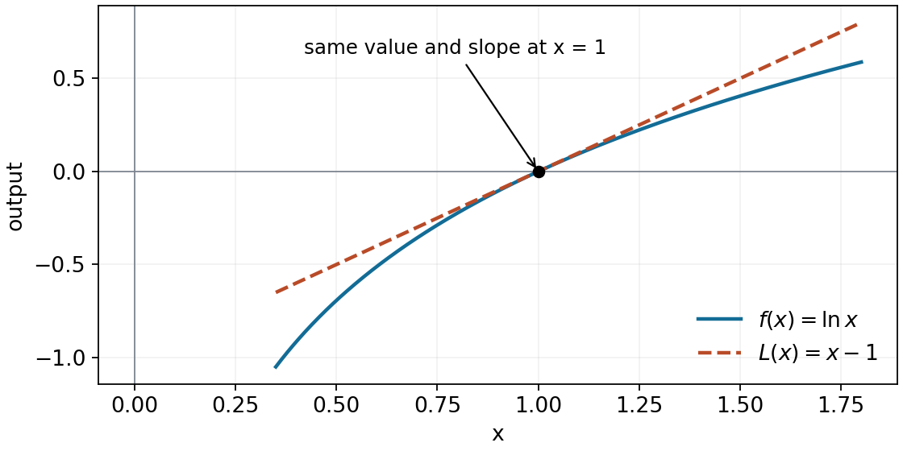
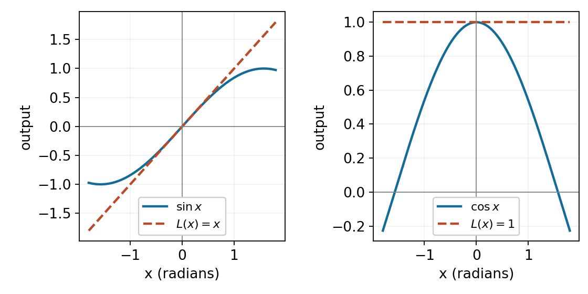
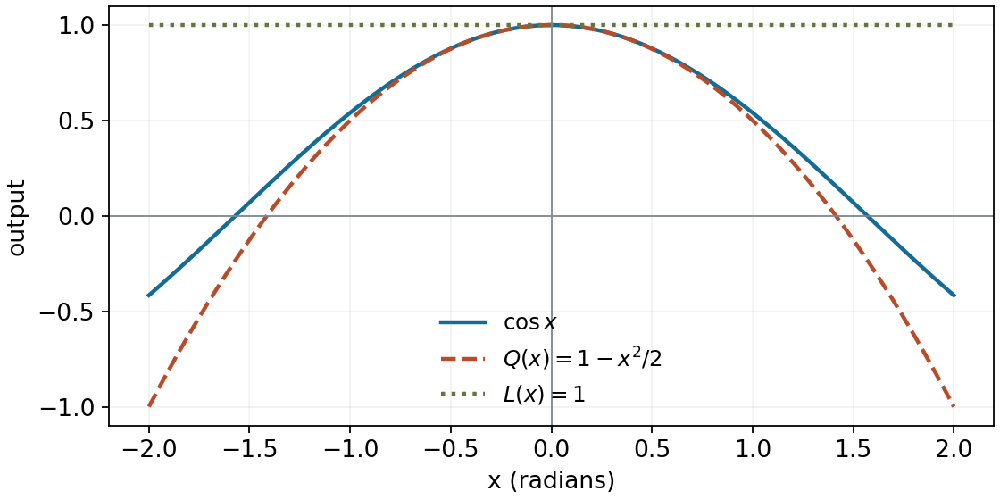
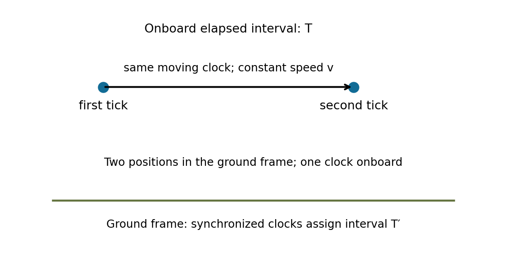

Linear and quadratic approximations

MIT 18.01, Fall 2006, Lecture 9 — a standalone study route

Read this file in order. Try each labelled exercise when you reach it; [hints](hints.md) and [complete solutions](solutions.md) are grouped separately. The final exercise offers a later return to the ideas. The original lecture's examples and figures are developed here using algebra, derivatives, tangent equations and the familiar Maclaurin expansions. All trigonometric inputs below are in radians.

1. Replace a curve locally by its tangent

Suppose an exact function is awkward to evaluate near an input where its value and derivative are easy. Choose that convenient input as the base point, written $`x_0`$. Let $`h=x-x_0`$ be the displacement from it. The derivative $`f'(x_0)`$ is the tangent's slope, so the line through $`(x_0,f(x_0))`$ is

```math
L(x)=f(x_0)+f'(x_0)(x-x_0),\qquad
L(x_0+h)=f(x_0)+f'(x_0)h.
```

These are two descriptions of the same line: put $`x=x_0+h`$ in the first to obtain the second. Reading the formula gives “starting output plus slope times input change.” Constructing it requires choosing a base point, evaluating the function and its derivative there, then supplying the displacement. Once chosen, $`x_0`$, $`f(x_0)`$ and $`f'(x_0)`$ are fixed; $`x`$ varies. The exact equality defines $`L`$. Using $`f(x)\approx L(x)`$ is the approximation.

This is called linear approximation even when the line has an intercept or zero slope. The polynomial has degree at most one in the displacement. The method requires a finite derivative at the base point. We use base points with a small surrounding interval inside the function's domain unless a one-sided situation is explicitly specified.

Why does the tangent give a local approximation? The derivative definition supplies the precise connection. For nonzero $`h`$, define the discrepancy in the secant slope by

```math
\varepsilon(h)=\frac{f(x_0+h)-f(x_0)}{h}-f'(x_0).
```

Rearranging gives the exact relation

```math
f(x_0+h)=f(x_0)+f'(x_0)h+h\varepsilon(h),
\qquad \varepsilon(h)\to0\quad\text{as }h\to0.
```

Thus the tangent error divided by $`h`$ tends to zero. The error is small compared with the size of the displacement sufficiently near the base point. This statement does not provide a numerical error bound at a particular input; that requires additional information. Nor does it say the error must increase monotonically as you move away. It establishes local agreement, not global accuracy.

For the lecture's first example, take $`f(x)=\ln x`$ and $`x_0=1`$. The domain is $`x\gt 0`$, $`f(1)=0`$, and $`f'(x)=1/x`$ gives $`f'(1)=1`$. Hence

```math
L(x)=0+1(x-1)=x-1,
\qquad \ln x\approx x-1\quad\text{near }x=1.
```

The plot shows the curve and its tangent sharing the point and slope at $`x=1`$. A vertical separation is an output error; a horizontal separation from 1 is the input displacement. The visible separation farther away explains why a tangent should be used locally.



We can rewrite this same approximation around a zero displacement. Set $`u=x-1`$, so $`x=1+u`$. When $`x=1`$, $`u=0`$; when $`x`$ is near 1, $`u`$ is near zero. Substitution gives $`\ln(1+u)\approx u`$. This changes the input coordinate, not the physical point on the graph. For example, $`\ln(1.03)\approx0.03`$ uses $`u=0.03`$, not $`u=1.03`$.

<a id="d008-main-e1"></a>

Exercise D008-E1. An early approximation

Estimate $`\sqrt{4.08}`$ using a tangent approximation to $`f(x)=\sqrt{x}`$ at $`x_0=4`$. State the increment, construct the tangent formula, and explain why this is an estimate rather than an identity. Your response should show how the base point and derivative enter, not only a decimal.

[Hint for E1](hints.md#d008-hint-e1) · [Solution for E1](solutions.md#d008-solution-e1)

2. A small set of reusable linear approximations

At base point zero the line becomes $`L(x)=f(0)+f'(0)x`$. Evaluate those two pieces for each familiar function:

- For $`f(x)=\sin x`$, $`f(0)=0`$ and $`f'(0)=\cos0=1`$, giving $`\sin x\approx x`$.
- For $`f(x)=\cos x`$, $`f(0)=1`$ and $`f'(0)=-\sin0=0`$, giving $`\cos x\approx1`$.
- For $`f(x)=e^x`$, the value and derivative at zero are both 1, giving $`e^x\approx1+x`$.
- For $`f(x)=\ln(1+x)`$, the value is 0 and the derivative $`1/(1+x)`$ is 1 at zero, giving $`\ln(1+x)\approx x`$.
- For $`f(x)=(1+x)^r`$ with fixed real $`r`$, the value is 1 and the derivative $`r(1+x)^{r-1}`$ is $`r`$ at zero, giving $`(1+x)^r\approx1+rx`$. Work with $`1+x\gt 0`$ to cover arbitrary real powers without additional domain cases.

All five are local statements as $`x\to0`$. The logarithm also requires $`1+x\gt 0`$. In applications the input to a basic formula may be a substituted quantity. For $`e^{-2x}`$, that input is $`-2x`$; for $`(1+2x)^{10}`$, it is $`2x`$. Check the size of that whole quantity. For a fixed but large exponent or scaling constant, an apparently small number may still be too large for the required accuracy.

The sine tangent rises through the origin; the cosine tangent is horizontal through height 1. Both are linear approximations in the “degree at most one” sense. Cosine's zero slope means its first-order model predicts no change, not that cosine is a constant function.



3. Combine approximations without mixing orders

Consider the lecture's recurring example

```math
f(x)=\frac{e^{-2x}}{\sqrt{1+x}}=e^{-2x}(1+x)^{-1/2},\qquad x\gt -1.
```

The rewritten product exposes two basic forms. Near zero,

```math
e^{-2x}\approx1-2x,\qquad
(1+x)^{-1/2}\approx1-\frac{x}{2}.
```

Multiplying these two linear polynomials exactly gives

```math
(1-2x)\left(1-\frac{x}{2}\right)
=1-\frac52x+x^2.
```

For the linear approximation, keep the constant and first-degree terms:

```math
f(x)\approx1-\frac52x.
```

Why discard the displayed $`x^2`$ term? Each factor was itself truncated. Its omitted quadratic contribution would also affect the product's quadratic coefficient. Keeping only the cross-product would mix one available contribution with other discarded contributions of the same degree. It would not establish a correct quadratic approximation. For the smooth functions here, their familiar power expansions also show that omitted terms start at degree two; multiplying a bounded factor by those terms cannot change the constant or first-degree coefficient. More generally, the derivative remainder from section 1 supports the same first-order conclusion for differentiable factors.

The lecture takes a longer, valid route: approximate $`\sqrt{1+x}\approx1+x/2`$, then use $`(1+u)^{-1}\approx1-u`$ at $`u=x/2`$ to approximate the reciprocal. Writing the reciprocal as the power $`(1+x)^{-1/2}`$ reaches the same result directly. The denominator is nonzero near zero, which makes the reciprocal operation legitimate.

A tangent polynomial also reveals the exact value and derivative it was constructed to match: here $`f(0)=1`$ and $`f'(0)=-5/2`$. This conclusion comes from the justified first-order construction, not from an arbitrary numerical fit. As an independent check, the product and chain rules give

```math
f'(0)=(-2)(1)+(1)\left(-\frac12\right)=-\frac52.
```

4. Connect a local approximation to a limit

For $`p(x)=(1+2x)^{10}`$, the basic power formula gives $`p(x)\approx1+20x`$ near zero. The lecture uses this to anticipate

```math
\lim_{x\to0}\frac{(1+2x)^{10}-1}{x}=20.
```

A bare approximation sign does not prove that limit: dividing an uncontrolled error by a small number can magnify it. Here we have the needed control. The chain rule gives $`p'(x)=20(1+2x)^9`$, so $`p(0)=1`$ and $`p'(0)=20`$. Consequently the expression is exactly the derivative difference quotient at zero. Alternatively, section 1 gives $`p(x)=1+20x+x\varepsilon(x)`$ with $`\varepsilon(x)\to0`$. For nonzero $`x`$, the quotient equals $`20+\varepsilon(x)`$, which tends to 20. The discarded error survives the division in a form whose limit is known.

<a id="d008-main-e2"></a>

Exercise D008-E2. A limit from local change

For $`g(x)=e^{3x}(1-2x)`$, construct its linear approximation at zero by combining basic approximations. Then determine

```math
\lim_{x\to0}\frac{e^{3x}(1-2x)-1}{x}.
```

Explain what licenses the limit: use the derivative definition with an independently computed derivative, or explicitly show that the omitted error divided by $`x`$ tends to zero. An approximate equality by itself is not a proof of a limit.

[Hint for E2](hints.md#d008-hint-e2) · [Solution for E2](solutions.md#d008-solution-e2)

5. Match the next derivative to obtain a quadratic

When a tangent misses useful curvature, add a squared-displacement term. We seek a polynomial of degree at most two, written

```math
Q(x)=A+B(x-x_0)+C(x-x_0)^2.
```

Choose its coefficients to share the function's value, first derivative and second derivative at the base point. Differentiating with respect to $`x`$ gives $`Q'(x)=B+2C(x-x_0)`$ and $`Q''(x)=2C`$. Therefore matching at $`x_0`$ requires $`A=f(x_0)`$, $`B=f'(x_0)`$ and $`2C=f''(x_0)`$. This constructs

```math
Q(x)=f(x_0)+f'(x_0)(x-x_0)
+\frac{f''(x_0)}{2}(x-x_0)^2.
```

The factor one-half compensates for the factor 2 produced by differentiating a square twice. The three matching conditions uniquely determine this polynomial. “Best-fit parabola” in this local sense means derivative matching at one point; no least-squares fit over a finite interval is being asserted. If the second derivative vanishes at the base point, the polynomial can reduce to a line or constant.

For functions whose second derivative exists and is continuous on an interval around the base point, $`f(x_0+h)-Q(x_0+h)`$ divided by $`h^2`$ tends to zero as $`h\to0`$. Continuous here means the second derivative's values approach $`f''(x_0)`$ as their inputs approach $`x_0`$, with no jump there. The elementary functions used here satisfy this condition inside their stated domains. One way to see the result is to integrate the change in derivative twice: the constant part $`f''(x_0)`$ contributes $`f''(x_0)h^2/2`$, while the difference $`f''(x_0+t)-f''(x_0)`$ becomes arbitrarily small near zero and leaves a remainder small compared with $`h^2`$. The condition concerns a function near the base point; matching three numbers alone is not an accuracy guarantee far away.

For an exact quadratic $`f(x)=a+bx+cx^2`$, the derivatives at zero are $`a`$, $`b`$ and $`2c`$. The construction returns exactly $`a+bx+cx^2`$, with no approximation error. The same derivative-matching construction is exact for a quadratic about any base point, since shifting the variable leaves a polynomial of degree at most two.

For cosine, $`f(0)=1`$, $`f'(0)=0`$ and $`f''(0)=-1`$, so

```math
\cos x\approx1-\frac{x^2}{2}.
```

The line matches value and slope but stays at height 1. The parabola also matches the second derivative and therefore follows the initial downward bending. In the plot it is the dashed curve; its agreement is local. At $`x=0.2`$, the line predicts 1 while the quadratic predicts 0.98. The supplied cosine series shows the next term is $`x^4/24`$, about $`0.0000667`$ here: the quadratic captures the leading change that the line omits.



At zero the five useful quadratic approximations are

```math
\begin{aligned}
\sin x&\approx x,\\
\cos x&\approx1-\frac{x^2}{2},\\
e^x&\approx1+x+\frac{x^2}{2},\\
\ln(1+x)&\approx x-\frac{x^2}{2},\\
(1+x)^r&\approx1+rx+\frac{r(r-1)}{2}x^2.
\end{aligned}
```

The domains and small-input conditions are the same as for the corresponding linear formulas. For sine the second derivative is $`-\sin x`$, which is zero at zero, so its quadratic polynomial is still $`x`$. Its first nonzero correction is the cubic $`-x^3/6`$ from the familiar sine expansion. Exponential's second derivative at zero is 1. The power's second derivative is $`r(r-1)(1+x)^{r-2}`$, giving the displayed coefficient. For the logarithm, compute explicitly

```math
f(x)=\ln(1+x),\quad f'(x)=\frac1{1+x},\quad
f''(x)=-\frac1{(1+x)^2};\qquad
f(0)=0,\ f'(0)=1,\ f''(0)=-1.
```

Substitution into the matching formula gives $`x-x^2/2`$. These are finite approximations; writing one down does not assert equality to an infinite series outside that series' valid interval.

<a id="d008-main-e3"></a>

Exercise D008-E3. Move the base point

Construct the quadratic approximation to $`f(x)=\ln x`$ at $`x_0=2`$ and use it to estimate $`\ln(2.1)-\ln2`$. Keep the displacement from the base point explicit and show why the coefficient of its square is half the second derivative. No numerical value of $`\ln2`$ is needed.

[Hint for E3](hints.md#d008-hint-e3) · [Solution for E3](solutions.md#d008-solution-e3)

6. Revisit the product through degree two

Now both factors in the lecture's $`e^{-2x}/\sqrt{1+x}`$ example must be retained through degree two:

```math
e^{-2x}\approx1-2x+\frac{(-2x)^2}{2}=1-2x+2x^2,
```

```math
(1+x)^{-1/2}\approx1-\frac{x}{2}
+\frac{(-1/2)(-3/2)}{2}x^2
=1-\frac{x}{2}+\frac38x^2.
```

To construct a coefficient, collect every pair of factor terms whose degrees add to that degree. The constant is $`1\cdot1`$. The coefficient of $`x`$ is $`-2-1/2=-5/2`$. The coefficient of $`x^2`$ has three contributions: $`2`$ from the first factor times the second's constant, $`(-2)(-1/2)=1`$ from the two linear terms, and $`3/8`$ from the first's constant times the second's quadratic term. Hence

```math
\frac{e^{-2x}}{\sqrt{1+x}}
\approx1-\frac52x+\left(2+1+\frac38\right)x^2
=1-\frac52x+\frac{27}{8}x^2.
```

Products of the retained terms also generate cubic and quartic terms, but those are outside the requested degree and omit contributions from higher terms in the original factors. Do not interpret them as verified coefficients of the function. Here an independent product-rule check gives

```math
f''(0)=4+2(-2)\left(-\frac12\right)+\frac34
=\frac{27}{4},
```

so half this derivative is indeed $`27/8`$. At $`x=0.02`$, the two approximations are 0.95 and 0.95135. Their difference is the included quadratic correction, not by itself the exact remaining error.

<a id="d008-main-e4"></a>

Exercise D008-E4. When the first change cancels

Find the linear and quadratic approximations at zero of $`H(x)=e^x/\sqrt{1+2x}`$, for $`x`$ near zero with $`1+2x\gt 0`$. Show all contributions through degree two. Explain what the linear approximation misses and what the quadratic approximation predicts about the leading change on the two sides of zero. Distinguish a local prediction from an identity for all allowed inputs.

[Hint for E4](hints.md#d008-hint-e4) · [Solution for E4](solutions.md#d008-solution-e4)

7. Use the small parameter that the model actually contains

The lecture's Planet Quirk example supplies a law from special relativity. Treat it as a physical premise for this application, not something deduced from a calculus expansion. Use an idealised constant-speed situation, ignoring gravity and acceleration. Choose two ticks of the same onboard clock. Let $`T`$ be the elapsed time on that clock: the ticks occur at the same place in its own rest frame, so this is its proper time. Let $`T'`$ be the time between those same events assigned in the ground frame using clocks synchronized in that frame. It is not the uncorrected arrival-time separation of two light signals at one wristwatch. The [time-dilation relation](https://openstax.org/books/university-physics-volume-3/pages/5-3-time-dilation) is

```math
T'=\frac{T}{\sqrt{1-v^2/c^2}},\qquad
0\le v\lt c,
```

where $`v`$ is the clock's speed relative to the ground frame and $`c`$ is the speed of light. The figure identifies which events and intervals are compared. It represents the simplified straight-motion model, not a full satellite orbit.



Set $`z=v^2/c^2`$, a dimensionless number, and $`F(z)=(1-z)^{-1/2}`$. The power formula uses $`u=-z`$ and $`r=-1/2`$. Its linear and quadratic forms in $`z`$ are

```math
F(z)\approx1+\frac z2,\qquad
F(z)\approx1+\frac z2+\frac38z^2.
```

The signs follow from $`ru=(-1/2)(-z)=z/2`$ and $`r(r-1)u^2/2=3z^2/8`$. Restoring the time factor gives

```math
T'\approx T\left(1+\frac{v^2}{2c^2}\right),
\qquad
T'-T\approx\frac{Tv^2}{2c^2}.
```

The correction is positive: in this model the ground-frame interval for those ticks is longer than the onboard interval. The time factor must remain; the bracket alone is a dimensionless ratio $`T'/T`$, not a time.

For the lecture's $`v=4\,\mathrm{km/s}`$ and $`c=3\times10^5\,\mathrm{km/s}`$,

```math
z=\frac{16}{9\times10^{10}}\approx1.78\times10^{-10},
\quad \frac z2\approx8.89\times10^{-11},
\quad \frac38z^2\approx1.19\times10^{-20}.
```

The units cancel in $`v/c`$. The last number is a fractional correction, so its contribution to a time interval is that number multiplied by $`T`$. “Linear” here refers to $`z`$, not to speed: the first correction is quadratic in $`v`$, and the next is quartic in $`v`$.

Small fractional effects can accumulate. For an illustrative onboard interval of 86400 seconds, the first correction is about $`7.68\times10^{-6}\,\mathrm{s}`$, or 7.68 microseconds. This is a calculation in the stated kinetic model. Actual GPS also needs the gravitational contribution. [NIST explains](https://www.nist.gov/atomic-clocks/a-powerful-tool-for-science/putting-einstein-test) that typical GPS clock shifts are about 7 microseconds per day slower from motion and 45 faster from gravity, giving about 38 faster overall before correction. Our formula supplies only the motion part. Those engineering facts illustrate why small corrections matter; they do not follow from the power expansion alone.

The 2006 lecture compares the very small next term with atomic-clock capabilities. Such instrument comparisons depend on the date, measurement conditions and the meaning of uncertainty. For this calculation, use the actual error tolerance rather than a timeless claim about the best possible clock.

A usable error bound

To guarantee a tolerance, bound the entire omitted error. If $`f''`$ is continuous along the segment from $`x_0`$ to $`x_0+h`$ and $`|f''|\le M`$ throughout it, the tangent error satisfies

```math
|f(x_0+h)-f(x_0)-f'(x_0)h|\le\frac{M h^2}{2}.
```

The reason uses familiar integration. The derivative can change by at most $`M|t|`$ after an input displacement $`t`$, because that change is the integral of $`f''`$. Integrating this slope discrepancy from displacement zero to $`h`$ bounds the output discrepancy by $`\int_0^{|h|}Ms\,ds=Mh^2/2`$. Reversing direction changes the integral's sign but not the absolute bound. The constant $`M`$ bounds the second derivative over the whole segment, not only at the base point.

For the clock factor, $`F''(z)=\tfrac34(1-z)^{-5/2}`$. On $`0\le z\le10^{-4}`$ this is positive and below 1, so the linear error is at most $`z^2/2`$. Multiplying by a positive $`T`$ converts the ratio-error bound into seconds. This is an example of checking a stated tolerance; the next term alone generally suggests an error scale but is not a bound on all remaining terms.

<a id="d008-main-e5"></a>

Exercise D008-E5. Choose enough accuracy

In the stated constant-speed, gravity-free clock model, let $`z=v^2/c^2=10^{-4}`$ and let the onboard proper interval be $`T=1000\,\mathrm{s}`$. The ground-frame interval is $`T'=T F(z)`$, where $`F(z)=(1-z)^{-1/2}`$. Use the linear and quadratic approximations of $`F`$ at zero to estimate $`T'-T`$.

The required absolute error in $`T'`$ is at most $`10^{-5}\,\mathrm{s}`$. On $`0\le z\le10^{-4}`$, you may use the verified bound $`|F''(z)|\le1`$ and the linear-error bound $`|F(z)-F(0)-F'(0)z|\le z^2/2`$. Decide whether the linear calculation alone already meets the requirement. Compare the quadratic correction with that requirement and explain why a small next term alone would not generally be a complete error guarantee. Show the units and the variable in which each approximation is linear or quadratic.

[Hint for E5](hints.md#d008-hint-e5) · [Solution for E5](solutions.md#d008-solution-e5)

8. Choose the base, variable and degree deliberately

A practical route is to identify the required output and tolerance, choose a nearby easy base point inside the domain, name the actual small displacement or substituted input, then retain every contribution through the chosen degree. Check values, derivative coefficients, signs and units. Use a numerical comparison or an error bound when a specific accuracy is required. Higher degree can capture an omitted effect, but need not alter the polynomial when the added coefficient is zero. No approximation order makes a local model uniformly reliable over an unlimited interval.

The differentiability requirement matters as well as numerical smallness. For example, $`|x|`$ has slope 1 on the positive side of zero and -1 on the negative side, so it has no single derivative at zero and the usual two-sided tangent construction is unavailable there. Check the condition before substituting a formally written derivative into a formula.

<a id="d008-main-e6"></a>

Exercise D008-E6. Return later and choose the method

After a break of a length convenient for you, first write the formulas for a linear and a quadratic approximation at a general base point from memory, then check them against the notes. This is a recall opportunity, not a scored test. Next justify each of these decisions using the notes:

- Does moving from the linear to the quadratic approximation at zero improve the polynomial used for $`\sin x`$? Identify the first nonzero correction available in the stated sine expansion.
- Is $`e^{50x}\approx1+50x`$ justified as a small-input estimate at $`x=0.02`$ merely because $`x`$ is numerically small? Identify the effective input and explain the limitation.
- Can the usual finite-slope tangent formula at zero approximate $`\sqrt{x}`$ for small positive $`x`$? Check the derivative requirement using its difference quotient at zero.

Your response should state the condition or coefficient controlling each choice. This changed application is distinct from recalling the formulas.

[Hint for E6](hints.md#d008-hint-e6) · [Solution for E6](solutions.md#d008-solution-e6)

Source and notation notes

This teaching develops all pages and figures of [MIT 18.01 Fall 2006, Lecture 9: Linear and Quadratic Approximations](https://ocw.mit.edu/courses/18-01-single-variable-calculus-fall-2006/40cb41807e6d67373f3299ce87c4d9b3_lec9.pdf). The exercises are newly written applications; they are not claimed as MIT examination questions. The worked power limit and repeated exponential/root product follow the lecture's examples.

Where the source writes an equality for an approximating function, the notes distinguish the exact polynomial $`L`$ or $`Q`$ from its approximate agreement with $`f`$. In the source's clock calculation the missing multiplying factor $`T`$ is restored, and its printed power-4 substitution is read as the intended general exponent $`r=-1/2`$. The local matching meaning of the quadratic and the clock-model assumptions are made explicit above. These corrections preserve the intended mathematics while keeping equality, units and physical scope consistent.

[Open the grouped hints](hints.md) · [Open the complete solutions](solutions.md)
