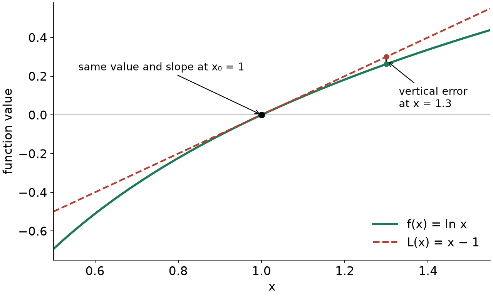
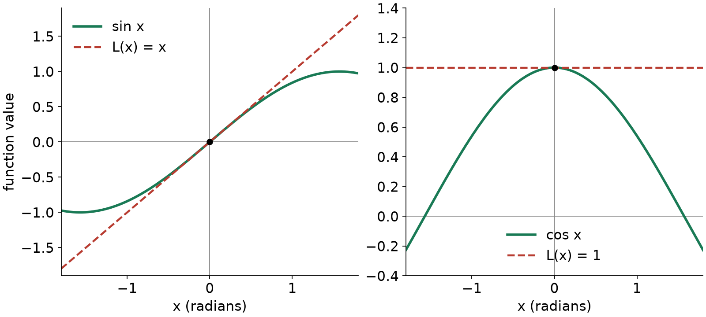
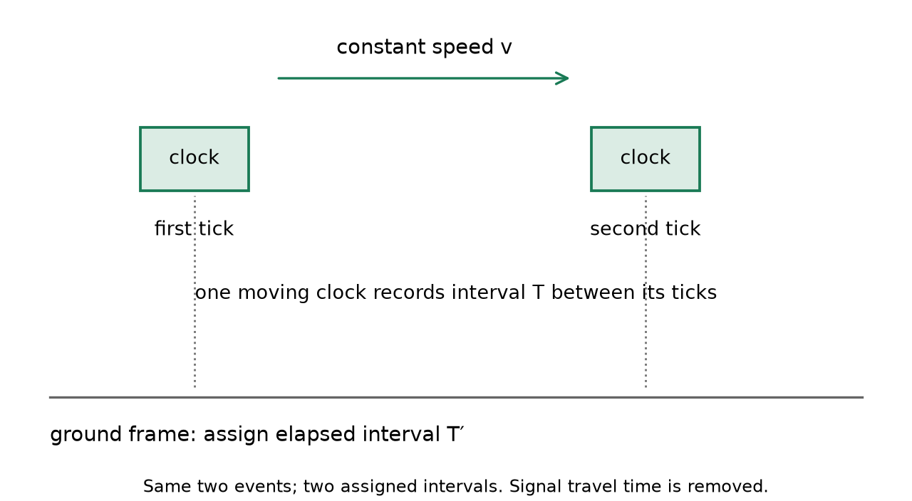
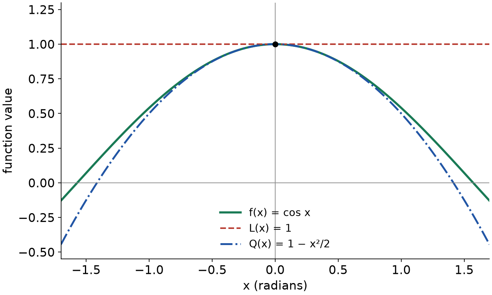

Linear and quadratic approximations

MIT 18.01, Fall 2006, Lecture 9 · Complete teaching route

Read this file in order. Try each labelled attempt when you reach it; its links lead to a separate hint file and a separate solution file. The final revisit is for a later study session. The route covers the tangent model, the five basic formulas, algebra with approximations, limits, the Planet Quirk clock example, and quadratic models. All figures are local assets.

You already have differentiation, tangent lines, limits, binomial expansion and the standard Maclaurin expansions from the supplied starting knowledge. Here we connect them into a way to choose, construct, justify and use an approximation. The clock law is supplied explicitly when it is needed.

An approximation replaces a difficult function by an easier expression near a chosen input. Its purpose might be a quick numerical estimate, a limiting calculation or a decision about which physical correction is worth keeping. We will keep exact equality and approximation distinct: $`L(x)=x-1`$ defines a polynomial exactly; $`\ln x\approx L(x)`$ says that polynomial estimates a different function.

<a id="d008-main-linear"></a>
1. A tangent line as a local model

Choose an input $`x_0`$ at which the function and its derivative are easy to evaluate. This is the basepoint. Let $`h=x-x_0`$ be the signed change from it. Both $`x_0`$ and $`f'(x_0)`$ stay fixed as $`x`$ varies. Starting with the tangent-line equation, define

```math
L(x)=f(x_0)+f'(x_0)(x-x_0).
```

Read this as “starting output plus local rate times input change.” The grouping matters: the slope multiplies the whole displacement $`x-x_0`$, not just $`x`$. The result is a polynomial of degree at most one; a horizontal tangent gives a constant polynomial. If the input has units, $`f'(x_0)`$ has output units divided by input units, so its product with the displacement has output units.

This construction follows directly from what a tangent must do. It passes through $`(x_0,f(x_0))`$, and its gradient is $`f'(x_0)`$. To build the line from that description, use its starting height $`f(x_0)`$ and add slope times displacement. Conversely, reading the formula at $`x=x_0`$ gives its height, and differentiating it gives its constant slope.

Why does it approximate? Differentiability at $`x_0`$ means the following limit exists and equals the derivative:

```math
\frac{f(x_0+h)-f(x_0)}{h}\longrightarrow f'(x_0)
\qquad(h\longrightarrow0,\ h\ne0).
```

Define the error $`E_1(h)=f(x_0+h)-f(x_0)-f'(x_0)h`$. Subtracting the derivative from that quotient gives

```math
\frac{E_1(h)}{h}\longrightarrow0.
```

Thus the unaccounted change becomes small compared with the input change. This is the precise local basis for $`f(x)\approx L(x)`$. It does not supply a numerical error bound at a particular nonzero input. A basepoint close to the target is usually a useful choice, provided the values there are easy. Moving far away loses the local justification; error need not grow monotonically with distance for every function. For a function that is already a line, the model is exact everywhere.

Worked example: the logarithm near 1

For $`f(x)=\ln x`$, the real domain is $`x\gt 0`$, and

```math
f(1)=0,\qquad f'(x)=\frac1x,\qquad f'(1)=1.
```

Choose $`x_0=1`$. Then

```math
L(x)=0+1(x-1)=x-1,\qquad \ln x\approx x-1.
```

For example, $`\ln(1.1)\approx0.1`$. The actual value is about $`0.09531`$, so this estimate is about $`0.00469`$ too high. That numerical comparison checks this example; it is not a general error guarantee.



Figure 1. The black contact point represents the shared value at the basepoint. The two coloured graphs share a slope there. The vertical segment at $`x=1.3`$ represents function value minus model value in magnitude, not a horizontal input error.

The lecture also rewrites the input. Put $`u=x-1`$, so $`x=1+u`$. This changes the location of the basepoint from $`x_0=1`$ to $`u_0=0`$, without changing the function values:

```math
\ln(1+u)\approx u\qquad(u\approx0,\ 1+u\gt 0).
```

Read $`u`$ as the small displacement, not as an extra independent quantity. To use this for $`\ln(0.96)`$, one would set $`1+u=0.96`$ and solve for $`u`$.

<a id="d008-main-task-a"></a>
Attempt A · Build and interpret a local estimate

Estimate $`\ln(0.96)`$ using the basepoint 1. State the displacement and the tangent model. Explain why the estimate is negative and why it is not an exact logarithm identity. A useful response gives the estimate and connects its sign to the local slope and input change.

[Hint A](hints.md#d008-hints-a) · [Solution A](solutions.md#d008-solutions-a)

<a id="d008-main-library"></a>
2. Five small-input models

The shorthand $`|u|\ll1`$ means that the magnitude of $`u`$ is small compared with one. It is a qualitative instruction, not a fixed cutoff. The required accuracy and the coefficients determine how small is useful. In the next formulas $`u`$ is dimensionless; trigonometric inputs are in radians. For the power formula, $`r`$ is fixed while $`u`$ approaches zero. For an arbitrary real $`r`$, use $`1+u\gt 0`$ so the real power and its derivatives are defined near zero.

Construct each model from $`g(0)+g'(0)u`$:

1. For $`g(u)=\sin u`$, the value is 0 and the slope is $`\cos0=1`$. Hence $`\sin u\approx u`$.
2. For $`g(u)=\cos u`$, the value is 1 and the slope is $`-\sin0=0`$. Hence $`\cos u\approx1`$.
3. For $`g(u)=e^u`$, both the value and the slope at zero are 1. Hence $`e^u\approx1+u`$.
4. For $`g(u)=\ln(1+u)`$, the value is 0 and $`g'(u)=1/(1+u)`$, giving slope 1 at zero. Hence $`\ln(1+u)\approx u`$.
5. For $`g(u)=(1+u)^r`$, the value is 1 and $`g'(u)=r(1+u)^{r-1}`$, giving slope $`r`$. Hence $`(1+u)^r\approx1+ru`$.

These are the lecture's basic linear approximations. Exact equalities above identify values, derivatives and model coefficients; the approximation signs connect the original functions to the models.



Figure 2. The left model has a nonzero slope; the right model is constant because cosine has zero slope at zero. “Linear approximation” includes this constant case. A constant model records the starting value and a vanishing first change; it does not claim the function stays constant.

The small quantity is the whole substituted input. For $`e^{-2x}`$, use $`u=-2x`$ and obtain $`e^{-2x}\approx1-2x`$ when $`|2x|`$ is small. For $`(1+2x)^{10}`$, use $`u=2x`$ and $`r=10`$. The coefficient 10 remains; it can make the neglected terms significant sooner than for a small exponent. “Small” should be judged against the calculation's purpose, not from $`x`$ alone.

<a id="d008-main-algebra"></a>
3. Combining approximations consistently

Worked example: the lecture's composite function

We want a linear model near zero for

```math
f(x)=\frac{e^{-2x}}{\sqrt{1+x}}
     =e^{-2x}(1+x)^{-1/2}.
```

The two forms are exactly equal for $`x\gt -1`$. The exponent $`-1/2`$ means take the square root and then its reciprocal. Rewriting this way lets both factors use the basic list:

```math
e^{-2x}\approx1-2x,\qquad
(1+x)^{-1/2}\approx1-\frac{x}{2}.
```

The first substitution was $`u=-2x`$; the second used $`u=x`$ and $`r=-1/2`$. Multiply the two polynomials exactly:

```math
(1-2x)\left(1-\frac{x}{2}\right)
=1-\frac52x+x^2.
```

For a linear model, retain only degree zero and degree one:

```math
f(x)\approx1-\frac52x.
```

Why discard the $`x^2`$ just generated? We already omitted the original factors' own quadratic terms. The displayed $`x^2`$ is only one of several contributions to the true quadratic coefficient. Keeping it would suggest accuracy that this calculation has not established. For $`0\lt |x|\lt1`$, the ratio $`x^2/|x|=|x|`$ tends to zero. With fixed coefficients, quadratic and higher contributions become smaller than first-degree contributions near zero. This licenses the order of truncation, not the claim that a coefficient is irrelevant at every chosen input.

The longer route in the lecture reaches the same result. First $`\sqrt{1+x}\approx1+x/2`$. Then use $`(1+u)^{-1}\approx1-u`$ with $`u=x/2`$ to estimate its reciprocal by $`1-x/2`$. The direct exponent $`-1/2`$ route reaches that same first-degree expression in one step.

The constant and linear coefficients of the correctly constructed local model give $`f(0)=1`$ and $`f'(0)=-5/2`$. A rough numerical fit would not establish those exact derivatives. Here the coefficients came from derivative-based local models. As an independent check, the product and chain rules give

```math
f'(0)=(-2)(1)+1\left(-\frac12\right)=-\frac52.
```

The original lecture's final slope sentence prints a plus sign; its preceding polynomial and this calculation give the minus sign.

When a quotient is convenient, either rewrite a reciprocal as a power or find its reciprocal polynomial by multiplication. The denominator must stay away from zero near the basepoint. A denominator vanishing at the basepoint needs a separate cancellation or limit analysis; division of ordinary linear models can otherwise hide the first surviving term.

<a id="d008-main-task-b"></a>
Attempt B · Adapt the substitutions and the domain

Find the linear model at zero for

```math
g(x)=\frac{e^{3x}}{\sqrt{1-2x}}.
```

Show the small input and exponent used for each factor. State a real domain near the basepoint, and obtain $`g'(0)`$ from the constructed model. A useful response retains every contribution to the linear coefficient and explains why the denominator is admissible.

[Hint B](hints.md#d008-hints-b) · [Solution B](solutions.md#d008-solutions-b)

<a id="d008-main-limit"></a>
4. A local model inside a limit

The lecture asks for

```math
\lim_{x\to0}\frac{(1+2x)^{10}-1}{x}.
```

Set $`f(x)=(1+2x)^{10}`$. Since $`f(0)=1`$, the quotient is exactly $`[f(x)-f(0)]/x`$. Its limit is the derivative $`f'(0)`$, by the derivative definition at zero. The chain rule gives $`f'(0)=10(1+0)^9\cdot2=20`$.

The approximation method explains the same answer. The power model gives $`f(x)\approx1+20x`$. To justify the limit, retain what the approximation says about the discarded part. Write $`f(x)=1+20x+E_1(x)`$, where $`E_1(x)/x\to0`$. Then, for $`x\ne0`$,

```math
\frac{(1+2x)^{10}-1}{x}
=20+\frac{E_1(x)}{x}
\longrightarrow20.
```

An approximate equality at a small input alone would not prove a limit after division. The error must still vanish after the division. Here differentiability supplies exactly that condition. The finite binomial expansion supplies another check: its remaining terms begin at $`x^2`$, so dividing them by $`x`$ leaves terms that tend to zero.

This is also a way to choose how many terms to compute. If subtraction removes the constant and linear terms and division is by $`x^2`$, a linear model is insufficient: its discarded quadratic term can become the whole nonzero answer. We will return to that situation after constructing a quadratic model.

<a id="d008-main-clock"></a>
5. Planet Quirk: choose the small variable

The lecture supplies a special-relativity law. We use it as a physical premise, not as something implied by calculus:

```math
T'=\frac{T}{\sqrt{1-v^2/c^2}}.
```

Here $`T\gt0`$ is the interval recorded by one moving clock between two ticks. $`T'`$ is the ground frame's elapsed time assigned to those same two events. The speed $`v`$ is the clock's constant speed relative to that frame, and $`c`$ is the vacuum light speed. We assume $`0\le v\lt c`$, ignore gravity, and idealise the frames as moving without acceleration or rotation. The ground times can be assigned using synchronised stationary clocks; delays for light signals to reach an observer must be removed. This is the precise meaning behind the lecture's wristwatch shorthand. A received flash spacing can also contain travel-delay effects.



Figure 3. The two boxes represent the same clock at two positions. Its own tick interval is $`T`$; the ground frame assigns $`T'`$ to the same pair of ticks. This is a comparison of elapsed intervals, not a drawing of a light-signal path. The model premise and its inertial-frame scope agree with [Einstein Online's explanation of moving clocks](https://www.einstein-online.info/en/spotlight/light-clocks-time-dilation/).

Build a dimensionless small parameter:

```math
z=\frac{v^2}{c^2}=\left(\frac vc\right)^2,\qquad
\frac{T'}{T}=(1-z)^{-1/2}.
```

The ratio uses compatible speed units, so $`z`$ has no units. If $`v/c`$ is small, then $`z`$ is smaller still. The power model uses $`u=-z`$ and $`r=-1/2`$:

```math
(1-z)^{-1/2}\approx1+\frac z2,\qquad
T'\approx T\left(1+\frac{v^2}{2c^2}\right).
```

The factor $`T`$ is necessary: an interval cannot equal a dimensionless number. Equivalently, the fractional excess is

```math
\frac{T'-T}{T}\approx\frac z2.
```

Since $`z\ge0`$, this excess is nonnegative, and it is zero at $`v=0`$. For nonzero speed, the ground assigns a longer interval between ticks; the moving clock ticks more slowly in that comparison.

Use the lecture's $`v=4\ \mathrm{km/s}`$ and $`c=3\times10^5\ \mathrm{km/s}`$:

```math
z=\frac{16}{9\times10^{10}}\approx1.78\times10^{-10},
\qquad \frac z2\approx8.89\times10^{-11}.
```

For an onboard interval of $`T=86400\ \mathrm{s}`$ (one day), this gives

```math
T'-T\approx86400(8.89\times10^{-11})\ \mathrm{s}
\approx7.68\times10^{-6}\ \mathrm{s}.
```

A tiny fractional change can therefore accumulate into microseconds over a day. The lecture connects such approximations with GPS corrections. Real GPS also includes gravity: [NIST describes approximately 7 microseconds per day of motion-related slowing and 45 microseconds per day in the opposite direction from gravity](https://www.nist.gov/atomic-clocks/a-powerful-tool-for-science/putting-einstein-test). Our simplified Quirk law describes the motion contribution only; it cannot calculate the complete GPS correction.

Notice that this model is linear in $`z`$, yet its first correction is quadratic in $`v/c`$. “Linear” or “quadratic” always refers to the variable being expanded.

<a id="d008-main-quadratic"></a>
6. Add the local change in slope

A tangent models the value and first derivative. To include how the slope changes, introduce a polynomial of degree at most two. Keep $`h=x-x_0`$ and write

```math
Q(x)=a+bh+dh^2.
```

The letters $`a,b,d`$ are coefficients to choose; $`d`$ here is not a differentiation symbol. Differentiating with respect to $`x`$ uses $`dh/dx=1`$:

```math
Q'(x)=b+2dh,\qquad Q''(x)=2d.
```

At $`x=x_0`$, $`h=0`$. Require the model to share $`f(x_0)`$, $`f'(x_0)`$ and $`f''(x_0)`$. These three conditions give $`a=f(x_0)`$, $`b=f'(x_0)`$ and $`d=f''(x_0)/2`$. Thus

```math
Q(x)=f(x_0)+f'(x_0)(x-x_0)
+\frac{f''(x_0)}{2}(x-x_0)^2.
```

The division by 2 compensates for differentiating a square twice. This makes the construction exact for every polynomial of degree at most two. For example, if $`f(x)=a+bx+dx^2`$ and $`x_0=0`$, its first three values are $`a,b,2d`$, so the formula reconstructs $`a+bx+dx^2`$. The shifted form does the same at any basepoint.

This is a local matching parabola when the quadratic coefficient is nonzero. It is not a least-squares fit through a set of measured points over an interval. A zero quadratic coefficient leaves a line.

Why the quadratic error is smaller in order

A sufficient condition is that $`f''`$ exists and is continuous on a small interval around $`x_0`$. Continuity here means $`f''(x_0+t)`$ approaches $`f''(x_0)`$ as $`t`$ approaches zero. For our functions, derivatives are combinations of exponentials, trigonometric functions and powers with nonzero denominators on their stated local domains; this condition can be checked directly.

If $`f''`$ were exactly constant, integration gives a slope change $`f''(x_0)h`$ and then an output correction $`f''(x_0)h^2/2`$. If it differs from that constant by at most $`\delta`$ between the basepoint and target, integration bounds the slope error at displacement $`t`$ by $`\delta|t|`$, and bounds the output error by $`\delta h^2/2`$. This uses the fundamental theorem of calculus and $`\int_0^{|h|}t\,dt=h^2/2`$. Continuity lets the maximum difference $`\delta`$ tend to zero as the interval shrinks. Consequently

```math
E_2(h)=f(x_0+h)-Q(x_0+h),
\qquad \frac{E_2(h)}{h^2}\longrightarrow0.
```

This justifies the extra order of local approximation without assuming a full infinite series. It does not guarantee that the quadratic model beats the linear model at every particular finite input. If $`f''(x_0)=0`$, the two models coincide. When $`f''(x_0)\ne0`$, the linear error has a nonzero leading quadratic term, whereas the quadratic error divided by $`h^2`$ tends to zero; this explains its eventual improvement sufficiently close to the basepoint.

Worked example: cosine at zero

For $`f(x)=\cos x`$ in radians,

```math
f(0)=1,\qquad f'(0)=-\sin0=0,\qquad f''(0)=-\cos0=-1.
```

Therefore

```math
L(x)=1,\qquad Q(x)=1-\frac{x^2}{2},\qquad
\cos x\approx1-\frac{x^2}{2}.
```



Figure 4. The quadratic term captures the downward change of slope that the horizontal tangent misses. At $`x=0.2`$, the linear estimate is 1, the quadratic estimate is 0.98, and $`\cos(0.2)\approx0.9800666`$. The corresponding absolute errors are approximately $`0.0199334`$ and $`0.0000666`$.

<a id="d008-main-quadratic-library"></a>
7. The five models through degree two

Use $`g(0)+g'(0)u+g''(0)u^2/2`$ at zero. The same radian and real-domain conditions as before apply.

For sine, $`g''(u)=-\sin u`$, so $`g''(0)=0`$. Its model through degree two is still

```math
\sin u\approx u.
```

“Through degree two” means keep every term up to that degree, including a zero coefficient. It does not require a nonzero square term. The next nonzero sine term is cubic in the familiar Maclaurin expansion.

For cosine, $`g''(0)=-1`$, so

```math
\cos u\approx1-\frac{u^2}{2}.
```

For the exponential, $`g(0)=g'(0)=g''(0)=1`$, so

```math
e^u\approx1+u+\frac{u^2}{2}.
```

For the logarithm, differentiate the reciprocal using its power form and the chain rule:

```math
g(u)=\ln(1+u),\quad
g'(u)=(1+u)^{-1},\quad
g''(u)=-(1+u)^{-2}.
```

The values at zero are $`0,1,-1`$, giving

```math
\ln(1+u)\approx u-\frac{u^2}{2}.
```

For a fixed real power,

```math
g'(u)=r(1+u)^{r-1},\qquad
g''(u)=r(r-1)(1+u)^{r-2}.
```

Thus

```math
(1+u)^r\approx1+ru+\frac{r(r-1)}2u^2.
```

These formulas agree with truncating the supplied standard Maclaurin and binomial expansions. A finite local approximation does not require claiming that an infinite series converges at a faraway input.

Worked example: complete the composite model

Return to $`f(x)=e^{-2x}(1+x)^{-1/2}`$. Use the whole substituted input in the square:

```math
e^{-2x}\approx1-2x+\frac{(-2x)^2}{2}
=1-2x+2x^2,
```

```math
(1+x)^{-1/2}
\approx1-\frac{x}{2}
+\frac{(-1/2)(-3/2)}2x^2
=1-\frac{x}{2}+\frac38x^2.
```

Now retain every product whose total degree is at most two. The constant comes from constant times constant. The linear coefficient combines the two linear terms. The quadratic coefficient has three sources: each quadratic term times the other constant, and linear times linear:

```math
Q(x)
=1+\left(-2-\frac12\right)x
+\left(2+(-2)\left(-\frac12\right)+\frac38\right)x^2
=1-\frac52x+\frac{27}{8}x^2.
```

Terms such as $`(-2x)(3x^2/8)`$ have degree three, so they are discarded at this order. The linear product's lone $`x^2`$ contributed 1 to the coefficient; the true coefficient is $`2+1+3/8=27/8`$. That is why retaining only the earlier product's square term was unjustified.

Reading the constructed polynomial back into the general formula gives

```math
f(0)=1,\qquad f'(0)=-\frac52,\qquad
\frac{f''(0)}2=\frac{27}{8},\qquad f''(0)=\frac{27}{4}.
```

At $`x=0.05`$, the linear estimate is 0.875, the quadratic estimate is 0.8834375, and direct evaluation gives about 0.8830328. The quadratic error is smaller in this checked case. It is still an approximation.

<a id="d008-main-task-c"></a>
Attempt C · Select the order that survives cancellation

Evaluate

```math
\lim_{x\to0}
\frac{\displaystyle \frac{e^{-2x}}{\sqrt{1+x}}-1+\frac52x}{x^2}.
```

Explain why the linear model alone cannot establish the answer and why the discarded error vanishes after this division when the quadratic model is used. A useful response identifies what cancels, what survives and the error condition that licenses the limit.

[Hint C](hints.md#d008-hints-c) · [Solution C](solutions.md#d008-solutions-c)

<a id="d008-main-clock-precision"></a>
8. Return to the clock: is the extra term useful?

Use $`u=-z`$, $`r=-1/2`$ in the degree-two power formula. Since $`(-z)^2=z^2`$,

```math
\frac{T'}T=(1-z)^{-1/2}
\approx1+\frac z2+\frac38z^2.
```

It is quadratic in $`z`$ and includes a fourth-power correction in $`v/c`$. The added term is positive when $`v\ne0`$. For the lecture's speeds,

```math
\frac38z^2\approx1.19\times10^{-20}.
```

That is a dimensionless correction to $`T'/T`$. To express its effect on an elapsed interval, multiply by $`T`$. Over $`86400\ \mathrm{s}`$ it contributes about $`1.02\times10^{-15}\ \mathrm{s}`$. To compare it with the first correction, divide:

```math
\frac{(3/8)z^2}{z/2}=\frac34z
\approx1.33\times10^{-10}\qquad(z\ne0).
```

The extra term is therefore tiny compared with the already small leading correction. At $`z=0`$, both corrections vanish; the last ratio is then unnecessary.

The lecture dismisses this term using atomic-clock precision. The calculation supports a more reusable decision: compare the neglected correction with the required uncertainty or tolerance, in matching units. For context, [NIST's July 2025 clock report gives a systematic fractional uncertainty of $`5.5\times10^{-19}`$](https://www.nist.gov/news-events/news/2025/07/nist-ion-clock-sets-new-record-most-accurate-clock-world), larger than this $`1.19\times10^{-20}`$ correction. That is a dated comparison, not a timeless impossibility of measurement. A time offset in seconds and a fractional clock uncertainty are different quantities; one must compare like with like and account for the elapsed interval and measurement method.

For a stringent guaranteed error bound, a next-term estimate alone may not suffice: establish a bound on the remainder or evaluate the original formula with adequate precision. In ordinary low-speed estimates the scale separation here makes the leading term useful.

<a id="d008-main-task-d"></a>
Attempt D · Change the physical scale

Keep the supplied clock law and neglect gravity.

(a) If the speed is doubled from the lecture's 4 km/s, by what factors do $`z`$, the leading fractional correction $`z/2`$ and the added correction $`3z^2/8`$ change? Explain using their powers of speed.

(b) Suppose the target is to retain corrections to $`T'/T`$ as small as $`10^{-19}`$. At the original speed, does the added quadratic term exceed that threshold? At doubled speed, does it exceed it? This is a comparison of term sizes, not a proof of total error.

(c) If instead $`v=0.8c`$, calculate $`z`$. Is the small-input justification reliable? Compare $`1+z/2`$ and $`1+z/2+3z^2/8`$ with the exact value, for which $`\sqrt{1-0.8^2}=0.6`$ is supplied.

A useful response distinguishes the chosen expansion variable, scaling of successive corrections and the loss of a small parameter.

[Hint D](hints.md#d008-hints-d) · [Solution D](solutions.md#d008-solutions-d)

<a id="d008-main-shift"></a>
9. Use a basepoint that is not zero

The zero-centred formulas are convenient tools, not a restriction. For $`f(x)=\sqrt{x}`$ near $`x_0=4`$, use $`h=x-4`$. Its local domain is $`x\gt0`$. Differentiation gives

```math
f(4)=2,\qquad
f'(x)=\frac12x^{-1/2},\qquad f'(4)=\frac14,
```

```math
f''(x)=-\frac14x^{-3/2},\qquad f''(4)=-\frac1{32}.
```

Construct the polynomials in the displacement:

```math
L(x)=2+\frac{x-4}{4},\qquad
Q(x)=2+\frac{x-4}{4}-\frac{(x-4)^2}{64}.
```

At $`x=4.04`$, $`h=0.04`$, so the quadratic estimate is $`2+0.01-0.000025=2.009975`$. Do not replace the square $`(x-4)^2`$ by $`x^2`$: that would destroy matching at 4.

There is a second construction using the power list. Factor the input:

```math
\sqrt{x}=\sqrt{4+h}=2\left(1+\frac h4\right)^{1/2}.
```

With $`u=h/4`$ and $`r=1/2`$, its model is

```math
2\left(1+\frac12\frac h4-\frac18\left(\frac h4\right)^2\right)
=2+\frac h4-\frac{h^2}{64}.
```

This recovers exactly the same polynomial. It also reveals the relevant small dimensionless change, $`h/4`$.

<a id="d008-main-task-e"></a>
Attempt E · Construct a model from local measurements

A sensor's output $`F(t)`$ is measured in volts, with $`t`$ in seconds. At $`t_0=2\ \mathrm{s}`$, suppose its local values are

```math
F(2)=3\ \mathrm{V},\qquad
F'(2)=0.4\ \mathrm{V/s},\qquad
F''(2)=-0.2\ \mathrm{V/s^2}.
```

Assume a continuous second derivative near 2 s. Construct its linear and quadratic models, estimate the output at 2.1 s, and explain what the sign of the quadratic correction means for the changing slope. Check the units of each term. Finally, state whether these three measured values alone guarantee the estimate's error is below 0.001 V.

A useful response uses a displacement from 2 s, distinguishes second derivative from square-term coefficient, and separates a local model from a certified finite-interval error bound.

[Hint E](hints.md#d008-hints-e) · [Solution E](solutions.md#d008-solutions-e)

<a id="d008-main-revisit"></a>
10. Later revisit: recall and select

After a break, try the next task before rereading the worked examples. A later day is a reasonable adjustable study choice; there is no universal best interval. Part (a) checks recall. Parts (b)–(d) check using the ideas under changed algebra and conditions. If you get stuck, use the corresponding hint, then compare your reasoning with the complete solution.

<a id="d008-main-task-f"></a>
Attempt F · Mixed use

(a) From memory, write the linear and quadratic models for $`f`$ at a general basepoint $`x_0`$, and state what they match.

(b) Find a model through degree two at zero for

```math
H(x)=\frac{\ln(1+2x)}{1+x}.
```

Show the substitutions, reciprocal and product terms needed. State a real domain around zero.

(c) Use that model to evaluate

```math
\lim_{x\to0}\frac{H(x)-2x}{x^2}.
```

Explain the required error after division.

(d) Does the absence of a square term in the degree-two model of $`\sin x`$ show that sine is locally a straight line exactly? Would the two models be identical for $`f(x)=7-3x`$ at any basepoint? Explain the different reasons.

A useful response reconstructs the coefficients, chooses the order from the cancellation, and distinguishes a zero model coefficient from a zero function error.

[Hint F](hints.md#d008-hints-f) · [Solution F](solutions.md#d008-solutions-f)

<a id="d008-main-reference"></a>
Reference route

To estimate a value, choose an easy nearby basepoint, compute the derivatives needed and insert the signed displacement. To combine models, identify each whole small input and retain all products through the chosen degree. To use a model in a limit, track the discarded error after any cancellation and division. To decide whether a correction matters, compare its scale with the required accuracy and keep the model's physical assumptions visible.

The source is David Jerison's [MIT 18.01 Fall 2006 Lecture 9: Linear and Quadratic Approximations](https://ocw.mit.edu/courses/18-01-single-variable-calculus-fall-2006/resources/lec9/), PDF printed pages 1–6 (PDF pages 2–7); its cover is PDF page 1. The worked logarithm, composite function, power limit and Quirk examples follow the lecture. The explanation of order/error, shifted square-root example and Attempts A–F are generated teaching and practice. The local figures are newly drawn. The derivative sign, omitted time factor and equality slips in the source have been corrected here.

[All hints](hints.md#d008-hints-start) · [All complete solutions](solutions.md#d008-solutions-start) · [Return to the start](#d008-main-linear)
