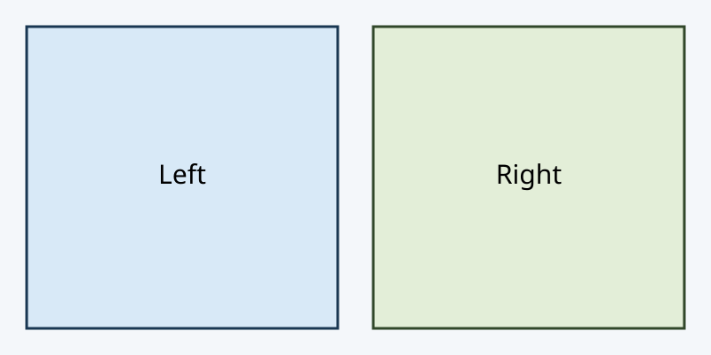

Destination fixture for published PROF r40. Synthetic mathematics only; this is not D008 teaching or acceptance evidence.

<a id="r40-fixture-main-start"></a>
Plain paragraph label. [Hint](hints.md#r40-fixture-hint) and [solution](solutions.md#r40-fixture-solution).

Inline command checks: $`1.25\approx1.3`$, $`\frac{6}{3}=2`$, $`\sqrt{9}=3`$, $`\sin 0=0`$, $`\cos 0=1`$, $`\ln 1=0`$, $`\left(2+1\right)=3`$, $`\Delta x=1`$, $`\theta=0`$, $`\text{test}`$, $`2\,\mathrm{m/s}`$, $`0\lt 1`$ and $`1\gt 0`$.

Display command check:

```math
\left(\frac{\sqrt{9}}{3}+\sin\theta+\cos\theta+\ln1\right)\approx2,\quad \Delta x=1,\quad 0\lt 1\gt 0,\quad 2\,\mathrm{m/s},\quad\text{test}.
```

Wrapper boundary check: the value $`\sqrt{9}=3`$ appears before [a plain reference label](https://example.com), followed by ordinary words and the separate value $`\frac{6}{3}=2`$.

Intrinsic geometry fixture:



<a id="r40-fixture-main-late"></a>
Later target after the image. [Hint](hints.md#r40-fixture-hint) and [solution](solutions.md#r40-fixture-solution).
