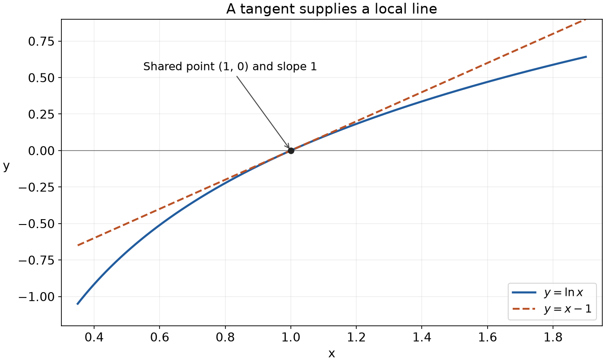
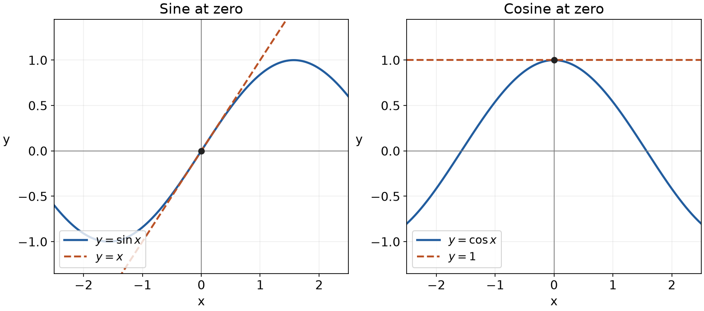
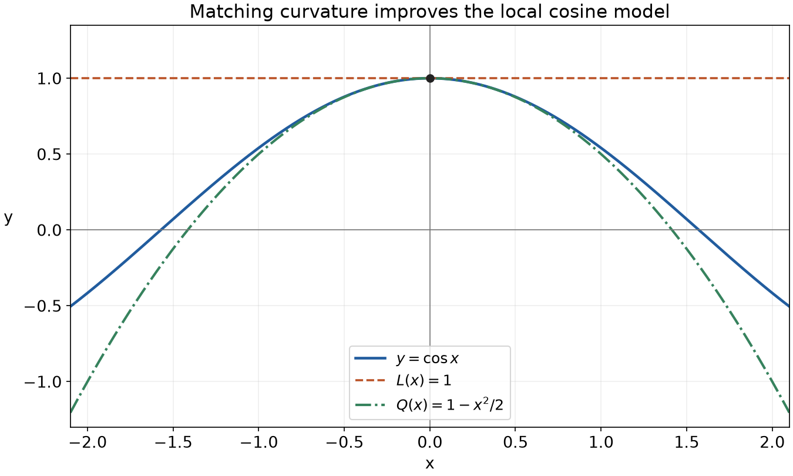

<a id="main-d008-start"></a>

Linear and quadratic approximations

MIT 18.01, Fall 2006, Lecture 9

A complicated function can often be replaced near one input by a much simpler polynomial. The useful decisions are where to centre that polynomial, which quantity is small, and which terms to keep. This lesson follows the complete [MIT lecture](https://ocw.mit.edu/courses/18-01-single-variable-calculus-fall-2006/resources/lec9/), with the numerical and physical assumptions made explicit.

Read this file in order. The attempts belong at the points where they appear; [hints](hints.md#hints-d008-start) and [complete solutions](solutions.md#solutions-d008-start) are in separate files, each with return links. The final revisit is for a later study session. You can stop with a partial attempt and use the matched hint. The assumed toolkit is algebra, differentiation, tangent equations, radians, binomial expansion and the basic Maclaurin series; the new connections are developed below.

<a id="main-d008-linear"></a>

A line built at a base point

Choose a fixed base point $`x_0`$ near the input of interest, where $`f(x_0)`$ and $`f'(x_0)`$ are easy to obtain. The nearby input $`x`$ varies; $`h=x-x_0`$ is its signed displacement from the base point. The value $`f(x_0)`$ fixes the line's height there, and the derivative $`f'(x_0)`$ fixes its slope. The tangent equation therefore gives the linear model

```math
L(x)=f(x_0)+f'(x_0)(x-x_0),
\qquad f(x)\approx L(x) \quad\text{near }x_0.
```

The equality defines $`L`$ exactly. The approximation sign compares the original function with that line. The whole product $`f'(x_0)(x-x_0)`$ is slope times input displacement, not the derivative evaluated at $`x-x_0`$. If the input has units, slope has output units per input unit, so this product has the same units as $`f(x_0)`$.

Why is this a local approximation? Differentiability at $`x_0`$ means that the difference quotient tends to $`f'(x_0)`$. Define the residual $`R_1(h)`$ to be the exact difference between the function and its line:

```math
f(x_0+h)=f(x_0)+f'(x_0)h+R_1(h).
```

For nonzero $`h`$,

```math
\frac{R_1(h)}h=
\frac{f(x_0+h)-f(x_0)}h-f'(x_0)
\longrightarrow0\quad\text{as }h\to0.
```

Thus the error becomes small even compared with the displacement. This explains why matching the tangent works close to the base point, provided the finite derivative exists. It gives no fixed distance that works for every function and no claim that the error must grow monotonically as you move away. For a specified numerical accuracy, the error still needs a bound or a comparison.

Worked case: a logarithm near one

For $`f(x)=\ln x`$, the domain is $`x\gt 0`$. Choose $`x_0=1`$, because $`\ln1=0`$ and $`f'(1)=1`$. Then

```math
L(x)=0+1(x-1)=x-1,
\qquad \ln x\approx x-1\quad\text{near }1.
```



Figure 1. The solid curve is $`\ln x`$; the dashed line is $`x-1`$. They share the marked point and slope. Their separation away from the point is the approximation error. This is the tangent geometry in the lecture's first figure, shown for its logarithm example.

To express the same approximation around zero, set $`x=1+u`$, so $`u=x-1`$. The old base point $`x=1`$ becomes $`u=0`$, and the line becomes

```math
\ln(1+u)\approx u\quad\text{for }u\text{ near }0,\qquad u\gt -1.
```

For example, $`\ln(1.02)\approx0.02`$. A calculator gives $`0.0198026273`$, so the absolute error of this estimate is about $`0.0001973727`$. Absolute error means the magnitude of true value minus estimate. Printing more decimal places in the estimate would not make that approximation more accurate.

<a id="main-d008-a1"></a>

Attempt A1: move the centre

Estimate $`\ln(2.04)`$ with a tangent at $`x_0=2`$. Use the supplied value $`\ln2\approx0.69314718056`$. State the displacement, the slope and the resulting estimate, rounded to six decimal places. The target is to preserve the base value and slope when the centre changes; the criterion is a correctly constructed tangent estimate, not six-place accuracy of the true logarithm. This is a generated application.

[Hint A1](hints.md#hints-d008-a1) · [Solution A1](solutions.md#solutions-d008-a1)

<a id="main-d008-basic"></a>

Five reusable linear forms

The lecture writes these with $`x`$ centred at zero. Here $`u`$ stands for the small input so that later substitutions are visible. In each case, insert the value and derivative at zero into $`f(0)+f'(0)u`$.

- Sine has value $`0`$ and derivative $`\cos0=1`$, giving $`\sin u\approx u`$.
- Cosine has value $`1`$ and derivative $`-\sin0=0`$, giving $`\cos u\approx1`$.
- The exponential has value and derivative $`1`$, giving $`e^u\approx1+u`$.
- For $`\ln(1+u)`$, the value is $`0`$ and the derivative is $`1/(1+u)`$, which is $`1`$ at zero, giving $`\ln(1+u)\approx u`$.
- For a fixed real exponent $`r`$, the function $`(1+u)^r`$ has value $`1`$ and derivative $`r(1+u)^{r-1}`$, which is $`r`$ at zero. Hence $`(1+u)^r\approx1+ru`$.

The trigonometric inputs are in radians. Logarithms and the general real power above use $`1+u\gt 0`$; near zero this is satisfied. These are local approximations, not identities. A fixed large exponent or a scaled input can demand a smaller displacement for useful accuracy.



Figure 2. On the left, sine and its line share value zero and slope one. On the right, cosine and its horizontal line share value one and slope zero. The plots show a wider interval to reveal the separation; the approximation is intended near the marked point. The lines continue beyond the plotted window. These are the two relationships in the lecture's second figure.

Combining approximations consistently

Consider the lecture's function

```math
f(x)=\frac{e^{-2x}}{\sqrt{1+x}}=e^{-2x}(1+x)^{-1/2},\qquad x\gt -1.
```

We want its line near zero. The exponential rule must receive its whole input: substitute $`u=-2x`$ into $`e^u\approx1+u`$, obtaining $`e^{-2x}\approx1-2x`$. The smallness needed is that of $`-2x`$, not an arbitrary replacement of the exponent.

For the other factor, set $`u=x`$, $`r=-1/2`$ in the power rule:

```math
(1+x)^{-1/2}\approx1-\frac12x.
```

This is the lecture's shortcut. Its longer denominator route also works: first $`\sqrt{1+x}\approx1+x/2`$, then use $`(1+w)^{-1}\approx1-w`$ with $`w=x/2`$ to approximate its reciprocal by $`1-x/2`$. Both routes preserve the constant and linear terms.

Multiply the two linear polynomials exactly:

```math
(1-2x)\left(1-\frac12x\right)=1-\frac52x+x^2.
```

For a linear approximation retain the constant and $`x`$ terms:

```math
f(x)\approx1-\frac52x.
```

Why discard the displayed $`x^2`$? The factors were themselves truncated before their quadratic terms. Those missing terms also contribute to the product's quadratic coefficient. Keeping the one accidental $`x^2`$ term would therefore mix incomplete information of the same degree. For the standard series used here, terms of degree two and above cannot change the constant or linear coefficient when these factors are multiplied. We will compute the complete quadratic coefficient later.

The coefficients identify $`f(0)=1`$ and $`f'(0)=-5/2`$, because this is its derivative-matching linear model. A separate product-rule check gives $`f'(0)=(-2)(1)+(1)(-1/2)=-5/2`$. An arbitrary approximate fit would not justify reading off an exact derivative in this way.

<a id="main-d008-limits"></a>

From a local model to a limit

The lecture asks for

```math
\lim_{x\to0}\frac{(1+2x)^{10}-1}{x}.
```

Set $`F(x)=(1+2x)^{10}`$. Then $`F(0)=1`$, so the quotient is exactly $`[F(x)-F(0)]/x`$. Its limit is $`F'(0)`$ by the derivative definition. The chain rule gives

```math
F'(x)=10(1+2x)^9\cdot2,
\qquad F'(0)=20.
```

The approximation route says the same thing: substitute $`u=2x`$, $`r=10`$ into the power rule, giving $`F(x)\approx1+20x`$. To justify the exact limit after division by $`x`$, use the earlier residual property:

```math
F(x)=1+20x+R_1(x),
\qquad \frac{R_1(x)}x\longrightarrow0.
```

For nonzero $`x`$ the quotient is $`20+R_1(x)/x`$, hence its limit is $`20`$. Merely replacing a numerator by a nearby value is not enough after division by a quantity tending to zero; the relative size of the omitted part matters. Here the finite binomial expansion provides another check: its next term is $`180x^2`$, which becomes $`180x`$ after division and tends to zero.

<a id="main-d008-a2"></a>

Attempt A2: a changed numerator

For $`k(x)=\sin(3x)/\sqrt{1+x}`$ near zero, find its linear model and then

```math
\lim_{x\to0}\frac{\sin(3x)}{x\sqrt{1+x}}.
```

State which terms determine the line and why a change in the denominator does or does not contribute at linear degree. Justify the exact limit using the derivative definition or a residual divided by $`x`$. The target is combining forms when the numerator's constant term vanishes, then carrying that model into a quotient. Correct coefficients and the limit warrant are the response criteria. Use radians and $`x\gt -1`$. This is a generated application.

[Hint A2](hints.md#hints-d008-a2) · [Solution A2](solutions.md#solutions-d008-a2)

<a id="main-d008-timing"></a>

Planet Quirk: choose the small quantity

The lecture next borrows a model from special relativity. Treat a passing satellite and the ground as frames moving at constant relative velocity, and neglect gravity. A frame here means a coordinate system with a consistent assignment of times and positions. Take two events on one onboard clock, such as the start and end of a timed process. Let $`T\gt 0`$ be the elapsed interval on that onboard clock. Let $`T'`$ be the elapsed coordinate interval assigned to the same events in the ground frame. The prime distinguishes the two time symbols; it is not a derivative.

The events occur at one place in the onboard rest frame, but at different ground-frame positions. Ground-frame time can be assigned with synchronized clocks at those positions. This makes precise the lecture's ground-wristwatch shorthand; the formula is not a comparison of the arrival times of light signals at one watch. The supplied physical law is

```math
T'=\frac{T}{\sqrt{1-v^2/c^2}},\qquad c\gt 0,\quad 0\le v\lt c.
```

Here $`v`$ is relative speed and $`c`$ is light speed. The lecture's satellite arrow gives a direction of motion; the scalar factor depends on its speed squared, so reversing that arrow would not change it. This event/frame interpretation and law are explained in [OpenStax, Time Dilation](https://openstax.org/books/university-physics-volume-3/pages/5-3-time-dilation). They are introduced physical premises for this calculus example.

Define the dimensionless quantity $`q=(v/c)^2`$. Then

```math
\frac{T'}T=(1-q)^{-1/2}.
```

For $`q`$ near zero, substitute $`u=-q`$, $`r=-1/2`$ into $`(1+u)^r\approx1+ru`$:

```math
\frac{T'}T\approx1+\frac12q,
\qquad T'\approx T\left(1+\frac{v^2}{2c^2}\right),
\qquad \frac{T'-T}T\approx\frac{v^2}{2c^2}.
```

The ratio has no units, while the expression for $`T'`$ retains the factor $`T`$ and has time units. For $`v=0`$ the two intervals agree. For $`0\lt v\lt c`$ the exact denominator is between zero and one, so $`T'\gt T`$: less onboard time passes than ground-frame coordinate time for these events.

Use the lecture's $`v=4\ \mathrm{km/s}`$ and $`c=3\times10^5\ \mathrm{km/s}`$. Matching units before taking the ratio gives

```math
q=\left(\frac{4}{300000}\right)^2
=1.777777\ldots\times10^{-10},
\qquad \frac q2=8.888888\ldots\times10^{-11}.
```

The lecture's $`10^{-10}`$ is an order estimate for $`q`$; retain the unrounded ratio when calculating a coefficient-sensitive result. For an onboard interval $`T=86400\ \mathrm{s}`$, the leading estimate of $`T'-T`$ is $`7.68\times10^{-6}\ \mathrm{s}`$, or $`7.68`$ microseconds. This daily scale is an added illustration with its interval stated.

GPS makes small clock-rate corrections consequential when time is used to infer distance. Actual GPS also needs a gravitational correction; this constant-velocity example isolates the kinematic contribution. [NIST's account](https://www.nist.gov/atomic-clocks/a-powerful-tool-for-science/putting-einstein-test) describes both effects. The one formula above is not a complete GPS clock model.

<a id="main-d008-quadratic"></a>

Match one more derivative

A line has no changing slope. To capture the function's local bending, use a polynomial with terms through degree two in $`h=x-x_0`$:

```math
Q(x)=A+Bh+Ch^2.
```

Since $`h=x-x_0`$ and $`x_0`$ is fixed, differentiation with respect to $`x`$ gives $`Q'(x)=B+2Ch`$ and $`Q''(x)=2C`$. At the base point $`h=0`$, matching the function's value, slope and second derivative requires

```math
A=f(x_0),\qquad B=f'(x_0),\qquad 2C=f''(x_0).
```

Solving for $`C`$ explains the factor one half:

```math
Q(x)=f(x_0)+f'(x_0)(x-x_0)
+\frac{f''(x_0)}2(x-x_0)^2.
```

The square applies to the whole displacement. A positive second derivative means the slope increases with input; a negative one means it decreases. Matching it captures that bending at the base point. The lecture calls this a best-fit parabola: the precise meaning here is local derivative matching, not a least-squares fit over a finite interval. If the original function has degree at most two, the matching coefficients recover it exactly. Otherwise $`f(x)\approx Q(x)`$ is still a local approximation. For the smooth functions and valid series used here, retaining the quadratic terms usually reduces the nearby error; it does not guarantee every desired tolerance or a strict improvement when the added coefficient is zero.

Worked case: cosine

At zero, cosine has value $`1`$, first derivative $`-\sin0=0`$, and second derivative $`-\cos0=-1`$. Therefore

```math
\cos x\approx1+0x-\frac12x^2=1-\frac12x^2.
```



Figure 3. The green quadratic and solid cosine share value, slope and second derivative at zero. The orange line only shares value and slope. This gives the local-contact interpretation of the lecture's fourth figure. The wider plot makes visible where the parabola separates from cosine; it is not a global replacement.

The five quadratic forms

At zero, the general formula becomes $`Q(u)=f(0)+f'(0)u+f''(0)u^2/2`$. Reuse the earlier values and first derivatives, then add the second derivative:

- For sine, $`f''(u)=-\sin u`$, so $`f''(0)=0`$ and $`\sin u\approx u`$ even through quadratic degree. Its first missing nonzero series term is $`-u^3/6`$.
- For cosine, $`f''(0)=-1`$, giving $`\cos u\approx1-u^2/2`$.
- For the exponential, $`f''(0)=1`$, giving $`e^u\approx1+u+u^2/2`$.
- For $`f(u)=\ln(1+u)`$, differentiating $`f'(u)=1/(1+u)`$ gives $`f''(u)=-(1+u)^{-2}`$. Thus $`f''(0)=-1`$ and $`\ln(1+u)\approx u-u^2/2`$.
- For the fixed power, differentiating $`r(1+u)^{r-1}`$ gives $`r(r-1)(1+u)^{r-2}`$. Hence $`(1+u)^r\approx1+ru+r(r-1)u^2/2`$.

The earlier radian and positive-base conditions still apply. Calling a model quadratic means terms through degree two are available; a zero coefficient is retained as zero, not replaced by an invented term. For example, at $`x_0=1`$ the logarithm's displacement is $`h=x-1`$, so its quadratic model is $`h-h^2/2`$. At $`x=1.02`$ it gives $`0.0198`$, compared with the earlier true value $`0.0198026273`$. The absolute error is about $`0.0000026273`$; the quadratic improves this particular estimate.

<a id="main-d008-timing-refinement"></a>

Return to the timing factor

Keep $`q=(v/c)^2`$ as the expansion variable. Using $`u=-q`$ and $`r=-1/2`$ in the quadratic power rule gives

```math
(1-q)^{-1/2}\approx1+\frac12q
+\frac{(-1/2)(-3/2)}2(-q)^2
=1+\frac12q+\frac38q^2.
```

Thus $`T'\approx T(1+q/2+3q^2/8)`$. This is quadratic in $`q`$; its last term is fourth degree in $`v/c`$. For the lecture's speed, $`3q^2/8\approx1.185185\times10^{-20}`$. It changes the ratio by about $`1.2\times10^{-20}`$, compared with the leading change of about $`8.9\times10^{-11}`$. Whether that extra term is needed depends on the required accuracy; multiply ratio error by the specified $`T`$ to express a time error. The lecture compares this scale with atomic clocks. The mathematical conclusion is the scale of the correction, not a universal claim about every clock's present capabilities.

<a id="main-d008-a3"></a>

Attempt A3: judge a changed regime

In the same constant-velocity model, let $`v=0.6c`$. The exact factor is $`T'/T=1.25`$. Compute the two factors obtained by keeping terms through degree one and through degree two in $`q`$. Does either approximate the exact factor with absolute error at most $`0.001`$? Give the errors and explain what this reveals about the small-quantity condition. The target is choosing an adequate order from an accuracy requirement; a smaller error alone is not the acceptance criterion. This is a generated application.

[Hint A3](hints.md#hints-d008-a3) · [Solution A3](solutions.md#solutions-d008-a3)

<a id="main-d008-composite-quadratic"></a>

Complete the composite quadratic

Return to $`f(x)=e^{-2x}(1+x)^{-1/2}`$. To obtain all terms through $`x^2`$, both factors now need that degree:

```math
e^{-2x}\approx1-2x+\frac{(-2x)^2}2=1-2x+2x^2,
```

```math
(1+x)^{-1/2}\approx1-\frac12x
+\frac{(-1/2)(-3/2)}2x^2
=1-\frac12x+\frac38x^2.
```

When multiplying, a term's degree is the sum of the degrees chosen from the two factors. The constant comes from constant times constant. Linear terms come from linear times constant in either order. Quadratic terms have three sources: quadratic times constant, linear times linear, and constant times quadratic. Therefore

```math
f(x)\approx1+\left(-2-\frac12\right)x
+\left(2+(-2)(-1/2)+\frac38\right)x^2
=1-\frac52x+\frac{27}{8}x^2.
```

Terms such as $`(-2x)(3x^2/8)`$ have degree three and are discarded at this order. The earlier accidental quadratic coefficient $`1`$ was only the linear-times-linear contribution; the missing $`2+3/8`$ explains why it was insufficient. As a check, the product rule applied twice gives $`f''(0)=4+2(-2)(-1/2)+3/4=27/4`$, so $`f''(0)/2=27/8`$.

At $`x=0.02`$, the line predicts $`0.95`$, the quadratic predicts $`0.95135`$, and direct evaluation of the original expression gives about $`0.9513233025`$. Their absolute errors are about $`0.0013233025`$ and $`0.0000266975`$, respectively. These are checks at this input, not error bounds over an interval.

<a id="main-d008-a4"></a>

Attempt A4: make the first change vanish

Let $`g(x)=(1+ax)e^{-2x}/\sqrt{1+x}`$, where $`a`$ is a constant you may choose. Choose $`a`$ so that $`g'(0)=0`$, then find the quadratic model of $`g`$ near zero. Explain whether the zero derivative makes $`g`$ constant near zero. The target is using coefficient structure to change the leading behaviour; the criteria are the chosen $`a`$, all terms through degree two and an interpretation of the first nonzero correction. Work in $`x\gt -1`$. This is a generated integrated application.

[Hint A4](hints.md#hints-d008-a4) · [Solution A4](solutions.md#solutions-d008-a4)

<a id="main-d008-revisit"></a>

Revisit R1

In a later study session, first try to recall how the value, first derivative and second derivative determine the two local models. Then apply them to $`\cos x`$ at zero to estimate $`\cos(0.2)`$ in radians. A supplied reference value is $`0.98006657784`$. Which of your two models meets an absolute-error tolerance of $`0.0001`$? Explain the role of the second derivative, and why a second-order model for sine at zero would not gain a nonzero quadratic term. The recall part revisits the construction; the tolerance decision is an application, so success at one does not establish the other. A later day is a possible study interval, adjustable to your needs rather than a fixed optimal schedule. This is a generated revisit with matched help.

[Hint R1](hints.md#hints-d008-r1) · [Solution R1](solutions.md#solutions-d008-r1)

<a id="main-d008-sources"></a>

Source and interpretation notes

The lecture source is [MIT OpenCourseWare, Lecture 9 PDF](https://ocw.mit.edu/courses/18-01-single-variable-calculus-fall-2006/40cb41807e6d67373f3299ce87c4d9b3_lec9.pdf), including its cover and all six printed teaching pages. Figures here are newly plotted versions of its tangent and cosine relationships. MIT provides its [terms of use](https://ocw.mit.edu/terms/).

Some exact-equality signs in the basic linear proofs on printed page 2 should apply to the model polynomial, or be approximation signs when applied to the original function. On printed page 4, the time approximation's right side needs its factor $`T`$, and the bracket's exponent must be $`r`$ (here $`-1/2`$), rather than the printed $`4`$. The equations above preserve that factor and the correct substitution. The original derivative in the composite linear example is correctly $`-5/2`$. The event/frame clarification and GPS scope are supported by the linked OpenStax and NIST passages.

[Return to the reading route](#main-d008-start) · [Hints](hints.md#hints-d008-start) · [Solutions](solutions.md#solutions-d008-start)
