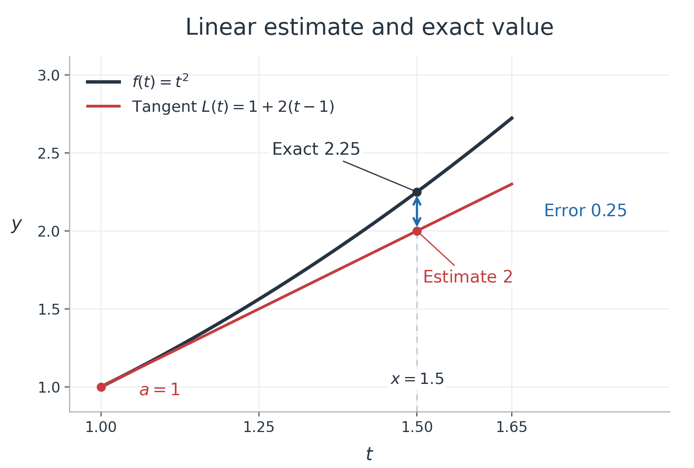

Image layout and fragment navigation diagnostic. This is a test fixture, not a teaching revision.

The two arms have identical neutral text and mathematical payloads. Their image markup and necessary file/anchor names differ.

[Open hints](hints.md) · [Open solutions](solutions.md)

Diagnostic region 1. The following image has intrinsic dimensions 1600 by 1080 pixels.


Reading block 1.1. This neutral paragraph supplies ordinary page height for the navigation test. It carries no task answer or required subject knowledge. The marker identifies a position that can be observed after a click. The page includes supported mathematical payloads so that image and math settlement can be recorded separately. Probe values are $`a\lt b`$, $`f(x)=x^2`$ and $`c\in(a,b)`$.

Reading block 1.2. This neutral paragraph supplies ordinary page height for the navigation test. It carries no task answer or required subject knowledge. The marker identifies a position that can be observed after a click. The page includes supported mathematical payloads so that image and math settlement can be recorded separately. Probe values are $`a\lt b`$, $`f(x)=x^2`$ and $`c\in(a,b)`$.

```math
f(b)-f(a)=f'(c)(b-a),\qquad a\lt c\lt b.
```

Reading block 1.3. This neutral paragraph supplies ordinary page height for the navigation test. It carries no task answer or required subject knowledge. The marker identifies a position that can be observed after a click. The page includes supported mathematical payloads so that image and math settlement can be recorded separately. Probe values are $`a\lt b`$, $`f(x)=x^2`$ and $`c\in(a,b)`$.

Reading block 1.4. This neutral paragraph supplies ordinary page height for the navigation test. It carries no task answer or required subject knowledge. The marker identifies a position that can be observed after a click. The page includes supported mathematical payloads so that image and math settlement can be recorded separately. Probe values are $`a\lt b`$, $`f(x)=x^2`$ and $`c\in(a,b)`$.

Reading block 1.5. This neutral paragraph supplies ordinary page height for the navigation test. It carries no task answer or required subject knowledge. The marker identifies a position that can be observed after a click. The page includes supported mathematical payloads so that image and math settlement can be recorded separately. Probe values are $`a\lt b`$, $`f(x)=x^2`$ and $`c\in(a,b)`$.

```math
f(b)-f(a)=f'(c)(b-a),\qquad a\lt c\lt b.
```

Reading block 1.6. This neutral paragraph supplies ordinary page height for the navigation test. It carries no task answer or required subject knowledge. The marker identifies a position that can be observed after a click. The page includes supported mathematical payloads so that image and math settlement can be recorded separately. Probe values are $`a\lt b`$, $`f(x)=x^2`$ and $`c\in(a,b)`$.

Reading block 1.7. This neutral paragraph supplies ordinary page height for the navigation test. It carries no task answer or required subject knowledge. The marker identifies a position that can be observed after a click. The page includes supported mathematical payloads so that image and math settlement can be recorded separately. Probe values are $`a\lt b`$, $`f(x)=x^2`$ and $`c\in(a,b)`$.

Reading block 1.8. This neutral paragraph supplies ordinary page height for the navigation test. It carries no task answer or required subject knowledge. The marker identifies a position that can be observed after a click. The page includes supported mathematical payloads so that image and math settlement can be recorded separately. Probe values are $`a\lt b`$, $`f(x)=x^2`$ and $`c\in(a,b)`$.

```math
f(b)-f(a)=f'(c)(b-a),\qquad a\lt c\lt b.
```

<a name="fixture-a-main-p2"></a>

P2 TARGET. This paragraph is the intended visible destination after the return click. Its first line should be in the viewport after the page has settled.

[Hint P2](hints.md#fixture-a-hints-p2) · [Solution P2](solutions.md#fixture-a-solutions-p2)

Diagnostic region 2. The following image has intrinsic dimensions 1600 by 1080 pixels.


Reading block 2.1. This neutral paragraph supplies ordinary page height for the navigation test. It carries no task answer or required subject knowledge. The marker identifies a position that can be observed after a click. The page includes supported mathematical payloads so that image and math settlement can be recorded separately. Probe values are $`a\lt b`$, $`f(x)=x^2`$ and $`c\in(a,b)`$.

Reading block 2.2. This neutral paragraph supplies ordinary page height for the navigation test. It carries no task answer or required subject knowledge. The marker identifies a position that can be observed after a click. The page includes supported mathematical payloads so that image and math settlement can be recorded separately. Probe values are $`a\lt b`$, $`f(x)=x^2`$ and $`c\in(a,b)`$.

```math
f(b)-f(a)=f'(c)(b-a),\qquad a\lt c\lt b.
```

Reading block 2.3. This neutral paragraph supplies ordinary page height for the navigation test. It carries no task answer or required subject knowledge. The marker identifies a position that can be observed after a click. The page includes supported mathematical payloads so that image and math settlement can be recorded separately. Probe values are $`a\lt b`$, $`f(x)=x^2`$ and $`c\in(a,b)`$.

Reading block 2.4. This neutral paragraph supplies ordinary page height for the navigation test. It carries no task answer or required subject knowledge. The marker identifies a position that can be observed after a click. The page includes supported mathematical payloads so that image and math settlement can be recorded separately. Probe values are $`a\lt b`$, $`f(x)=x^2`$ and $`c\in(a,b)`$.

Reading block 2.5. This neutral paragraph supplies ordinary page height for the navigation test. It carries no task answer or required subject knowledge. The marker identifies a position that can be observed after a click. The page includes supported mathematical payloads so that image and math settlement can be recorded separately. Probe values are $`a\lt b`$, $`f(x)=x^2`$ and $`c\in(a,b)`$.

```math
f(b)-f(a)=f'(c)(b-a),\qquad a\lt c\lt b.
```

Reading block 2.6. This neutral paragraph supplies ordinary page height for the navigation test. It carries no task answer or required subject knowledge. The marker identifies a position that can be observed after a click. The page includes supported mathematical payloads so that image and math settlement can be recorded separately. Probe values are $`a\lt b`$, $`f(x)=x^2`$ and $`c\in(a,b)`$.

Reading block 2.7. This neutral paragraph supplies ordinary page height for the navigation test. It carries no task answer or required subject knowledge. The marker identifies a position that can be observed after a click. The page includes supported mathematical payloads so that image and math settlement can be recorded separately. Probe values are $`a\lt b`$, $`f(x)=x^2`$ and $`c\in(a,b)`$.

Reading block 2.8. This neutral paragraph supplies ordinary page height for the navigation test. It carries no task answer or required subject knowledge. The marker identifies a position that can be observed after a click. The page includes supported mathematical payloads so that image and math settlement can be recorded separately. Probe values are $`a\lt b`$, $`f(x)=x^2`$ and $`c\in(a,b)`$.

```math
f(b)-f(a)=f'(c)(b-a),\qquad a\lt c\lt b.
```

Diagnostic region 3. The following image has intrinsic dimensions 1600 by 1080 pixels.



Reading block 3.1. This neutral paragraph supplies ordinary page height for the navigation test. It carries no task answer or required subject knowledge. The marker identifies a position that can be observed after a click. The page includes supported mathematical payloads so that image and math settlement can be recorded separately. Probe values are $`a\lt b`$, $`f(x)=x^2`$ and $`c\in(a,b)`$.

Reading block 3.2. This neutral paragraph supplies ordinary page height for the navigation test. It carries no task answer or required subject knowledge. The marker identifies a position that can be observed after a click. The page includes supported mathematical payloads so that image and math settlement can be recorded separately. Probe values are $`a\lt b`$, $`f(x)=x^2`$ and $`c\in(a,b)`$.

```math
f(b)-f(a)=f'(c)(b-a),\qquad a\lt c\lt b.
```

Reading block 3.3. This neutral paragraph supplies ordinary page height for the navigation test. It carries no task answer or required subject knowledge. The marker identifies a position that can be observed after a click. The page includes supported mathematical payloads so that image and math settlement can be recorded separately. Probe values are $`a\lt b`$, $`f(x)=x^2`$ and $`c\in(a,b)`$.

Reading block 3.4. This neutral paragraph supplies ordinary page height for the navigation test. It carries no task answer or required subject knowledge. The marker identifies a position that can be observed after a click. The page includes supported mathematical payloads so that image and math settlement can be recorded separately. Probe values are $`a\lt b`$, $`f(x)=x^2`$ and $`c\in(a,b)`$.

Reading block 3.5. This neutral paragraph supplies ordinary page height for the navigation test. It carries no task answer or required subject knowledge. The marker identifies a position that can be observed after a click. The page includes supported mathematical payloads so that image and math settlement can be recorded separately. Probe values are $`a\lt b`$, $`f(x)=x^2`$ and $`c\in(a,b)`$.

```math
f(b)-f(a)=f'(c)(b-a),\qquad a\lt c\lt b.
```

Reading block 3.6. This neutral paragraph supplies ordinary page height for the navigation test. It carries no task answer or required subject knowledge. The marker identifies a position that can be observed after a click. The page includes supported mathematical payloads so that image and math settlement can be recorded separately. Probe values are $`a\lt b`$, $`f(x)=x^2`$ and $`c\in(a,b)`$.

Reading block 3.7. This neutral paragraph supplies ordinary page height for the navigation test. It carries no task answer or required subject knowledge. The marker identifies a position that can be observed after a click. The page includes supported mathematical payloads so that image and math settlement can be recorded separately. Probe values are $`a\lt b`$, $`f(x)=x^2`$ and $`c\in(a,b)`$.

Reading block 3.8. This neutral paragraph supplies ordinary page height for the navigation test. It carries no task answer or required subject knowledge. The marker identifies a position that can be observed after a click. The page includes supported mathematical payloads so that image and math settlement can be recorded separately. Probe values are $`a\lt b`$, $`f(x)=x^2`$ and $`c\in(a,b)`$.

```math
f(b)-f(a)=f'(c)(b-a),\qquad a\lt c\lt b.
```

<a name="fixture-a-main-p6"></a>

P6 TARGET. This paragraph is the intended visible destination after the return click. Its first line should be in the viewport after the page has settled.

[Hint P6](hints.md#fixture-a-hints-p6) · [Solution P6](solutions.md#fixture-a-solutions-p6)

End of main diagnostic content.

[Hints](hints.md) · [Solutions](solutions.md)
