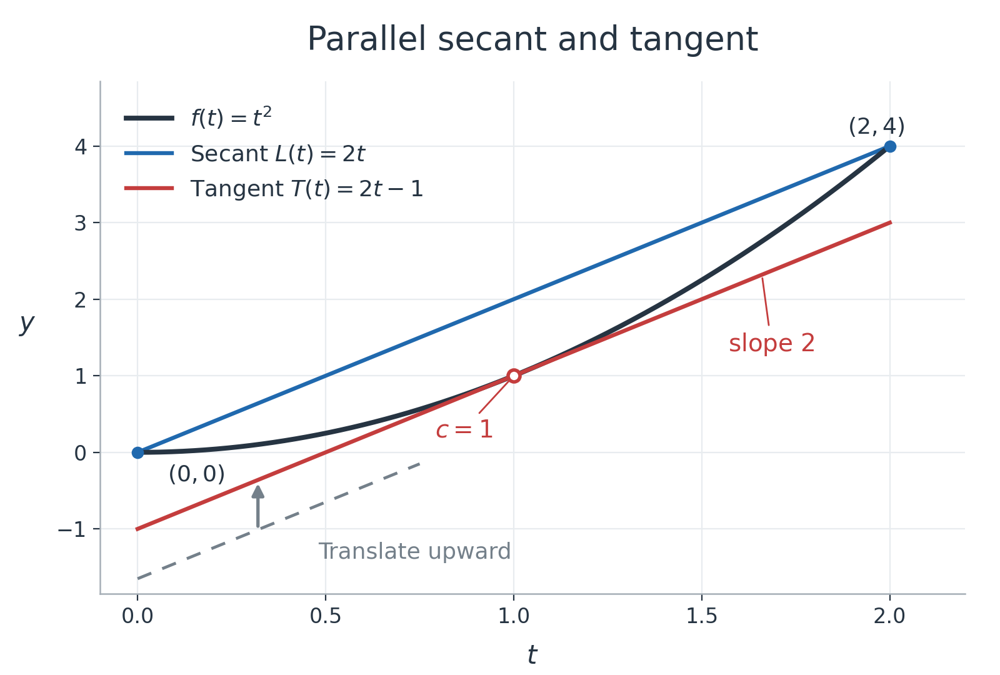
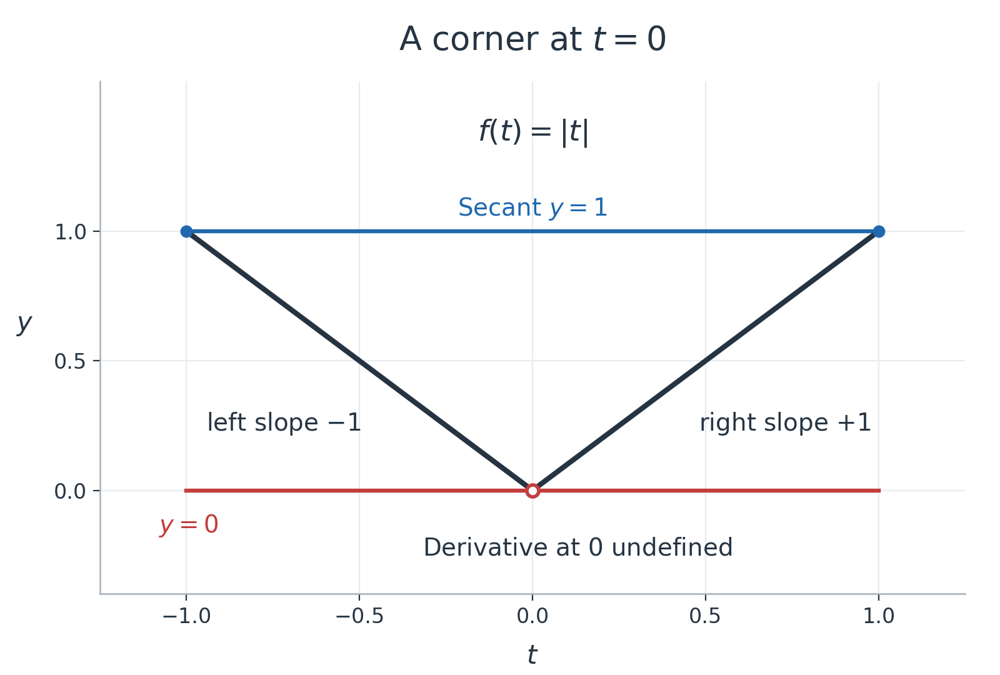

Mean value theorem and inequalities

Read this lesson in order, pausing at P1–P5. The [hints](hints.md) are grouped separately from the [complete solutions](solutions.md). Each task has its own help links and a return link. P6 is a later revisit: leave it until another study session if useful, then try recalling the theorem before looking back. That interval is an adjustable study suggestion, not a claim about an optimal schedule.

The aim is to turn information about local slopes into justified statements about a whole interval. You will identify when the mean value theorem applies, interpret its unknown point, distinguish an exact identity from a tangent estimate, and prove inequalities by comparing functions. Familiar differentiation rules and elementary algebra are used; the additional theorem conditions and proof ingredients are introduced below. All six practice tasks are generated for this lesson.

1. What the theorem connects

For two distinct inputs $`a\lt b`$, the secant line joins $`(a,f(a))`$ to $`(b,f(b))`$. Its slope is the average change in output per unit change in input:

```math
m=\frac{f(b)-f(a)}{b-a}.
```

The derivative $`f'(c)`$ is instead the tangent slope at one input $`c`$. The mean value theorem, abbreviated MVT, connects these two different kinds of slope. We first need to know exactly which functions it concerns.

A function is continuous at an input when its values approach its value at that input as the input approaches it: there is no jump or missing value there. At an interior point $`u`$, this means $`\lim_{t\to u}f(t)=f(u)`$, with agreement from both sides. Continuous on $`[a,b]`$ means this holds at every interior point, with the corresponding one-sided agreement at each endpoint. At $`a`$ approach from the right; at $`b`$ approach from the left. In particular, merely defining endpoint values is insufficient: they must agree with the values approached along the interval.

Differentiable at an interior point means that the difference quotient has a finite limit there:

```math
f'(u)=\lim_{h\to0}\frac{f(u+h)-f(u)}{h}.
```

The same finite value must be approached from both sides. A corner whose left and right slopes differ fails this condition. A vertical tangent with no finite slope also fails it. Continuous and differentiable describe properties of the function at specified inputs; they are not promises that every graph one sketches is smooth.

For the standard examples here, polynomials and the exponential are continuous and differentiable at every real input. For a function given by different formulas on different pieces, check the joins and endpoints against the definitions, even if each individual formula is well behaved. Differentiability at a point implies continuity there: for nonzero $`h`$, write

```math
f(u+h)-f(u)=h\frac{f(u+h)-f(u)}h.
```

If the quotient has a finite limit, the right side tends to zero. This gives the required agreement of nearby values with $`f(u)`$.

The MVT states: if $`a\lt b`$, $`f`$ is continuous on $`[a,b]`$, and $`f`$ is differentiable on $`(a,b)`$, then there is at least one $`c`$ strictly between $`a`$ and $`b`$ for which

```math
f'(c)=\frac{f(b)-f(a)}{b-a},\qquad a\lt c\lt b.
```

The closed interval includes the endpoints for the continuity check. The open interval excludes them for the derivative check. Thus the theorem does not demand finite endpoint derivatives. It guarantees an interior point with the required slope, without naming that point, making it unique, or placing it halfway between the endpoints. A straight line has the same derivative everywhere, so every interior point works for it.

To use the theorem, check the interval conditions, compute the average slope, then equate the derivative at an interior point to that slope. For example, take $`f(t)=t^2`$ on $`[0,2]`$. Both hypotheses hold because this is a polynomial. The secant slope is $`(4-0)/(2-0)=2`$. Since $`f'(t)=2t`$, the equation $`f'(c)=2`$ gives $`2c=2`$, hence $`c=1`$. This point is inside the interval. The tangent at $`(1,1)`$ has equation $`y=1+2(t-1)=2t-1`$, while the secant has equation $`y=2t`$. Their equal slopes make them parallel, even though they are different lines.



Figure 1. The horizontal coordinate is the input $`t`$ and the vertical coordinate is the output. The blue line connects the two endpoint values; the red line touches the curve at $`c=1`$. The dashed line and upward arrow illustrate moving a line vertically without changing its slope. Section 2 will justify why a suitable parallel line must touch at an interior point in the general case.

<a name="d013-main-p1"></a>

P1. For $`f(x)=x^2`$ on $`[1,4]`$, check the two MVT hypotheses, calculate the secant slope, and find every $`c`$ strictly between 1 and 4 for which $`f'(c)`$ equals that slope. Explain what equality of these two slopes means geometrically. A complete response identifies the interval conditions as well as $`c`$.

[Hint P1](hints.md#d013-hints-p1) · [Solution P1](solutions.md#d013-solutions-p1)

2. Why a parallel tangent must exist

The source lecture describes sliding a line parallel to the secant until it touches the graph. The following argument supplies the existence and interior-point reasons behind that picture.

One additional foundational result is used as a theorem here: the extreme value theorem. A real-valued function continuous on a finite closed interval attains both a largest value and a smallest value somewhere in that interval. “Attains” means that an actual input gives the value, not merely that outputs approach it. For example, $`t`$ on $`[0,1]`$ attains its largest value 1 at the included right endpoint; on $`[0,1)`$ it approaches 1 without attaining it. The closed interval and continuity are the hypotheses that give the guarantee. We use this theorem without proving it from more fundamental properties of the real numbers. Its role in the MVT proof can be checked in [OpenStax, Calculus Volume 1, Section 4.4](https://openstax.org/books/calculus-volume-1/pages/4-4-the-mean-value-theorem).

We also need the interior stationary-point fact, which follows directly from the derivative definition. Suppose a differentiable function $`H`$ has a maximum at an interior point $`c`$. For small nonzero $`h`$, $`H(c+h)-H(c)\le0`$. Dividing by positive $`h`$ makes the difference quotient nonpositive; dividing by negative $`h`$ makes it nonnegative. The common two-sided derivative is therefore both nonpositive and nonnegative, so it is zero. At an interior minimum the signs reverse and the same conclusion follows. At an endpoint there are not two available sides, so this argument does not require a zero derivative there.

Now fix any $`a\lt b`$ and function satisfying the MVT hypotheses. Let $`m`$ be the secant slope, and define the secant line and its vertical difference from the graph:

```math
L(t)=f(a)+m(t-a),\qquad H(t)=f(t)-L(t),\qquad a\le t\le b.
```

Here $`t`$ varies, while $`a`$, $`b`$ and $`m`$ remain fixed. Subtracting the line removes the common slope from the picture. Positive $`H(t)`$ means the curve is above the secant; negative means below. Substitution at each endpoint gives $`H(a)=H(b)=0`$, because the line passes through both endpoints. Subtraction preserves continuity and differentiability, so $`H`$ is continuous on the closed interval and differentiable inside it.

If $`H`$ is zero everywhere, the curve is that straight line and $`f'(t)=m`$ at every interior input. Otherwise, $`H`$ is positive somewhere or negative somewhere. If it is positive somewhere, its largest value is positive; the extreme value theorem guarantees that value is attained, and neither endpoint can attain it because both endpoint values are zero. Thus an interior maximum exists. If it is negative somewhere, the same reasoning gives an interior minimum. In either case there is an interior $`c`$ with $`H'(c)=0`$. Differentiating the definition gives

```math
0=H'(c)=f'(c)-m,\qquad f'(c)=m.
```

This proves the MVT. In the original picture, the line $`L(t)+H(c)`$ is parallel to the secant and passes through $`(c,f(c))`$. At a minimum of $`H`$ it lies no higher than the curve throughout the interval, so it is the line reaching the curve from below. At a maximum it reaches from above. Its slope equals $`f'(c)`$, making it a tangent. In Figure 1, $`H(t)=t^2-2t=(t-1)^2-1`$ has minimum $`-1`$ at $`c=1`$, explaining the red line $`2t-1`$.

3. What can fail when a hypothesis fails

On $`[-1,1]`$, $`f(t)=|t|`$ is continuous and has equal endpoint values 1. Its secant slope is zero. But its derivative is $`-1`$ for $`t\lt 0`$ and $`1`$ for $`t\gt 0`$; at zero the two sides disagree, so no derivative exists there. There is no interior derivative equal to the average slope zero.



Figure 2. Moving a horizontal line upward first reaches the corner at zero. Contact alone does not make the function differentiable: the two straight branches have different slopes. The failed differentiability condition explains why this picture cannot establish a horizontal tangent. This example makes a limited, precise claim about the displayed interval and slope; it does not assert that every line of every slope first touches a corner.

Endpoint continuity also matters. For example, keep $`g(t)=t`$ for $`0\le t\lt 2`$ but assign $`g(2)=5`$. Approaching the endpoint from the left gives values approaching 2, not the assigned value 5. Although the interior derivative is always 1, the endpoint secant slope is $`(5-0)/2=5/2`$, which no interior derivative equals. The endpoint mismatch defeats the MVT hypothesis.

Failure of a hypothesis means the theorem gives no guarantee. It does not by itself prove that a particular function lacks a point with the stated slope: one must inspect that function. In each example above, direct calculation established the stronger conclusion that no such point exists.

<a name="d013-main-p2"></a>

P2. Decide whether the MVT applies to each function on the given interval, and independently check whether its conclusion actually holds. (a) $`f(x)=|x|`$ on $`[-1,2]`$. (b) $`g(x)=x`$ for $`0\le x\lt 1`$, with $`g(1)=2`$, on $`[0,1]`$. For each, give the secant slope, the possible interior derivative values, and the specific hypothesis that fails. Distinguish failure of a hypothesis from a general assertion that a conclusion can never hold without it.

[Hint P2](hints.md#d013-hints-p2) · [Solution P2](solutions.md#d013-solutions-p2)

4. Rates, exact changes, and tangent estimates

The lecture's travel example assumes a 1,000-mile journey completed in exactly 3 hours. Make the motion model explicit: let $`s(t)`$ be cumulative distance travelled along the journey, in miles, after $`t`$ hours, with $`s(0)=0`$ and $`s(3)=1000`$. Assume $`s`$ is continuous on $`[0,3]`$ and differentiable on $`(0,3)`$. Its derivative is the rate at which travelled distance accumulates, namely speed. The MVT gives some time $`0\lt c\lt 3`$ with

```math
s'(c)=\frac{s(3)-s(0)}{3-0}=\frac{1000}{3}\ \mathrm{miles/hour}.
```

This is an idealized interpretation, not a statement about an actual journey. The conclusion is that the speed equals the journey's average at least once. It does not determine when. If one uses signed position instead of cumulative distance, the derivative and quotient describe velocity and average velocity; total distance divided by time need not equal displacement divided by time.

Multiplying the MVT equation by the positive interval length and then adding $`f(a)`$ gives equivalent exact forms:

```math
f(b)-f(a)=f'(c)(b-a),\qquad
f(b)=f(a)+f'(c)(b-a).
```

For a chosen endpoint $`x\gt a`$, rename $`b`$ as $`x`$:

```math
f(x)=f(a)+f'(c)(x-a),\qquad a\lt c\lt x.
```

The conditions now concern $`[a,x]`$ and its interior. For each choice of $`x`$ the theorem supplies some suitable $`c`$; changing $`x`$ can change $`c`$. It is not a fixed constant that works for every endpoint. A corresponding statement for $`x\lt a`$ comes by applying the theorem on the interval with the smaller endpoint first; the point then lies between $`x`$ and $`a`$.

Compare that exact identity with the tangent line at a differentiable base point $`a`$. Its value at input $`x`$ is

```math
L_a(x)=f(a)+f'(a)(x-a),\qquad f(x)\approx L_a(x)\quad\hbox{for }x\hbox{ near }a.
```

The subscript $`a`$ records the fixed contact point. The approximation replaces the unknown intermediate slope by the known slope at $`a`$. Its local justification is differentiability at $`a`$: as $`x\to a`$, the secant quotient approaches $`f'(a)`$, so

```math
\frac{f(x)-L_a(x)}{x-a}\longrightarrow0\quad(x\ne a).
```

The error divided by the input change tends to zero. That does not make the error zero at every finite change. Subtracting the tangent-line expression from the exact MVT identity gives the useful error relation

```math
f(x)-L_a(x)=\bigl(f'(c)-f'(a)\bigr)(x-a).
```

For a concrete comparison, use $`f(t)=t^2`$, $`a=1`$ and $`x=1.5`$. The tangent estimate is $`1+2(0.5)=2`$, while the exact value is $`1.5^2=2.25`$. The signed error, exact minus estimate, is $`0.25`$. The MVT secant slope is $`(2.25-1)/0.5=2.5`$, giving $`c=1.25`$ from $`2c=2.5`$. Thus the exact calculation uses $`1+2.5(0.5)`$, whereas the tangent estimate uses $`1+2(0.5)`$.


Figure 3. Both curves agree at the base point. The blue vertical arrow compares their output values at the same later input; its length is the positive error 0.25. It is a vertical difference, not a distance measured along the curve. The MVT guarantees an exact intermediate slope, while the tangent estimate uses the base-point slope.

<a name="d013-main-p3"></a>

P3. For $`f(x)=x^2`$, take $`a=2`$ and $`x=2.2`$. Write the tangent-line estimate at $`a`$, calculate the exact value and its signed error (exact minus estimate), and find the MVT point $`c`$ between $`a`$ and $`x`$. Explain why replacing $`f'(c)`$ by $`f'(a)`$ changes an exact identity into an approximation. A complete response distinguishes the two slopes and states all four numerical results.

[Hint P3](hints.md#d013-hints-p3) · [Solution P3](solutions.md#d013-solutions-p3)

5. Why derivative signs control a whole interval

Strictly increasing on an interval means that for any two inputs $`a\lt b`$ in it, $`f(a)\lt f(b)`$. Strictly decreasing means $`f(a)\gt f(b)`$ whenever $`a\lt b`$. Constant means the output is the same at every input. Here “increasing” and “decreasing” use these strict meanings, as intended in the lecture.

Suppose $`f`$ is differentiable on an open interval. Any two inputs $`a\lt b`$ in it bound a closed subinterval on which $`f`$ is continuous, because differentiability implies continuity. The MVT therefore applies between those two arbitrary inputs:

```math
f(b)-f(a)=f'(c)(b-a)\quad\hbox{for some }a\lt c\lt b.
```

Since $`b-a\gt 0`$, the sign of this finite output change is determined by the sign of $`f'(c)`$. If the derivative is positive everywhere on the interval, it is positive at that unknown point, so $`f(b)-f(a)\gt 0`$: the function is strictly increasing. If the derivative is negative everywhere, the product is negative, so $`f(b)\lt f(a)`$: it is strictly decreasing. If the derivative is zero everywhere, the product is zero, so $`f(b)=f(a)`$: it is constant. The two inputs were arbitrary, which is what turns an individual MVT statement into a conclusion for the whole interval. The same arguments include finite endpoints when the function is continuous there and has the stated derivative sign in the interior.

For example, $`r(x)=-e^x`$ has derivative $`-e^x\lt 0`$ everywhere, because the exponential is positive. Hence $`r(4)\lt r(1)`$ without needing either decimal value. For a zero-derivative example, let $`k(x)=\sin^2x+\cos^2x`$. Differentiation gives $`k'(x)=2\sin x\cos x-2\cos x\sin x=0`$ everywhere. Therefore $`k`$ is constant on the real line; evaluating at zero gives its constant value 1. The familiar trigonometric identity confirms that result independently.

The interval condition has a purpose. If a domain has a gap, the theorem cannot compare inputs across that gap. For instance, a function equal to 0 on negative inputs and 1 on positive inputs, undefined at zero, has derivative zero everywhere in its domain. It is constant on each of the two intervals, but not constant across their union. There is no continuous function on a closed interval crossing zero to which the MVT could be applied.

The rules above are sufficient conditions. A derivative of zero at one point does not make a function constant, and a strictly increasing differentiable function need not have a strictly positive derivative at every point. P4 asks you to test that converse. These distinctions concern the direction of implication, not an exception to the MVT.

<a name="d013-main-p4"></a>

P4. A differentiable function p on the real line has $`p'(x)\lt 0`$ everywhere and $`p(2)=7`$. What can you conclude about $`p(5)`$ and $`p(-1)`$, and why? Then decide whether the converse claim, 'every differentiable strictly increasing function has derivative strictly positive everywhere', is true. Use $`q(x)=x^3`$ to justify your decision, establishing its strict increase rather than relying on a sketch. A complete response gives the inequalities for p and a justified conclusion for the converse.

[Hint P4](hints.md#d013-hints-p4) · [Solution P4](solutions.md#d013-solutions-p4)

6. Building inequalities by subtracting the proposed bound

To prove that one expression is larger than another, define their difference. A positive difference proves the desired inequality. A useful starting point is where the difference is zero: if its derivative is positive to the right of that point, the MVT makes the difference positive there. This turns a comparison of function values into a derivative sign question.

The exponential is positive for every real input, has $`e^0=1`$, and satisfies $`(e^x)'=e^x`$. These are the starting exponential facts, not conclusions of the following argument.

First define $`F_1(x)=e^x-1`$. Then $`F_1(0)=0`$ and $`F_1'(x)=e^x\gt 0`$. For any chosen $`x\gt 0`$, the MVT on $`[0,x]`$ gives $`F_1(x)\gt F_1(0)=0`$. Rearranging gives

```math
e^x\gt 1\qquad(x\gt 0).
```

Next define $`F_2(x)=e^x-(1+x)`$. Again $`F_2(0)=0`$, while

```math
F_2'(x)=e^x-1=F_1(x)\gt 0\qquad(x\gt 0).
```

The last strict inequality uses the result just proved. For a fixed positive endpoint $`x`$, every interior input of $`[0,x]`$ is positive, so the derivative condition holds exactly where the MVT needs it. Consequently $`F_2(x)\gt F_2(0)=0`$, giving

```math
e^x\gt 1+x\qquad(x\gt 0).
```

Finally define $`F_3(x)=e^x-(1+x+x^2/2)`$. Its value at zero is zero, and differentiating the whole polynomial yields

```math
F_3'(x)=e^x-(1+x)=F_2(x)\gt 0\qquad(x\gt 0).
```

The same interval argument proves

```math
e^x\gt 1+x+\frac{x^2}{2}\qquad(x\gt 0).
```

At zero each displayed comparison becomes equality. We have proved these strict inequalities for positive inputs. The positive-input argument alone does not license applying every member of the ladder unchanged at negative inputs. In each step the function is continuous on the closed comparison interval and differentiable inside it because it is the difference of an exponential and a polynomial.

The design of the next bound is controlled by differentiation: the derivative of its new last term should be the previous last term. Differentiating $`x^3/6`$ gives $`x^2/2`$. That is why the next polynomial contains $`x^3/6`$, rather than an arbitrary cubic coefficient.

<a name="d013-main-p5"></a>

P5. You have established $`e^x\gt 1+x+x^2/2`$ for $`x\gt 0`$. Prove $`e^x\gt 1+x+x^2/2+x^3/6`$ for $`x\gt 0`$ by choosing a difference function, evaluating it at zero, and using the preceding inequality to establish the sign of its derivative. State what happens at $`x=0`$. Explain why arbitrarily many strict finite lower bounds alone do not prove that the infinite series equals $`e^x`$. A complete response includes the derivative link and the missing limiting claim.

[Hint P5](hints.md#d013-hints-p5) · [Solution P5](solutions.md#d013-solutions-p5)

Here is the general finite pattern after your attempt. Write $`n!=1\cdot2\cdots n`$ for a positive integer $`n`$, with $`0!=1`$, and set

```math
S_n(x)=\sum_{k=0}^{n}\frac{x^k}{k!},\qquad R_n(x)=e^x-S_n(x).
```

The sum includes each integer index $`k`$ from zero to $`n`$; for example, $`S_2(x)=1+x+x^2/2`$. The remainder $`R_n`$ is the gap between the exponential and that finite sum. For $`n\ge1`$, differentiating the $`k`$th term with $`k\ge1`$ gives $`kx^{k-1}/k!=x^{k-1}/(k-1)!`$. The constant term vanishes. Renaming $`k-1`$ as the index of the new sum gives

```math
S_n'(x)=S_{n-1}(x),\qquad R_n'(x)=R_{n-1}(x),\qquad R_n(0)=0.
```

The initial remainder $`R_0(x)=e^x-1`$ is positive for positive $`x`$, as proved above. Induction now applies: if $`R_{n-1}`$ is positive there, then $`R_n'`$ is positive there and $`R_n(0)=0`$, so the MVT shows $`R_n(x)\gt 0`$ for every positive $`x`$. Thus each finite $`S_n`$ is a strict lower bound. The earlier notation satisfies $`F_1=R_0`$, $`F_2=R_1`$ and $`F_3=R_2`$.

The source ends by previewing the exponential series:

```math
e^x=\sum_{k=0}^{\infty}\frac{x^k}{k!}
=1+x+\frac{x^2}{2}+\frac{x^3}{3!}+\cdots.
```

Here an infinite sum means the limit of its finite partial sums. This equality, already supplied as a Maclaurin expansion in the starting baseline, is a separate series result; the lecture postpones its fuller treatment. The finite lower-bound argument above does not prove the equality by itself. To obtain it from these partial sums one must also show $`R_n(x)\to0`$ as $`n\to\infty`$ for each fixed input. A positive gap can shrink without tending to zero, so positivity alone is insufficient. The finite inequalities need no appeal to the series equality.

7. Putting the conclusions to work, then returning later

Existence and uniqueness are different tasks. A continuous function with opposite signs at two endpoints has a root between them. That is the intermediate value property supplied in the baseline; it establishes existence. Strict increase establishes uniqueness of a zero, because two inputs in increasing order cannot both have output zero.

For a worked combination, consider $`v(x)=x^3+x-1`$ on $`[0,1]`$. It is a continuous polynomial, with $`v(0)=-1`$ and $`v(1)=1`$, so it has at least one root inside. Also $`v'(x)=3x^2+1\gt 0`$ at every real input. The derivative-sign consequence of the MVT makes $`v`$ strictly increasing, so it has at most one root. Combining the two conclusions gives exactly one root in the interval, without finding its decimal value. Neither a sign change alone nor strict increase alone would establish both parts.

<a name="d013-main-p6"></a>

P6. Later, without looking back first, state the MVT with its interval hypotheses and interpret its conclusion. Then show that $`e^x+x=2`$ has exactly one solution in $`(0,1)`$, without estimating the root. You may use the facts that a continuous function with opposite endpoint signs has a root between them, $`e^0=1`$, and $`e^x\gt 0`$ for every real x. Distinguish the arguments for existence and uniqueness. A complete response supplies both, with the relevant interval checks.

[Hint P6](hints.md#d013-hints-p6) · [Solution P6](solutions.md#d013-solutions-p6)

When revisiting, distinguish remembering the theorem's statement from using it in the new root argument. If recall is incomplete, look back at Section 1, then explain the particular use in P6. That separates retained recall from supported application; neither a completed reading nor a supplied solution measures your learning.

Source and scope

This lesson covers the whole [MIT 18.01 Fall 2006 Lecture 14, Mean Value Theorem and Inequalities](https://ocw.mit.edu/courses/18-01-single-variable-calculus-fall-2006/1a211af8e4860b63b801aa3d6e7a2e95_lec14.pdf), including its three geometric illustrations, travel interpretation, exact MVT forms, derivative-sign consequences, exponential inequalities and series preview. Figures here are new constructions showing the same mathematical relationships. The source's printed definition of decreasing repeats the increasing inequality; Section 5 gives the corrected direction and its proof. Its absolute-value discussion is interpreted for a secant across the corner, and its positive-input inequality proof is kept on that domain. The added extrema argument makes the source's sliding-line proof explicit; it uses the stated extreme value theorem as a foundation.
