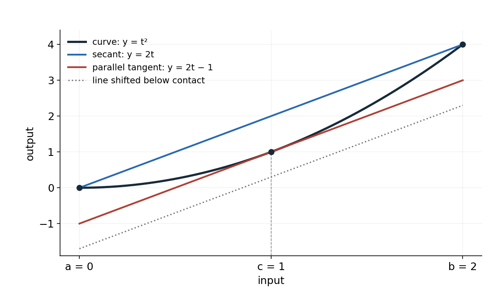
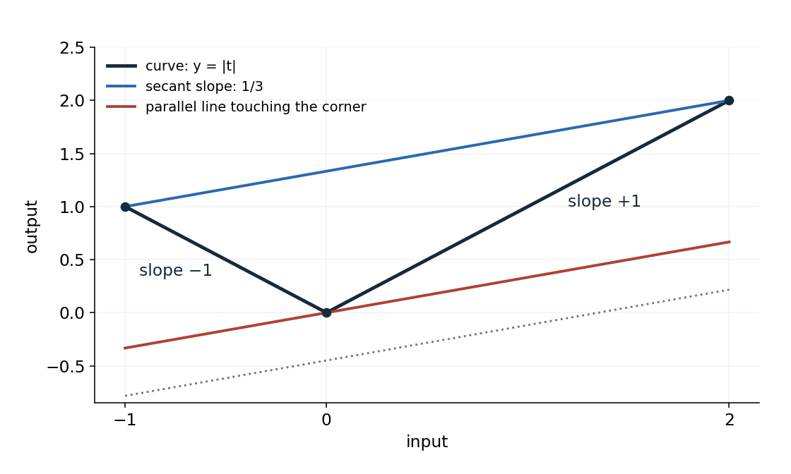
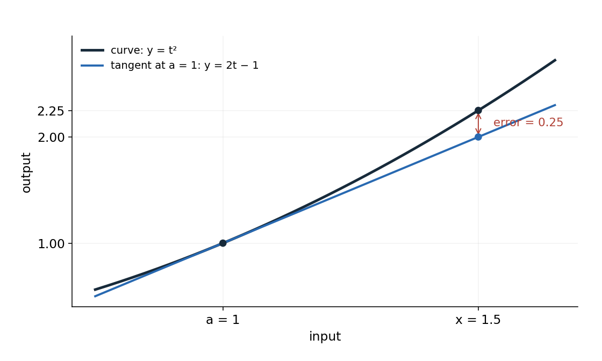

<a id="d013-main-start"></a>

Mean value theorem and inequalities

A derivative describes change at one point. The mean value theorem connects that local information to change across an entire interval. You will use it to justify increasing, decreasing and constant behaviour, distinguish an exact identity from a tangent approximation, and prove inequalities by comparing derivatives.

Read this file in order. Try P1–P5 where they occur; each has a link to a useful hint and a separate complete solution. [Hints](hints.md#d013-hints-start) and [solutions](solutions.md#d013-solutions-start) are grouped separately. The lesson uses familiar differentiation, algebra, logarithms, and induction; it supplies the additional theorem and proof premises locally. The five tasks are generated practice, not quoted examination questions.

The two hypotheses

Take real endpoints $`a\lt b`$. The interval $`[a,b]`$ contains the endpoints and every real input between them; $`(a,b)`$ excludes the endpoints. This distinction matters because the theorem requires continuity including the endpoints, but derivatives only in the interior.

Continuity at an input $`u`$ means that the function's values approach its actual value $`f(u)`$ when inputs approach $`u`$ within its domain. In limit notation this is

```math
\lim_{t\to u} f(t)=f(u).
```

At the left endpoint of an interval only approach from the right is required; at the right endpoint only approach from the left is required. To check continuity on the interval, check that there is a defined value at every input and that these limiting values agree with the assigned values. A hole, a jump or an endpoint value separated from the approaching graph fails that check. A sharp corner by itself need not fail it. Polynomials, the exponential, and the logarithm or square root on their respective domains are continuous; for a piecewise formula the joins and endpoints need particular attention.

For example, $`f(t)=t^2`$ is continuous on $`[0,2]`$: as $`t`$ approaches any $`u`$ there, $`t^2`$ approaches $`u^2`$, including the one-sided approaches at 0 and 2. In contrast, assigning value 1 at $`t=1`$ to a function that has value 0 for every $`0\le t\lt 1`$ creates an endpoint discontinuity: the approaching value is 0, whereas the assigned value is 1.

Differentiability at an interior point means that the difference quotient has a finite limit,

```math
f'(u)=\lim_{h\to0}\frac{f(u+h)-f(u)}{h}.
```

It is the tangent slope there. The left and right approaches must give the same finite value. For $`t^2`$, this derivative is $`2t`$, so it exists throughout $`(0,2)`$. For $`|t|`$ at zero, the left slope is −1 and the right slope is +1; the values join continuously, but the derivative does not exist. Thus continuity and differentiability are different checks.

The theorem and a first calculation

If $`f`$ is continuous on $`[a,b]`$ and differentiable on $`(a,b)`$, with $`a\lt b`$, then at least one interior point $`c`$ satisfies

```math
\frac{f(b)-f(a)}{b-a}=f'(c),\qquad a\lt c\lt b.
```

The fraction is the slope of the secant line joining the two endpoint points on the graph: output change divided by input change. The right-hand side is a tangent slope at one of the intermediate inputs. The theorem guarantees a match. It does not say that the matching point is the midpoint, that it is unique, or that it is the same when the endpoints change. For a straight-line function every interior point works.

To apply the theorem, first check the interval and both hypotheses. Then form the endpoint slope. If you need an actual point, solve $`f'(c)`$ equal to that slope and retain only solutions in the open interval. Often you need only the existence of the point, together with a sign or bound that holds for every possible interior point.

For $`f(t)=t^2`$ on $`[0,2]`$, the hypotheses were checked above. The endpoint slope is

```math
\frac{2^2-0^2}{2-0}=2.
```

A matching derivative satisfies $`2c=2`$, giving $`c=1`$, which is indeed between 0 and 2. The secant is $`y=2t`$. The tangent at $`(1,1)`$ is $`y-1=2(t-1)`$, or $`y=2t-1`$. Equal slopes make these lines parallel; they need not be the same line.



Figure 1. The blue secant and red tangent both have slope 2. Sliding the dotted line upward without changing its slope first brings it into contact at $`c=1`$. The general justification for such contact comes after the first attempt.

<a id="d013-main-p1"></a>

P1 — Find and interpret a matching tangent

Use the mean value theorem for $`f(x)=x^3`$ on $`[0,1]`$. Check its two hypotheses, calculate the secant slope, find every $`c`$ in $`(0,1)`$ whose tangent has that slope, and explain why the theorem guarantees at least one such $`c`$ but does not generally guarantee uniqueness. A complete response includes the interval check for any candidate $`c`$.

[Hint P1](hints.md#d013-hint-p1) · [Solution P1](solutions.md#d013-solution-p1)

Why the geometric argument works

The source lecture describes shifting lines parallel to the secant until a line touches the graph. To justify the existence and location of contact, we use one established result about continuous functions: on a closed bounded interval they attain a largest and a smallest value. “Attain” means there is an actual input in the interval with that value, not merely values approaching it. This is the extreme value theorem, supplied here as a foundation. Its proof is outside this lesson; the following argument shows how that foundation yields the mean value theorem. [A source for this foundation is given at the end.]

Write the secant's slope as $`m`$ and its line as $`\ell(t)`$:

```math
m=\frac{f(b)-f(a)}{b-a},\qquad \ell(t)=f(a)+m(t-a).
```

Subtract the line's height from the curve's height at each input:

```math
h(t)=f(t)-\ell(t).
```

This is the signed vertical gap: positive means the graph is above the secant, negative means below. The endpoints have zero gap, $`h(a)=h(b)=0`$. Subtracting a line preserves continuity and differentiability, so $`h`$ is continuous on the closed interval and differentiable inside it. Its derivative is $`h'(t)=f'(t)-m`$.

If the gap is zero everywhere, the graph is the secant itself and every interior point has derivative $`m`$. Otherwise the gap has a positive or a negative value somewhere. If it has a positive value, its attained maximum is positive and cannot be at either zero-valued endpoint. If it has a negative value, its attained minimum is negative and likewise occurs inside. In either case choose one such interior extremum and call its input $`c`$.

Why is the derivative there zero? At an interior maximum, nearby differences $`h(c+s)-h(c)`$ are nonpositive. Dividing by positive $`s`$ gives a nonpositive right difference quotient; dividing by negative $`s`$ gives a nonnegative left difference quotient. Because the derivative exists, both limiting slopes agree. A number that is both nonpositive and nonnegative is zero. The minimum case reverses both signs and has the same conclusion. Therefore

```math
0=h'(c)=f'(c)-m,
```

which proves the required slope equality. This uses the existence of the derivative, not a claim that every extremum is differentiable.

In the picture, choosing an extreme gap translates the secant vertically until it supports the curve at $`c`$. A minimum gap corresponds to moving a parallel line up from below; a maximum gap corresponds to moving one down from above. The extremum argument explains why at least one suitable contact is interior, which a sketch alone does not establish.

What can fail

For $`f(t)=|t|`$ on $`[-1,2]`$, continuity holds, but differentiability at zero fails. The endpoint slope is $`(2-1)/(2-(-1))=1/3`$. At every differentiable negative input the derivative is −1; at every positive input it is +1. Neither equals $`1/3`$, and zero has no derivative. There is no matching tangent.



Figure 2. The parallel line reaches a corner, so contact does not supply a tangent with its slope. More generally, slopes strictly between −1 and +1 give corner contact when a line is raised from below this graph. The source's phrase “no matter what its slope is” should be read within this relevant range; lines of arbitrary slope need not first touch this corner on a bounded interval.

Continuity at an endpoint cannot be dropped either. The function described earlier, zero on $`[0,1)`$ but one at 1, has derivative zero everywhere in $`(0,1)`$. Its endpoint secant slope is 1. The mismatch is possible because it is not continuous on the closed interval.

A motion interpretation

Idealise a journey as a one-dimensional route with position $`s(t)`$ in miles measured from Boston, with $`t`$ in hours. Assume $`s`$ is continuous on $`[0,3]`$ and differentiable during the journey, $`s(0)=0`$, and $`s(3)=1000`$. The lecture's 1,000-mile distance is a stipulated model value. The theorem gives

```math
s'(c)=\frac{1000-0}{3-0}=\frac{1000}{3}\ \mathrm{miles/hour},\qquad 0\lt c\lt 3.
```

Here $`s'`$ is signed velocity along the route. At this particular point it is positive, so speed, its magnitude, is also exactly $`1000/3`$ miles per hour. If $`s`$ instead denotes accumulated distance travelled, its derivative is speed wherever that distance function is differentiable, and the same conclusion follows under the corresponding hypotheses. End-to-end information establishes that the speed occurred, without telling you when. A model with jumps or interior corners in position would need its hypotheses checked anew.

From derivative signs to whole-interval behaviour

Increasing here means strictly increasing: for any two inputs $`u\lt v`$ in the interval, $`f(u)\lt f(v)`$. Decreasing means $`f(u)\gt f(v)`$. Constant means the same output at every input. The source lecture's printed definition of decreasing accidentally repeats the increasing inequality; the reversed inequality just stated is the intended one, consistent with a line of negative slope.

Suppose the theorem's hypotheses hold between any two chosen inputs in an interval. Applying it on $`[u,v]`$ and multiplying by the positive number $`v-u`$ gives

```math
f(v)-f(u)=f'(c)(v-u),\qquad u\lt c\lt v.
```

If the derivative is positive at every interior input, then $`f'(c)`$ is positive wherever the unknown point lies. The product is positive, so $`f(v)\gt f(u)`$. Since the two inputs were arbitrary, the function is strictly increasing throughout the interval.

If instead every derivative is negative, the product is negative and $`f(v)\lt f(u)`$: the function is strictly decreasing. If every derivative is zero, then the output difference is zero for every pair, so the function is constant. For example, $`q(t)=7-3t`$ has $`q'(t)=-3`$ and decreases, while $`q(t)=7`$ has derivative zero and is constant. Nonnegative derivatives give nondecreasing behaviour, allowing equal outputs; the analogous nonpositive statement gives nonincreasing behaviour.

These are sufficient conditions, not converses about strict signs. For instance, $`t^3`$ is strictly increasing although its derivative is zero at one point. Equally, finding a positive derivative at just one input does not establish increasing behaviour on an entire interval. The theorem turns an everywhere-on-the-interval derivative fact into an arbitrary-pair comparison. This is the precise bridge between the derivative's limiting, local definition and a finite change of output.

The interval condition ensures that every point between the two inputs is available. You cannot apply the theorem across a missing domain point merely because derivatives exist on both sides. On separate intervals, a zero derivative establishes a constant on each interval; it does not equate those constants across a gap.

<a id="d013-main-p2"></a>

P2 — Check the inference's reach

Decide what the mean value theorem can establish in each case, giving a calculation or counterexample rather than only naming a missing hypothesis.

(a) $`g(x)=|x-1|`$ on $`[0,3]`$: compare its secant slope with all derivative values where the derivative exists.

(b) $`r(x)=0`$ for $`x\lt 0`$ and $`r(x)=1`$ for $`x\gt 0`$, with domain all nonzero real numbers: $`r'(x)=0`$ everywhere in its domain. Is $`r`$ constant on that entire domain? Explain precisely why the constant-function consequence of the theorem does or does not apply between −1 and 1.

[Hint P2](hints.md#d013-hint-p2) · [Solution P2](solutions.md#d013-solution-p2)

Exact identity and tangent approximation

Rearranging the mean value theorem produces two equivalent forms:

```math
f(b)-f(a)=f'(c)(b-a),
```

```math
f(b)=f(a)+f'(c)(b-a).
```

Fix the starting input $`a`$ and rename the other endpoint $`x`$. When $`x\gt a`$ and the hypotheses hold on $`[a,x]`$,

```math
f(x)=f(a)+f'(c)(x-a),\qquad a\lt c\lt x.
```

For $`x\lt a`$ the same identity follows by using the ordered interval $`[x,a]`$, with $`x\lt c\lt a`$. The letter $`c`$ denotes a point whose existence depends on the function and the chosen endpoints, not one universal constant.

The tangent-line approximation uses the known slope at the starting point instead:

```math
L(x)=f(a)+f'(a)(x-a),\qquad f(x)\approx L(x)\quad\text{near }a.
```

Here the derivative at $`a`$ must exist too. Construct $`L`$ by taking the known output $`f(a)`$ and adding tangent slope times horizontal change. This is the equation of the tangent line, not an assertion that the curve follows that line exactly. Differentiability at $`a`$ licenses the local approximation: for nonzero small $`h`$,

```math
\frac{f(a+h)-L(a+h)}{h}
=\frac{f(a+h)-f(a)}{h}-f'(a)\longrightarrow0.
```

Thus the error divided by the input change tends to zero. This is a limiting statement, not a claim that the error is zero for each nonzero step, nor a numerical error guarantee for an arbitrarily chosen step.

For $`f(t)=t^2`$, start at $`a=1`$ and take $`x=1.5`$. The tangent gives $`L(1.5)=1+2(0.5)=2`$, while the exact output is $`2.25`$. The exact mean-value slope must satisfy $`2.25=1+f'(c)(0.5)`$, so it is $`2.5`$ and $`c=1.25`$. The approximation used slope 2 at the starting point; the exact identity used slope 2.5 at an intermediate point.



Figure 3. The error is the vertical difference at the same input, $`f(x)-L(x)`$. Here it is positive, so the tangent underestimates. The exact calculation also gives $`(1+h)^2-(1+2h)=h^2`$: nonzero for nonzero $`h`$, but smaller relative to $`h`$ as $`h`$ tends to zero.

The unknown point can still give useful bounds. If every interior derivative lies strictly between two numbers $`m`$ and $`M`$, then its value at the particular MVT point does too. For $`x\gt a`$, multiply by the positive $`x-a`$ and add $`f(a)`$:

```math
m\lt f'(t)\lt M\quad(a\lt t\lt x)
\quad\Longrightarrow\quad
f(a)+m(x-a)\lt f(x)\lt f(a)+M(x-a).
```

For example, for $`t^2`$ on $`[1,1.5]`$ the interior derivative satisfies $`2\lt 2t\lt 3`$. Hence $`2\lt f(1.5)\lt 2.5`$, consistent with $`2.25`$. If the derivative bounds are non-strict, the resulting output bounds are non-strict too. Multiplying by a negative input change would reverse inequalities, so order the interval and check the sign rather than copying this form unchanged.

<a id="d013-main-p3"></a>

P3 — Obtain an approximation and a bound

Let $`f(x)=\sqrt{x}`$, $`a=4`$ and $`x=4.04`$. Construct the tangent-line approximation $`L(4.04)`$. Write the exact mean-value identity with its unknown $`c`$ and interval. Use the derivative values on $`(4,4.04)`$ to prove

```math
2+\frac{0.04}{2\sqrt{4.04}}\lt \sqrt{4.04}\lt 2.01.
```

State whether $`L(4.04)`$ overestimates or underestimates the true value. Exact radical expressions are sufficient; no calculator value of $`\sqrt{4.04}`$ is needed. Your reasoning must distinguish the slope at $`a`$ from the slope at $`c`$.

[Hint P3](hints.md#d013-hint-p3) · [Solution P3](solutions.md#d013-solution-p3)

Proving inequalities with a difference function

To prove that one function's value exceeds another's, subtract the proposed lower expression. The desired inequality becomes a sign claim about the difference. A known value at a convenient input, together with a derivative sign on the interval between inputs, can establish that sign. Differentiating the two sides and comparing the derivatives alone is insufficient without a starting comparison: adding a large negative constant changes a function's values without changing its derivative.

For the exponential we use the established facts $`e^x\gt 0`$ for every real $`x`$, $`e^0=1`$, and $`(e^x)'=e^x`$. To prove $`e^x\gt 1`$ for $`x\gt 0`$, define the difference

```math
f_1(x)=e^x-1.
```

It has $`f_1(0)=0`$ and $`f_1'(x)=e^x\gt 0`$. The functions are continuous and differentiable on the intervals used. Strict increase therefore gives $`f_1(x)\gt f_1(0)=0`$ whenever $`x\gt 0`$. Adding 1 recovers the claimed inequality.

For the stronger lower bound, use

```math
f_2(x)=e^x-(1+x),\qquad f_2(0)=0,\qquad f_2'(x)=e^x-1=f_1(x).
```

We already proved that this derivative is positive for positive inputs. Apply the theorem on $`[0,x]`$ for a fixed $`x\gt 0`$: its interior point is positive, so $`f_2(x)-f_2(0)\gt 0`$. Consequently

```math
e^x\gt 1+x\qquad(x\gt 0).
```

The zero derivative of $`f_2`$ at the left endpoint causes no problem; the strict derivative hypothesis was used only in the open interval. At $`x=0`$ there is equality, so the displayed strict inequality must not include zero.

Repeat the construction once more:

```math
f_3(x)=e^x-\left(1+x+\frac{x^2}{2}\right),\qquad
f_3(0)=0,\qquad f_3'(x)=e^x-(1+x)=f_2(x).
```

The earlier positive difference is now the new derivative. Therefore $`f_3(x)\gt 0`$ for $`x\gt 0`$, giving $`e^x\gt 1+x+x^2/2`$. For the cubic lower expression, subtract $`1+x+x^2/2+x^3/6`$. Its difference from the exponential is zero at zero, and its derivative is $`f_3(x)`$, so the same argument yields

```math
e^x\gt 1+x+\frac{x^2}{2}+\frac{x^3}{3!}\qquad(x\gt 0),\qquad 3!=6.
```

Each step keeps both ingredients: the value at zero and positivity of the derivative between zero and the target. These arguments prove the stated positive-input inequalities; a different input range requires its own sign and ordering check.

For a comparison to the left of zero, the ordering matters. If a function $`d`$ is decreasing on $`[-1,0]`$ and $`d(0)=0`$, then $`x\lt 0`$ in that interval implies $`d(x)\gt d(0)=0`$. Decreasing means the value becomes smaller as the input moves to the right. A negative derivative does not mean the function's values themselves are negative. As a simple worked case, $`d(x)=-2x`$ has negative derivative and is positive to the left of zero.

<a id="d013-main-p4"></a>

P4 — Make a new comparison

Establish $`\ln(1+x)\lt x`$ first for $`x\gt 0`$ and then for $`-1\lt x\lt 0`$ by a derivative-sign comparison with the value at zero. State the domain and the equality case. Explain how a negative derivative on $`(-1,0)`$ can still establish that $`x-\ln(1+x)`$ is positive there. Give a connected argument identifying the compared function, its derivative, and the order of the two inputs used in the comparison.

[Hint P4](hints.md#d013-hint-p4) · [Solution P4](solutions.md#d013-solution-p4)

Finite bounds and the series preview

The lecture ends by pointing toward Taylor series. The pattern of lower polynomials is

```math
P_n(x)=\sum_{k=0}^{n}\frac{x^k}{k!}
=1+x+\frac{x^2}{2!}+\cdots+\frac{x^n}{n!}.
```

Here $`n`$ is a nonnegative integer specifying the degree, $`k`$ runs through the terms from zero to $`n`$, and $`0!=1`$. For $`n=0`$ this is just 1; for $`n=1`$ it is $`1+x`$. The expanded form with dots describes the larger cases. Increasing $`n`$ adds terms; it does not change the chosen value of $`x`$.

The exponential-series identity, already supplied in the starting knowledge, states that for real $`x`$,

```math
e^x=\sum_{k=0}^{\infty}\frac{x^k}{k!}.
```

The infinite sum denotes the limit of the finite partial sums as $`n`$ grows. This is a previewed, established identity here, not a consequence proved by the finite-inequality argument alone. Knowing that each finite sum lies below $`e^x`$ leaves open whether a positive gap remains in the limit. Proving that the gap tends to zero requires additional reasoning about convergence or a remainder estimate. This lesson's derivative method proves finite lower bounds without importing such a proof.

<a id="d013-main-p5"></a>

P5 — Retrieve the theorem and extend the argument

Revisit this after a break, with the earlier derivations covered if useful. State the mean value theorem and explain why its unknown $`c`$ can still establish an inequality. Then let $`P_n(x)=\sum_{k=0}^n x^k/k!`$, where $`n`$ is a nonnegative integer and $`0!=1`$. Using $`e^x\gt 0`$, $`(e^x)'=e^x`$, and the value $`e^0=1`$, prove $`e^x\gt P_n(x)`$ for every $`x\gt 0`$ by induction starting at $`n=0`$. Identify the derivative relation and the value at zero that make the induction step work. Finally, explain why these finite lower bounds alone do not prove that $`P_n(x)`$ tends to $`e^x`$ as $`n`$ tends to infinity, even though the exponential series identity is supplied in your starting knowledge. A complete response separates the finite-inequality proof from the additional convergence claim.

[Hint P5](hints.md#d013-hint-p5) · [Solution P5](solutions.md#d013-solution-p5)

The theorem statement in P5 checks recall; the induction and limiting distinction check how you use it in a new argument. A later revisit is a flexible study suggestion, not a prescribed optimal delay or a claim that completing it proves lasting mastery.

Sources and scope

This lesson covers the complete five-page PDF for MIT 18.01, Fall 2006, Lecture 14, “Mean Value Theorem and Inequalities”: theorem, geometric construction, corner counterexample, travel interpretation, equivalent forms, approximation comparison, sign consequences and exponential inequalities through the series preview. The three diagrams here are newly drawn mathematical illustrations of the source's three geometric relationships. The printed decreasing-definition error and the corner-slope qualification are identified where used.

[Original lecture PDF](https://ocw.mit.edu/courses/18-01-single-variable-calculus-fall-2006/1a211af8e4860b63b801aa3d6e7a2e95_lec14.pdf).

The extreme value theorem used as a proof foundation is stated in Jiří Lebl, Basic Analysis: Introduction to Real Analysis, section 3.3, Theorem 3.3.2, supplied by [MIT 18.100A](https://ocw.mit.edu/courses/18-100a-real-analysis-fall-2020/mit18_100af20_basic_analysis.pdf), PDF page 118. The local gap-function argument above supplies the connection to the present theorem. Neither external file is needed to attempt the exercises.

[Back to the reading route](#d013-main-start) · [Hints](hints.md#d013-hints-start) · [Solutions](solutions.md#d013-solutions-start)
