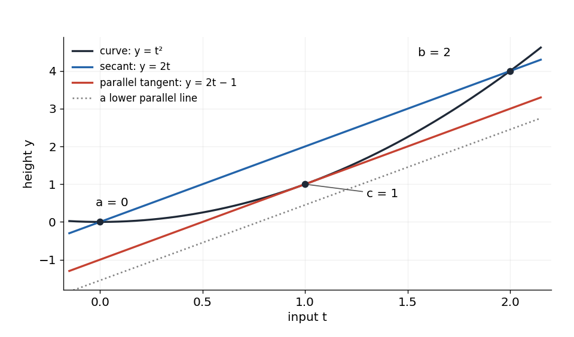
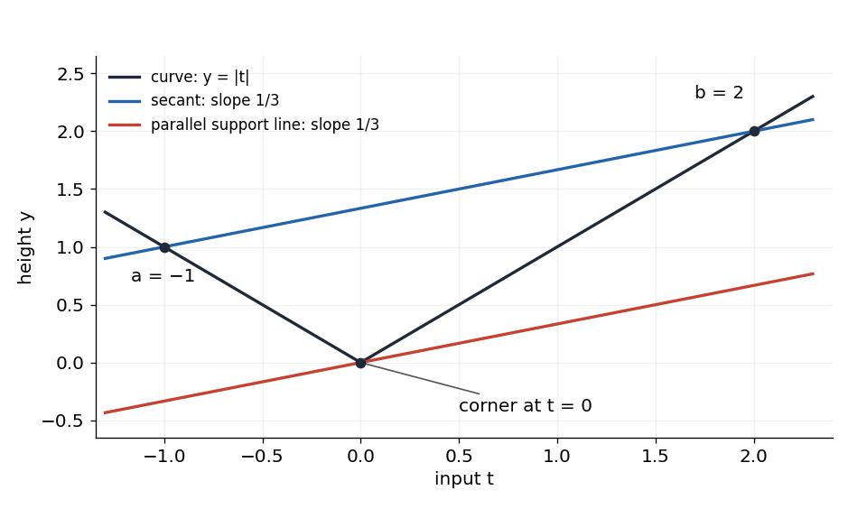
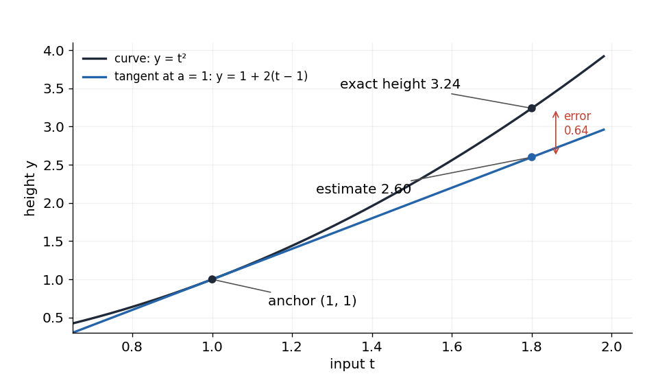

Mean value theorem and inequalities

Read this lesson in order. It explains why a derivative can control change across a whole interval, then uses that connection to prove inequalities. The six exercises have [separate hints](hints.md) and [separate complete solutions](solutions.md). Try an exercise before opening its help; return links bring you back to its prompt. All exercises and plotted examples are newly written for this lesson.

We use your existing derivative rules, tangent and secant slopes, inequalities, and elementary proof. The new work is to check the theorem's conditions and connect local slopes with finite changes. The source is [MIT 18.01, Fall 2006, Lecture 14](https://ocw.mit.edu/courses/18-01-single-variable-calculus-fall-2006/1a211af8e4860b63b801aa3d6e7a2e95_lec14.pdf), including all its figures and applications, reconstructed below.

Checking the conditions

Let $`a\lt b`$ be two finite real numbers. The closed interval $`[a,b]`$ includes both endpoints; the open interval $`(a,b)`$ excludes them. A secant joins the two graph points $`(a,f(a))`$ and $`(b,f(b))`$. Its slope measures the total change in output divided by the total change in input. The derivative $`f'(c)`$ gives a tangent slope at one input $`c`$.

We need two conditions on the function itself. Continuous means that the limiting height as the input approaches a point agrees with the actual height there: the function is defined there, the limit exists, and they agree. At an interior point $`u`$, this is $`\lim_{t\to u}f(t)=f(u)`$, approached from both sides. On $`[a,b]`$, require this at every interior point and require the corresponding approach from inside the interval at each endpoint: from the right at $`a`$ and from the left at $`b`$. Thus a hole, jump, or an endpoint placed at a different height breaks continuity. These are the [continuity conditions](https://openstax.org/books/calculus-volume-1/pages/2-4-continuity) used here.

For example, $`f(t)=t^2`$ is continuous on $`[0,2]`$: as $`t`$ tends to any input $`u`$ in that interval, $`t^2`$ tends to $`u^2=f(u)`$, including the one-sided endpoint approaches. We may use the standard fact that polynomials are continuous everywhere and rational functions are continuous wherever their denominator is nonzero. Sums and differences of continuous functions are continuous; subtracting a straight line cannot create a jump.

Differentiable at an interior input $`u`$ means that the difference quotient

```math
\frac{f(u+h)-f(u)}{h}
```

has one finite limit as nonzero $`h`$ tends to zero from either side. This limit is $`f'(u)`$. A corner with different left and right slopes therefore fails this condition. Differentiability also gives continuity at that point: write $`f(u+h)-f(u)`$ as $`h`$ times its difference quotient. The quotient tends to the finite derivative while $`h`$ tends to zero, so their product tends to zero. Interior differentiability alone says nothing about separately assigned endpoint values.

In applications below the derivative rules establish interior differentiability on their stated domains. The functions $`e^t`$ and $`\ln t`$ are differentiable on all real inputs and on positive inputs respectively, so they are continuous there too. No endpoint derivative is required by the theorem.

The theorem and a worked case

Mean value theorem (MVT). If $`f`$ is continuous on $`[a,b]`$ and differentiable on $`(a,b)`$, there is at least one $`c`$ strictly between $`a`$ and $`b`$ such that

```math
f'(c)=\frac{f(b)-f(a)}{b-a}.
```

The fraction on the right is the fixed secant slope. The derivative on the left is evaluated at some interior input. Thus at least one interior tangent is parallel to that secant. The statement guarantees existence; it neither specifies a universal midpoint nor promises a unique point.

For $`f(t)=t^2`$ on $`[0,2]`$, the continuity check was made above, and $`f'(t)=2t`$ exists throughout $`(0,2)`$. The secant slope is $`(4-0)/(2-0)=2`$. To find a suitable input, set the derivative equal to this slope: $`2c=2`$, so $`c=1`$, which belongs to $`(0,2)`$. The tangent there is $`y=1+2(t-1)=2t-1`$, whereas the secant is $`y=2t`$.



Figure 1. Blue joins the endpoint heights; red touches the curve at the interior input $`c=1`$. Moving the dotted line upward without changing its slope brings it into contact with the curve. The tangent and secant have equal slopes but different intercepts. This is a concrete reconstruction of the lecture's parallel-line picture.

<a id="d013-main-q1"></a>
Q1. For $`f(t)=t^3`$ on $`[-1,1]`$, check the mean value theorem's hypotheses, calculate the secant slope, and find every $`c`$ in $`(-1,1)`$ with that derivative. Explain what the number of answers shows about the theorem. Your response should distinguish the theorem's existence guarantee from the calculation of the points.

[Hint Q1](hints.md#d013-hints-q1) · [Solution Q1](solutions.md#d013-solutions-q1)

Why the parallel tangent must exist

The geometric idea needs a reason that contact occurs, occurs in the interior, and gives the required slope. We use one additional theorem as an explicit premise: a real function continuous on a closed, bounded interval attains a greatest and a least value there. This is the [extreme value theorem](https://openstax.org/books/calculus-volume-1/pages/4-3-maxima-and-minima). “Attains” means an actual input gives that extreme value, rather than the values only approaching it. A finite closed interval includes its endpoints and lies between finite bounds. The continuity requirement is essential. We use this theorem without proving the underlying real-analysis result.

Let $`m=(f(b)-f(a))/(b-a)`$, the secant slope. Build the secant line as $`L(t)=f(a)+m(t-a)`$: its starting height is $`f(a)`$, and its rise from $`a`$ is slope times horizontal change. It gives $`L(a)=f(a)`$ and $`L(b)=f(b)`$. Define the vertical difference

```math
h(t)=f(t)-L(t)=f(t)-f(a)-m(t-a).
```

Subtracting the line makes $`h(a)=h(b)=0`$. It preserves continuity on the closed interval and differentiability inside, and the derivative is $`h'(t)=f'(t)-m`$ because $`m`$ and $`a`$ are fixed here.

If $`h`$ is zero everywhere, the original curve is the secant line and $`f'(c)=m`$ at every interior point. Otherwise there is an interior input where $`h`$ is positive or negative. If positive, its attained greatest value is positive; neither endpoint can give it, because both have value zero. If negative, its attained least value is negative and likewise occurs in the interior. In either case $`h`$ has an interior extremum at some $`c`$.

At an interior maximum, nearby values satisfy $`h(c+u)-h(c)\le 0`$. Dividing by positive $`u`$ gives a quotient at most zero; dividing by negative $`u`$ gives one at least zero. Since the derivative exists, both one-sided limits give the same number. That number must be both at most and at least zero, hence $`h'(c)=0`$. At a minimum the two inequalities reverse and the same conclusion follows. Therefore

```math
0=h'(c)=f'(c)-m,
\qquad f'(c)=\frac{f(b)-f(a)}{b-a}.
```

This completes the proof under the stated extreme-value premise. It is the subtract-a-line version of [the standard Rolle/MVT argument](https://ocw.mit.edu/courses/18-100a-real-analysis-fall-2020/mit18_100af20_lec192.pdf), Lecture 19, theorems 4–7. Geometrically, the extremum of the vertical difference is where a parallel line first touches from below or above. In Figure 1, $`h(t)=t^2-2t=(t-1)^2-1`$ has minimum $`-1`$ at $`t=1`$, so lowering the secant by one unit produces the tangent. The proof handles the opposite shape by taking a maximum instead.

What a failed condition changes

For $`f(t)=|t|`$ on $`[-1,2]`$, the secant slope is $`(2-1)/(2-(-1))=1/3`$. The graph is continuous, but its derivative is $`-1`$ when $`t\lt 0`$ and $`1`$ when $`t\gt 0`$. At zero the left and right difference quotients are $`-1`$ and $`1`$, so no derivative exists there. No interior derivative equals $`1/3`$.



Figure 2. The red line touches the corner, but touching alone does not supply a derivative. Here its slope $`1/3`$ lies between the two branch slopes. The differentiability step of the proof fails exactly at the interior minimum of the vertical difference. The theorem has not given a wrong answer: its hypotheses are not met.

<a id="d013-main-q2"></a>
Q2. Define $`j(t)=t`$ for $`0\le t\lt 1`$ and $`j(1)=2`$. On $`[0,1]`$, calculate the endpoint secant slope and every interior derivative value. Decide whether the mean value theorem applies and explain the exact condition that fails using a one-sided limit. Your response should explain why differentiability at every interior point alone is insufficient.

[Hint Q2](hints.md#d013-hints-q2) · [Solution Q2](solutions.md#d013-solutions-q2)

An average speed must occur somewhere

Use the lecture's idealised trip: 1,000 miles from Boston to Chicago in exactly 3 hours. Let $`s(t)`$ be distance along a fixed route from the start, with $`t`$ in hours. Assume continuous motion on $`[0,3]`$, differentiability during the trip, and travel only forward, so this route coordinate's derivative is the speed. These are model assumptions, not a claim about every real journey or about straight-line distance from Boston.

Since $`s(0)=0`$ and $`s(3)=1000`$, the theorem gives some $`0\lt c\lt 3`$ with

```math
s'(c)=\frac{s(3)-s(0)}{3-0}=\frac{1000}{3}\ \mathrm{miles/hour}.
```

An instantaneous speed equals the trip's average speed at least once. The theorem does not identify the time. For a signed position with reversals, the same theorem would instead equate instantaneous velocity with average velocity; distance travelled and displacement must not be exchanged.

Exact change and tangent-line approximation

Multiplying the MVT equation by the positive interval length gives two equivalent forms:

```math
f(b)-f(a)=f'(c)(b-a),
\qquad f(b)=f(a)+f'(c)(b-a).
```

Rename the endpoint $`b`$ as $`x`$, with $`x\gt a`$:

```math
f(x)=f(a)+f'(c)(x-a),\qquad a\lt c\lt x.
```

This exact equality uses the derivative at some intermediate input depending on the function and the two endpoints. The tangent line at the known anchor $`a`$ instead uses the particular slope $`f'(a)`$:

```math
f(x)\approx f(a)+f'(a)(x-a)\qquad (x\text{ near }a).
```

The latter is a local estimate, assuming the derivative at the anchor exists. The theorem itself did not require that endpoint derivative. Replacing $`f'(c)`$ by $`f'(a)`$ is not an algebraic identity.

For $`f(t)=t^2`$ anchored at $`a=1`$, write $`x=1+h`$. Expanding gives $`f(1+h)=1+2h+h^2`$. The tangent estimate is $`1+2h`$, so the signed error, exact minus estimated value, is $`h^2`$. For $`h=0.1`$ this is $`0.01`$; for $`h=0.8`$ it is $`0.64`$. This example explains both why a small change can give a useful estimate and why the approximation needs its scale considered.



Figure 3. The vertical arrow measures the error at the same input $`x=1.8`$; it is not a horizontal displacement. For this example the exact MVT slope is $`(3.24-1)/0.8=2.8`$, attained at $`c=1.4`$, while the anchor tangent slope is $`2`$. The figure reconstructs the source's comparison of the curve with its tangent estimate.

More generally, subtracting the estimate from the exact formula gives $`f(x)-[f(a)+f'(a)(x-a)]=[f'(c)-f'(a)](x-a)`$. This expresses what slope change creates the error; it does not locate $`c`$ or bound the error without additional information. If $`x\lt a`$, apply the theorem on $`[x,a]`$ and rearrange: the same exact change formula holds, now with $`x\lt c\lt a`$.

<a id="d013-main-q3"></a>
Q3. For $`f(t)=t^3`$, use $`a=1`$ and $`x=2`$. Calculate the tangent-line estimate at $`x`$, the exact value, the signed error $`f(x)-[f(a)+f'(a)(x-a)]`$, and a point $`c`$ giving the exact mean-value formula. Is the midpoint $`c=(a+x)/2`$ valid here? Justify using the derivative equation, not a sketch.

[Hint Q3](hints.md#d013-hints-q3) · [Solution Q3](solutions.md#d013-solutions-q3)

From derivative signs to whole-interval behavior

A function is strictly increasing on an interval if every pair $`a\lt b`$ in it satisfies $`f(a)\lt f(b)`$. It is strictly decreasing if every such pair satisfies $`f(a)\gt f(b)`$. Constant means every input in the interval has the same output. The source's printed decreasing definition repeats the increasing inequality; the decreasing comparison must point the other way.

Suppose $`f`$ is continuous on an interval and differentiable at its interior points. Pick any $`a\lt b`$ in that interval. The whole segment between them belongs to the interval, and the theorem gives

```math
f(b)-f(a)=f'(c)(b-a),\qquad a\lt c\lt b.
```

If the derivative is positive at every interior point, then $`f'(c)\gt 0`$ and $`b-a\gt 0`$. Their product is positive, so $`f(b)\gt f(a)`$. Because the pair was arbitrary, this proves strict increase throughout the interval. A derivative defined through arbitrarily small changes has now controlled a finite difference, which is the main role of the theorem here.

For example, $`F(t)=t+t^3`$ has $`F'(t)=1+3t^2\gt 0`$ for every real input. Thus any later input has a larger output, even across a long interval; testing a few plotted points would not prove that universal statement.

A negative derivative throughout the interior gives strict decrease by the same finite-difference equation. For example $`G(t)=-e^t`$ has $`G'(t)=-e^t\lt 0`$, so it decreases on the real line. Exercise Q4 asks for the sign argument in full.

If instead $`f'(t)=0`$ at every interior point, the equation gives $`f(b)-f(a)=0(b-a)=0`$ for every pair. Thus $`f`$ is constant. This is a statement about the entire interval, not one stationary point: $`t^2`$ has derivative zero at zero but is not a constant function. Likewise strict positivity is sufficient for increase, not necessary at every point; $`t^3`$ is strictly increasing even though its derivative is zero at zero. For $`a\lt b`$, the factorization $`b^3-a^3=(b-a)(a^2+ab+b^2)`$ proves this: the first factor is positive, and $`a^2+ab+b^2=(a+b/2)^2+3b^2/4`$ is positive unless both inputs are zero, impossible when they are distinct.

<a id="d013-main-q4"></a>
Q4. Let $`f`$ be continuous on an interval $`I`$ and differentiable at each interior point of $`I`$, with $`f'(t)\lt 0`$ there. Prove that $`f`$ is strictly decreasing by comparing arbitrary $`a\lt b`$ in $`I`$ and stating why the mean value theorem applies on $`[a,b]`$. Then consider $`k(t)=0`$ for $`t\lt 0`$ and $`k(t)=1`$ for $`t\gt 0`$, with domain all nonzero real numbers. Its derivative is zero everywhere on its domain. Explain why it need not be one constant on the whole domain, and state what can correctly be concluded on each side of zero.

[Hint Q4](hints.md#d013-hints-q4) · [Solution Q4](solutions.md#d013-solutions-q4)

Proving inequalities by comparing with an anchor

To prove one expression exceeds another, form their difference in the desired order. If that difference starts at zero and then increases, it is positive. The anchor value matters: a positive derivative alone says values increase, not that they are positive. For instance $`t-100`$ increases but remains negative for $`t\lt 100`$.

We take $`e^t\gt 0`$, $`e^0=1`$, and $`(e^t)'=e^t`$ from the exponential facts already available. First define $`r_1(t)=e^t-1`$. This difference has $`r_1(0)=0`$ and $`r_1'(t)=e^t\gt 0`$. For any fixed $`x\gt 0`$, apply the increase result on $`[0,x]`$ to obtain $`r_1(x)\gt r_1(0)=0`$. Thus $`e^x\gt 1`$ for $`x\gt 0`$.

Now compare the exponential with its tangent line at zero. Define $`r_2(t)=e^t-(1+t)`$. The new difference again has $`r_2(0)=0`$, and

```math
r_2'(t)=e^t-1=r_1(t)\gt 0\qquad(t\gt 0).
```

The sign is licensed by the inequality just proved. On the interior $`(0,x)`$ the derivative is positive, so $`r_2(x)\gt r_2(0)=0`$. We have proved $`e^x\gt 1+x`$ for every $`x\gt 0`$. No derivative sign at the endpoint zero was needed; indeed $`r_2'(0)=0`$.

Add a quadratic term by defining $`r_3(t)=e^t-(1+t+t^2/2)`$. Its value at zero is zero, and

```math
r_3'(t)=e^t-(1+t)=r_2(t)\gt 0\qquad(t\gt 0).
```

The same anchor comparison gives $`e^x\gt 1+x+x^2/2`$ for $`x\gt 0`$. For the cubic polynomial let $`r_4(t)=e^t-(1+t+t^2/2+t^3/6)`$. Differentiation gives $`r_4'(t)=r_3(t)\gt 0`$ on the positive half-line, and $`r_4(0)=0`$. Therefore

```math
e^x\gt 1+x+\frac{x^2}{2}+\frac{x^3}{6}\qquad(x\gt 0).
```

Each new derivative is the preceding difference. This is why the coefficients contain factorials: $`3!=3\cdot2\cdot1=6`$, and differentiating $`t^3/3!`$ gives $`t^2/2!`$. All these inequalities are equalities at zero. Their proofs above are for positive inputs; do not carry a derivative-sign conclusion to negative inputs without checking the sign and the direction from the anchor.

<a id="d013-main-q5"></a>
Q5. For every $`x\gt 0`$ prove $`e^x\gt 1+x+x^2/2+x^3/6+x^4/24`$ by continuing the derivative-and-anchor chain. Identify the previously established inequality that gives the sign of your derivative, and handle $`x=0`$ separately. Explain why proving every finite polynomial lies below $`e^x`$ would not, by itself, prove that their infinite sum equals $`e^x`$.

[Hint Q5](hints.md#d013-hints-q5) · [Solution Q5](solutions.md#d013-solutions-q5)

The lecture ends by looking ahead to the exponential series:

```math
e^x=1+x+\frac{x^2}{2!}+\frac{x^3}{3!}+\cdots
=\sum_{n=0}^{\infty}\frac{x^n}{n!}.
```

Here $`0!=1`$ and the infinite sum means the limit of the finite partial sums. This equality, valid for real $`x`$, is already supplied in the Further Mathematics Maclaurin baseline; a later Taylor-series treatment explains its justification. It has not been proved merely by establishing the finite lower bounds above. Being below a target, even at every stage, does not show that the remaining gap tends to zero.

A changed application and later revisit

For a fresh comparison, choose which expression to subtract so that a positive difference gives the desired conclusion. Then check its domain, find a convenient anchor, and establish the derivative sign on the entire interval connecting the anchor to the desired input. If the input is on the other side of the anchor, the order of the comparison changes. This method uses derivatives and a known value; it need not calculate the unknown MVT point.

<a id="d013-main-q6"></a>
Q6. Without using an infinite series, establish for every $`x\gt 0`$ the two-sided bound $`x/(1+x)\lt \ln(1+x)\lt x`$. Choose the difference functions and the interval on which to compare them with zero, showing derivatives, signs and anchor values. Then decide whether the upper inequality $`\ln(1+x)\lt x`$ remains true for $`-1\lt x\lt 0`$, and justify the direction of the comparison with the anchor. A complete response must account for the domain, strictness and the endpoint $`x=0`$.

[Hint Q6](hints.md#d013-hints-q6) · [Solution Q6](solutions.md#d013-solutions-q6)

For later study, revisit Q4 without looking at the theorem's proof, then retry Q6 without its help. The first checks whether you can reconstruct the connection from derivative sign to finite change; the second checks applying it to a different comparison and input range. A later day is one possible spacing choice, to adjust to your needs rather than a fixed optimal schedule. Use the separate solutions to locate the first missing condition or inference in your attempt.
