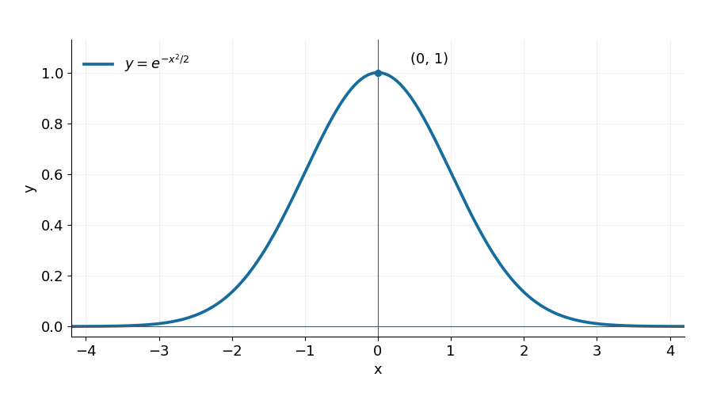
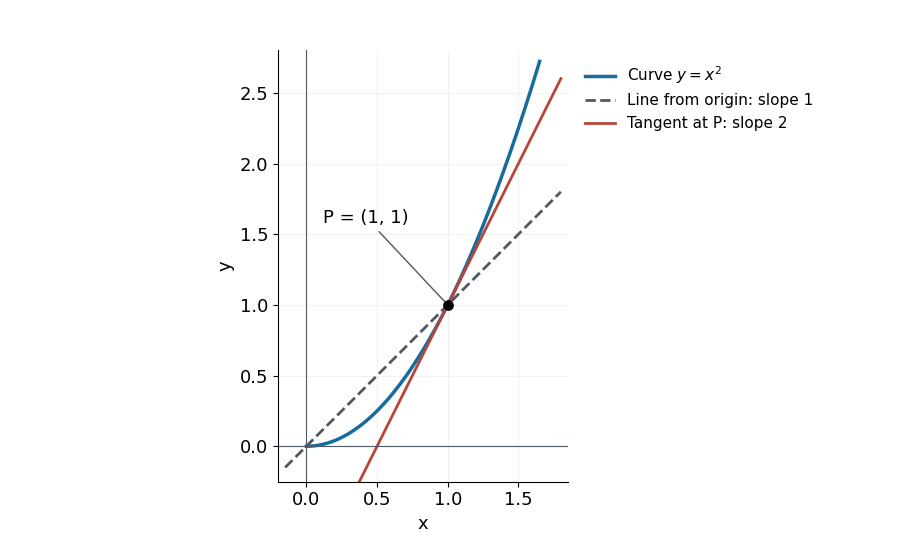
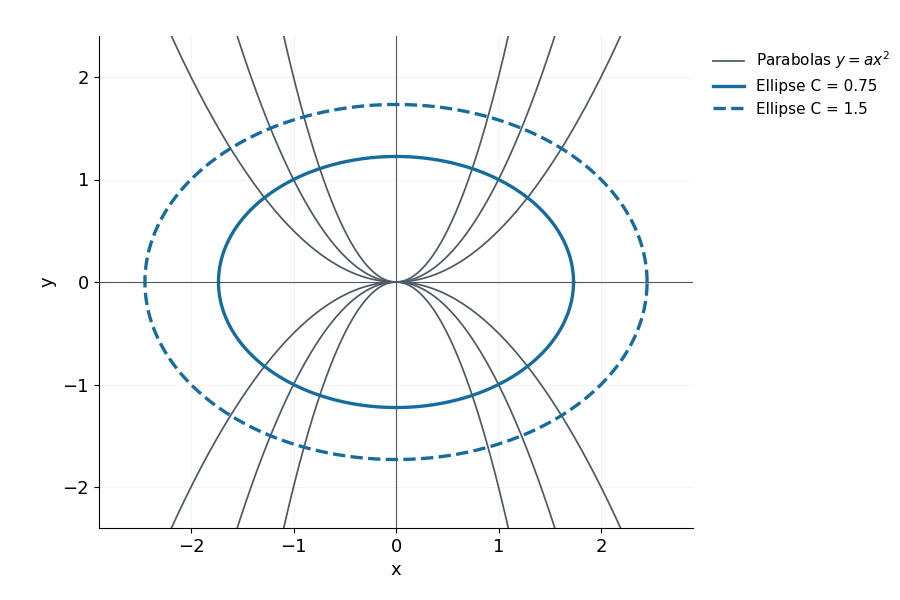

<a id="d015-r36-main-start"></a>

Differential equations: from a slope rule to a curve

MIT 18.01, Lecture 16 study notes

Read this file in order. Try Q1–Q4 where they appear; Q5 revisits the main decisions after the worked route. Each question links to a hint and a complete solution in separate files. Those files also link back to the question. All tasks are generated for these notes.

The aim is to turn a rule for a curve's slope into an equation for the curve, then check the equation and its domain. We use the familiar derivative, antiderivative, chain rule, logarithm laws, and perpendicular-line slopes. The extra care here concerns what is being solved for, what division can discard, and which part of an implicit curve is a solution.

Section 1. The unknown is a function

An ordinary differential equation relates a function of one independent variable to its derivatives. Here x is the independent variable and $`y=y(x)`$ is the unknown function. A first-order equation uses its first derivative $`y'=dy/dx`$ and no higher derivative. A solution on an interval is a differentiable function that makes the equation true at every point of that interval. A value at one point, such as $`y(0)=1`$, is an initial condition; it selects a curve from the possibilities.

When the derivative depends only on x, solving is direct antidifferentiation. For example,

```math
y'=3x^2+1,\qquad y(0)=2
```

has $`y=x^3+x+C`$. The condition gives $`C=2`$, and differentiating $`x^3+x+2`$ returns the given derivative. The integral sign denotes a family of antiderivatives; the arbitrary constant is part of the answer until a condition fixes it.

The lecture also writes an equation using an operator:

```math
\left(\frac{d}{dx}+x\right)y=0.
```

The expression in parentheses tells us what to do to the function on its right: differentiate it, then add x times that function. Thus its expanded form is $`y'+xy=0`$. For instance, applying the same operator to $`u(x)=x^2`$ gives $`2x+x^3`$. Conversely, to write “the derivative of y plus x times y is zero” compactly, put the two operations in the parentheses and apply them to y. The operator is not multiplication by an ordinary number, and the displayed zero means the resulting function is zero throughout the solution interval.

The original notes associate this operator with quantum mechanics. More precisely, in a dimensionless coordinate it is proportional to the harmonic oscillator's annihilation operator; that name is context, not an extra premise needed for the calculus. The coordinate scaling and operator are given in [MIT 5.61, Lecture 9, pages 2–3 and 6](https://ocw.mit.edu/courses/5-61-physical-chemistry-fall-2017/ca914a031c803bf4728976edf1852390_MIT5_61F17_lec9.pdf).

Section 2. Separate the variables, and keep the excluded case

The operator equation becomes $`y'=-xy`$. Its right side contains both x and the unknown y, so merely integrating it as if y were constant would change the problem. On an interval where y is nonzero, divide by y:

```math
\frac{y'}{y}=-x.
```

The chain rule identifies the left side as the derivative of $`\ln|y(x)|`$. Integrating with respect to x therefore gives

```math
\ln|y|=-\frac{x^2}{2}+C.
```

The familiar separated notation expresses the same step:

```math
\frac{dy}{y}=-x\,dx,\qquad
\int\frac{1}{y}\,dy=-\int x\,dx.
```

The left integral is with respect to y and the right one with respect to x. Substitution, or the chain-rule statement above, licenses this notation. Two integration constants would enter only through their difference, which can be renamed C; one arbitrary constant is sufficient.

Exponentiating and recovering the sign gives

```math
|y|=e^C e^{-x^2/2},\qquad y=a e^{-x^2/2},\qquad a=\pm e^C.
```

This calculation has covered the nonzero solutions on such an interval. Its coefficient a can be positive or negative. It has not covered $`y=0`$, because that case was excluded by division. Check that case in the original equation: both $`y'`$ and $`-xy`$ are zero. It is a solution too, so the family can include $`a=0`$.

A useful independent check also shows why this family accounts for every differentiable solution on an interval. For any solution of $`y'+xy=0`$, the product rule gives

```math
\frac{d}{dx}\left(e^{x^2/2}y\right)
=e^{x^2/2}(xy+y')=0.
```

A function with zero derivative on an interval is constant, so $`e^{x^2/2}y=a`$. This argument never divides by y. It therefore covers the zero solution and rules out an extra solution obtained by changing a partway through an interval.

At x=0 the exponential equals 1, so $`y(0)=a`$. In particular, the lecture's condition $`y(0)=1`$ gives the curve below. Its value is always positive, it is even because its formula contains $`x^2`$, and its slope $`-xy`$ is positive to the left of zero and negative to the right. The graph rises to 1 and then falls towards zero; it never reaches zero at a finite x.



Figure 1. The particular solution $`y=e^{-x^2/2}`$. Multiplying by positive a rescales the height; negative a also reflects it across the x axis. The formula and slope signs explain the picture.

<a id="d015-r36-main-q1"></a>

Q1

A proposed argument says: “After dividing by y, exponentiation gives a nonzero coefficient, so the equation has no solution with y(0)=0.” For the equation $`y'=-xy`$, decide whether that conclusion is valid. Give and check a solution for $`y(0)=0`$ and a solution for $`y(0)=-2`$. Your explanation should identify exactly which operation excludes a case and distinguish an excluded derivation step from an impossible solution.

[Hint Q1](hints.md#d015-r36-hint-q1) · [Solution Q1](solutions.md#d015-r36-solution-q1)

Section 3. The general separated form and the choice of a branch

An equation is separable when its right side can be written as a function of x times a function of y:

```math
\frac{dy}{dx}=f(x)g(y).
```

Here f and g name the two functions, not constants. For the previous equation a consistent choice is $`f(x)=-x`$ and $`g(y)=y`$. First check the original equation's domain and any values $`y=b`$ for which $`g(b)=0`$. Where the original right side is defined, a constant function at such a value has $`y'=0=f(x)g(b)`$ and is a solution.

For a part of a solution where $`g(y)\ne0`$, set $`h(y)=1/g(y)`$. Choose antiderivatives H and F satisfying $`H'(y)=h(y)`$ and $`F'(x)=f(x)`$ on the intervals being used. For example, continuous f and continuous nonzero g on their respective intervals supply these antiderivatives. Then

```math
h(y)\frac{dy}{dx}=f(x),\qquad
\frac{d}{dx}H(y(x))=\frac{d}{dx}F(x),\qquad
H(y)=F(x)+C.
```

The middle equality is the chain rule. The last relation is an implicit solution: it constrains x and y together without yet giving y alone. On a differentiable branch where $`g(y)\ne0`$, differentiating this relation recovers $`y'=f(x)g(y)`$. The conditions used in separating must still hold.

If H is one-to-one on a selected interval of y values and $`F(x)+C`$ lies in its range, we can undo H:

```math
y=H^{-1}(F(x)+C).
```

$`H^{-1}`$ means the inverse function, not $`1/H`$. Read this as: calculate $`F(x)+C`$, then find the y in the selected interval whose H-value equals that number. If H takes the same value at two possible y values, selecting an inverse requires a branch. A branch is a chosen portion of the relation that gives one y for each allowed x. Sometimes the implicit relation is the more useful final answer.

For a concrete branch choice, consider $`y'=x/y`$ with $`y(0)=-2`$. The original equation requires $`y\ne0`$. Multiplication by y, followed by integration, gives

```math
y\,dy=x\,dx,\qquad
\frac{y^2}{2}=\frac{x^2}{2}+C.
```

The condition makes $`C=2`$, so $`y^2=x^2+4`$. Here $`H(y)=y^2/2`$ is not one-to-one across both positive and negative y. On the negative branch its inverse is the negative square root, and the required solution is

```math
y=-\sqrt{x^2+4}.
```

It is defined and negative for every real x. Its derivative is $`-x/\sqrt{x^2+4}=x/y`$, and its initial value is −2. The positive root solves the differential equation but fails the initial condition. The constant zero function is unavailable here because the original expression $`x/y`$ is undefined at y=0.

Separation thus involves four decisions: keep the original domain, inspect any zeros before division, integrate a valid separated relation, and choose a branch or interval consistent with the data. The divided calculation covers only where its divisor is nonzero. If a proposed solution reaches a zero of that divisor, check the original equation there instead of assuming the divided formula decides what can happen.

<a id="d015-r36-main-q2"></a>

Q2

Consider $`y'=x(1-y)`$. Find a solution satisfying $`y(0)=2`$ and separately one satisfying $`y(0)=1`$. Show the separated integral for the nonconstant case, retain the constant case if it satisfies the original equation, and verify both final formulas. State on which side of $`y=1`$ the first solution stays for finite real x and justify that claim.

[Hint Q2](hints.md#d015-r36-hint-q2) · [Solution Q2](solutions.md#d015-r36-solution-q2)

Section 4. Build an equation from a geometric condition

At a point $`(x,y)`$ with $`x\ne0`$, the slope of the line from the origin to the point is $`y/x`$. The tangent slope of the unknown graph is $`y'`$. Requiring the tangent slope to be twice that line's slope translates directly into

```math
y'=\frac{2y}{x},\qquad x\ne0.
```

For example, at $`(1,1)`$ the origin-to-point line has slope 1, while the required tangent has slope 2. In Figure 2 the line from the origin and the tangent meet at that point, but they are different lines. The condition compares slopes, not angles: twice the slope does not generally mean twice the angle.



Figure 2. A member of the required family with its origin-to-point line and tangent. Equal horizontal and vertical scales preserve the geometric angles.

On an interval where $`x\ne0`$ and $`y\ne0`$, separation gives

```math
\frac{dy}{y}=2\frac{dx}{x},\qquad
\ln|y|=2\ln|x|+C.
```

Because $`e^{2\ln|x|}=|x|^2=x^2`$, recovering the sign gives $`y=ax^2`$ with nonzero a. The separately checked zero solution adds $`a=0`$. Direct differentiation confirms

```math
y'=2ax=\frac{2ax^2}{x}\qquad (x\ne0).
```

The coefficient changes the curve: a positive a gives an upward parabola, a negative a a downward one, and zero gives the x axis. Values such as 1, 2, −1, −2 and 100 are all allowed. The coefficient is fixed along any one solution interval. One can also check completeness without dividing by y: using the quotient rule, the derivative of $`y/x^2`$ is zero whenever $`y'=2y/x`$ and $`x\ne0`$.

The formulas for the parabolas extend smoothly through the origin. The differential equation does not: its right side still divides by x. Its solution intervals lie entirely to one side of zero. Nothing in the equation links a coefficient chosen for $`x\lt 0`$ to one chosen for $`x\gt 0`$ unless an extra condition does so. A valid initial point $`(x_0,y_0)`$ with $`x_0\ne0`$ gives $`a=y_0/x_0^2`$ on its interval.

<a id="d015-r36-main-q3"></a>

Q3

On $`x\lt 0`$, a curve's tangent slope is three times the slope of the line from the origin to the point on the curve. The curve passes through $`(-1,2)`$. Construct its differential equation and find its formula on that interval. Check the two slopes at the given point and explain why substituting x=0 into a smooth extension of your formula would not make the original slope equation defined there.

[Hint Q3](hints.md#d015-r36-hint-q3) · [Solution Q3](solutions.md#d015-r36-solution-q3)

Section 5. Curves that meet the parabolas at right angles

Perpendicular curves have perpendicular tangent lines at their intersection. For finite nonzero slopes m and n, this means $`mn=-1`$, so $`n=-1/m`$. A horizontal and a vertical tangent are the exceptional perpendicular pair; the reciprocal formula cannot encode a vertical line as a finite derivative.

For the family $`y=ax^2`$, differentiating gives $`y'=2ax`$. At any point with $`x\ne0`$, use $`a=y/x^2`$ to express its slope as $`2y/x`$. This eliminates the family parameter and tells us the slope of the particular member through the point. Therefore a perpendicular family must have slope

```math
\frac{dy}{dx}=-\frac{1}{2y/x}=-\frac{x}{2y}\qquad (x\ne0, y\ne0).
```

Separate and integrate:

```math
y\,dy=-\frac{x}{2}\,dx,\qquad
\frac{y^2}{2}=-\frac{x^2}{4}+C,\qquad
\frac{x^2}{4}+\frac{y^2}{2}=C.
```

The last equation describes a family of implicit curves. For $`C\gt 0`$, division by C rewrites it as

```math
\frac{x^2}{4C}+\frac{y^2}{2C}=1.
```

An ellipse centred at the origin with horizontal semiaxis A and vertical semiaxis B has equation $`x^2/A^2+y^2/B^2=1`$. A semiaxis is the distance from the centre to an end of the curve along that axis. This form can be constructed from the unit circle $`u^2+v^2=1`$ by setting $`x=Au`$ and $`y=Bv`$: scale horizontal and vertical coordinates separately. Here $`A=2\sqrt C`$ and $`B=\sqrt{2C}`$, so $`A/B=\sqrt2`$. The horizontal semiaxis is the longer one. If $`C=0`$ the relation is just the origin, not a solution curve on an interval; if $`C\lt 0`$ it has no real points.

For a worked initial point, take $`(1,1)`$. Substitution gives $`C=3/4`$, hence $`x^2+2y^2=3`$. At this point the parabola's slope is 2 and the perpendicular curve's slope is $`-1/2`$; their product is −1. At other intersections with $`x\ne0`$ and $`y\ne0`$, the same check is

```math
\left(\frac{2y}{x}\right)\left(-\frac{x}{2y}\right)=-1.
```



Figure 3. Parabolas and ellipses drawn on equal axis scales. The full geometric curves are shown; the differential-equation domain restrictions still apply. The zero member of the parabola family lies on the x axis.

An ellipse is a useful implicit answer precisely because it includes both its upper and lower halves. Solving for y gives

```math
y=\pm\sqrt{2C-\frac{x^2}{2}}.
```

The two signs label two branches, not permission to choose either sign independently at each x. For $`C\gt 0`$, each branch solves $`y'=-x/(2y)`$ on $`-2\sqrt C\lt x\lt 2\sqrt C`$; y is nonzero there. The branch through $`(1,1)`$ uses the plus sign. For perpendicular intersections with the original slope equation, further restrict to $`x\ne0`$; the relevant part through that point is on $`0\lt x\lt \sqrt3`$.

At the left and right ends of an ellipse, y=0 and its tangent is vertical, so a finite $`dy/dx`$ description fails. Geometrically it is perpendicular to the horizontal zero member of the parabola family there. At the top and bottom of an ellipse, x=0, and no finite-a parabola passes through that nonzero y. Thus the picture does not assert a perpendicular intersection at every point on the coordinate axes. The whole ellipse is a geometric continuation of the local solution branches, not one differentiable function y of x around the whole loop.

<a id="d015-r36-main-q4"></a>

Q4

Find the curve through $`P=(2,-1)`$ that meets the family $`y=ax^2`$ at right angles wherever both slope expressions are defined. Give its implicit equation and its horizontal and vertical semiaxis lengths. Then give the branch containing P and the maximal open x interval containing x=2 on which that branch has both $`x\gt 0`$ and $`y\lt 0`$. Verify the perpendicular slopes at P. Explain why the entire implicit curve cannot be described by that single branch.

[Hint Q4](hints.md#d015-r36-hint-q4) · [Solution Q4](solutions.md#d015-r36-solution-q4)

Section 6. Choose and reconnect the method

If the derivative depends only on x, direct antidifferentiation is enough. If it factors into $`f(x)g(y)`$, separation is available where the divisor is nonzero, with excluded cases checked separately. If the problem begins with a curve family or a slope condition, first construct the derivative equation. Solving the resulting equation is a second step. Finally, an initial condition, branch, and valid interval complete the answer; differentiation checks it.

The following later task combines those choices. Part (a) revisits a familiar decision; part (b) transfers the perpendicular-family reasoning to a changed shape. If a step is blocked, retain the part you can justify and use the matched hint before the full solution.

<a id="d015-r36-main-q5"></a>

Q5

Return to this task after a break if useful, starting without the worked examples. The timing is adjustable. In each part, identify what determines the slope before choosing your first solving step.

(a) Find $`y(x)`$ when $`y'=2x`$ and $`y(1)=3`$. Explain why direct antidifferentiation is sufficient.

(b) A family is given by $`y=a/x`$ on $`x\gt 0`$, with a an arbitrary real constant. Find a curve through $`(1,2)`$ that meets these curves at right angles wherever both slopes are nonzero and finite. Derive the required slope from the family, give an implicit equation and the branch through the given point for $`x\gt 0`$, and verify the perpendicularity at $`(1,2)`$. No name for the resulting conic is required. A complete response should connect the family, the slope equation, integration, branch selection and the check.

[Hint Q5](hints.md#d015-r36-hint-q5) · [Solution Q5](solutions.md#d015-r36-solution-q5)

Section 7. Source context and corrections

These notes follow [David Jerison's MIT 18.01 Fall 2006 Lecture 16](https://ocw.mit.edu/courses/18-01-single-variable-calculus-fall-2006/resources/lec16/), including its three geometric figures, redrawn here. Two slips in the original are corrected in the reasoning above. On printed page 2, the Gaussian example needs $`f(x)=-x`$, consistent with $`F(x)=-x^2/2`$. On printed page 3, the member labelled a=−2 is $`y=-2x^2`$. Each correction can be checked by differentiation and substitution.

The final page of the original also announces the course's Exam 2 review: linear and quadratic approximations, curve sketching, maxima and minima, related rates, antiderivatives and separation of variables, and the mean value theorem. It warns students that the second exam will be harder than the first and points to a separate review sheet. That is historical course guidance; this lecture's mathematical route is the differential-equation material above.

[Grouped hints](hints.md#d015-r36-hint-start) · [Grouped complete solutions](solutions.md#d015-r36-solution-start) · [Return to the beginning](#d015-r36-main-start)
