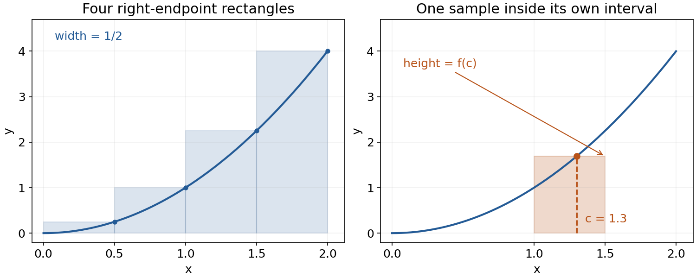
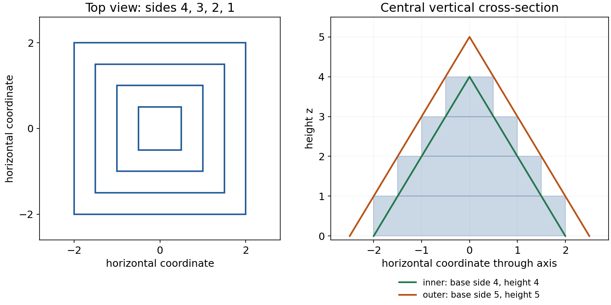
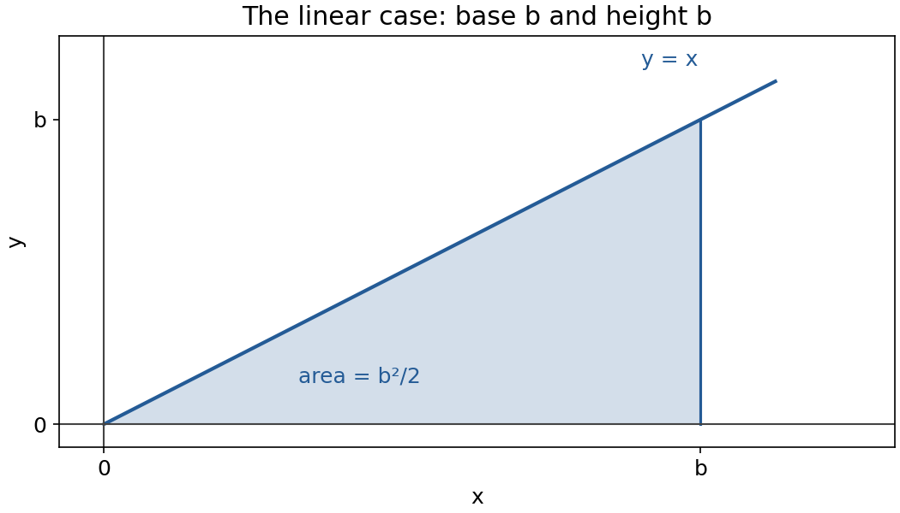
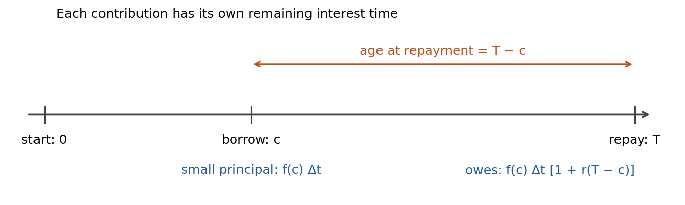

<a id="d016-main-start"></a>

Definite integrals: from small contributions to a total

Read this page in order and attempt P1–P5 where they occur. P6 is a later return to the main ideas. The [hints](hints.md#d016-hints-start) are grouped separately from the [complete solutions](solutions.md#d016-solutions-start); each help item links back to its prompt. You can use a partial attempt to locate the next useful step.

The goal is to construct an integral from what one small piece contributes, justify the limiting process in the cases used here, and interpret the result. We will connect area, average value and borrowing over time. The algebra, finite-sum formulae, elementary integration and differentiation already in your starting knowledge remain available. The staircase argument explains the geometric route in MIT Lecture 18 even though the sum-of-squares formula gives a shorter calculation.

Small pieces, samples and sums

Begin with a nonnegative continuous function on a finite interval $`[a,b]`$, with $`a\lt b`$. Continuous means that, as the input approaches a point, the function value approaches its value at that point: there is no jump or missing limiting value. At an endpoint only the approach from within the interval matters. Polynomials, including our first example $`f(x)=x^2`$, are continuous everywhere.

Divide the interval into $`n`$ equal parts, where $`n`$ is a positive integer. The width and boundary points are

```math
\Delta x=\frac{b-a}{n},\qquad x_i=a+i\Delta x\quad (i=0,1,\ldots,n).
```

Thus interval $`i`$ runs from $`x_{i-1}`$ to $`x_i`$. Pick one sample point $`c_i`$ inside that interval, endpoints allowed. It is an input coordinate; $`f(c_i)`$ is the corresponding height. Replacing the curved top on that interval by the horizontal height $`f(c_i)`$ gives a rectangle contribution $`f(c_i)\Delta x`$. Add the contributions:

```math
S_n=\sum_{i=1}^{n}f(c_i)\Delta x
   =f(c_1)\Delta x+\cdots+f(c_n)\Delta x.
```

This is a Riemann sum. The index selects a strip; the summation adds the strips. The subscript on $`c_i`$ does not mean multiplication by $`i`$. To build a sum, choose the interval and width, specify the sample location in each strip, evaluate the function there, and multiply by the width before adding. A right-endpoint choice is $`c_i=x_i`$; a left-endpoint choice is $`c_i=x_{i-1}`$. A midpoint uses their average.

For $`f(x)=x^2`$ on $`[0,2]`$ with four right-endpoint rectangles, the width is $`1/2`$, the sample points are $`1/2,1,3/2,2`$, and the heights are $`1/4,1,9/4,4`$. Hence

```math
S_4=\frac12\left(\frac14+1+\frac94+4\right)=\frac{15}{4}.
```

The first panel shows these four products as rectangles. Because the curve increases, each right-endpoint rectangle reaches at least as high as the curve on its strip. Their sum is an overestimate of the area. In the second panel the sample $`c=1.3`$ lies within $`[1,1.5]`$: the strip boundaries stay fixed while the chosen height is $`f(1.3)`$. A sample need not be a boundary.



Figure 1. Width belongs to the interval; height comes from its chosen sample. The finite sum is an approximation, not yet the integral.

<a id="d016-main-p1"></a>

P1. Let g(x)=3−x on [0,2]. Divide the interval into four equal parts. Construct the right-endpoint rectangle sum, showing its width, four sample points and four heights. Decide whether it is above or below the exact integral and explain the decision from how g changes. Obtain the exact integral by geometry and use it to check your decision. The target is to distinguish a sample point, a height and a rectangle contribution; a complete response includes the sum and a justified comparison.

[Hint P1](hints.md#d016-hints-p1) · [Solution P1](solutions.md#d016-solutions-p1)

The limit and what makes it legitimate

For fixed $`a`$ and $`b`$, increasing $`n`$ makes every width tend to zero. A function is Riemann integrable on this interval when the sums have one finite limit independent of the permitted sample choices, including choices that change as $`n`$ changes. That number is its definite integral:

```math
\int_a^b f(x)\,dx=\lim_{n\to\infty}\sum_{i=1}^{n}f(c_i)\Delta x.
```

Here $`a,b`$ are the bounds, $`f(x)`$ is the integrand, and $`dx`$ identifies the variable whose small widths are being accumulated. The entire expression denotes a number once the function and bounds are fixed. Renaming the dummy variable from $`x`$ to $`u`$ changes nothing if it is renamed consistently. An indefinite integral instead denotes a family of antiderivatives and carries an arbitrary constant.

A theorem supplies a useful existence guarantee: a function continuous on a closed finite interval is Riemann integrable there. Also sufficient for our later borrowing example is a bounded function made of finitely many continuous pieces, with finite one-sided limits at their joining points. Bounded means there is one finite number limiting the magnitude of every function value on the whole interval. A finite jump has finite left and right limiting values that differ. For example, a rate equal to 2 before the midpoint and 5 afterwards has two bounded continuous pieces and one finite jump. These are sufficient conditions, not a claim that every function defined at every point has an integral. The existence results are introduced here without their general proofs; they are stated in [OpenStax, Calculus Volume 1, §5.2](https://openstax.org/books/calculus-volume-1/pages/5-2-the-definite-integral).

For the increasing polynomial $`x^2`$ on $`[0,b]`$, $`b\gt 0`$, we can see directly how sample independence works. On each strip any sampled height lies between the left and right endpoint heights. Therefore any sampled sum lies between the two endpoint sums. If both endpoint sums tend to the same number, every intermediate sum must tend there too: the remaining gap can be made as small as desired. This is the squeeze principle, applied to the quantities we have just bounded.

The square curve: a connected calculation

Keep $`b\gt 0`$ fixed. For right endpoints, the width is $`b/n`$ and sample $`i`$ is $`ib/n`$. Height times width is $`(ib/n)^2(b/n)`$, so

```math
R_n=\frac{b^3}{n^3}\sum_{i=1}^{n}i^2.
```

This reconstructs the original lecture's $`b^3/n^3`$: two factors of $`b/n`$ came from squaring the height's input and one came from the width. Using the finite-sum identity already supplied in Further Mathematics gives

```math
R_n=\frac{b^3}{n^3}\frac{n(n+1)(2n+1)}6
   =\frac{b^3}{3}+\frac{b^3}{2n}+\frac{b^3}{6n^2}.
```

The last two terms tend to zero. The left sum uses squares $`0^2,1^2,\ldots,(n-1)^2`$, so subtracting the two sums cancels their common terms:

```math
R_n-L_n=\frac{b^3}{n^3}(n^2-0^2)=\frac{b^3}{n}\longrightarrow0.
```

Consequently both endpoint sums and every permitted intermediate sample sum tend to $`b^3/3`$. Thus

```math
\int_0^b x^2\,dx=\frac{b^3}{3}.
```

For $`b=2`$ the area is $`8/3`$, less than the finite right sum $`15/4`$. The exact finite error above is positive; it tends to zero but is not zero at finite $`n`$. An antiderivative check gives the same result. That quicker evaluation confirms the answer; it does not replace the explanation of the rectangle limit.

<a id="d016-main-p2"></a>

P2. For f(x)=x² on [1,3], use n equal subintervals. Construct the right-endpoint sum in sigma notation and reduce it to an expression in n. Evaluate its limit. Then compute the difference between the right- and left-endpoint sums and explain why any choice of one sample point in each subinterval has the same limiting value. You may use Σi=n(n+1)/2 and Σi²=n(n+1)(2n+1)/6, with i running from 1 to n. The target is to rebuild the sum when the starting point is nonzero and justify sample independence, not just evaluate an antiderivative.

[Hint P2](hints.md#d016-hints-p2) · [Solution P2](solutions.md#d016-solutions-p2)

Why the lecture uses a staircase pyramid

There is a second route to the same sum limit, using three-dimensional containment. Stack square slabs of height 1, with side lengths $`n,n-1,\ldots,1`$ from bottom to top. Their centres lie on one vertical axis. A slab of side $`k`$ has volume $`k^2\cdot1`$, so the stack has volume

```math
Q_n=n^2+(n-1)^2+\cdots+1^2.
```

We use the geometric fact that a pyramid of base area $`B`$ and perpendicular height $`h`$ has volume $`Bh/3`$; its square base of side $`s`$ gives $`s^2h/3`$. This fact is a supplied premise here, not a conclusion deduced from the integral we are trying to establish. [OpenStax §6.2](https://openstax.org/books/calculus-volume-1/pages/6-2-determining-volumes-by-slicing) states it as a known geometric formula. A prism instead retains its whole cross-section throughout its height and has volume $`Bh`$. The original lecture's bounding solids are pyramids, despite its use of the word “prism”.

Place an inner square pyramid with base side $`n`$ and height $`n`$ inside the stack. By similar triangles its horizontal cross-section at height $`z`$ has side $`n-z`$: the ratio of side to base side equals the remaining-height ratio $`(n-z)/n`$. Place an outer square pyramid with base side $`n+1`$ and height $`n+1`$ on the same base plane and axis. Its side at height $`z`$ is $`n+1-z`$.

To verify containment, look inside layer $`j`$, where $`j-1\lt z\lt j`$. Its square side is $`n-j+1`$. The inner side is smaller and the outer side larger:

```math
n-z\lt n-j+1\lt n+1-z.
```

The squares share their centre and orientation, so comparison of their sides establishes containment. The boundary cross-sections obey the corresponding non-strict bounds. Above the stack the outer pyramid also has an extra tip from height $`n`$ to $`n+1`$. The top view shows why these are square layers; the vertical view shows both bounding slopes.



Figure 2. The case $`n=4`$. The shaded staircase is a vertical section of a stack with square horizontal sections, not a pile of triangular slabs.

Containment now gives volume bounds, rather than merely a resemblance in the drawing:

```math
\frac{n^3}{3}\lt Q_n\lt \frac{(n+1)^3}{3}.
```

For $`n=4`$, this reads $`64/3\lt 30\lt 125/3`$. Divide the general inequality by the positive $`n^3`$:

```math
\frac13\lt \frac{Q_n}{n^3}\lt \frac13\left(1+\frac1n\right)^3.
```

The lower bound is $`1/3`$ and the upper bound tends to $`1/3`$. The squeeze principle therefore gives $`Q_n/n^3\to1/3`$. Multiplying by the fixed $`b^3`$ recovers $`R_n\to b^3/3`$. This route does not require the exact sum-of-squares formula; it does require the geometric volume premise and the demonstrated containment.

<a id="d016-main-p3"></a>

P3. A solid stack has n square layers, each of height 1. At height z from the base, layer j occupies j−1<z<j and has side n−j+1, for j=1,…,n. The layers are centred on the same vertical axis. Consider a proposed enclosing square pyramid with the same base plane and axis, base side n+1, and height n. Assume n is a positive integer. Does this pyramid contain the whole stack? Derive its square cross-section side at height z using similar triangles, and give a height that decides the question. Then state dimensions of an enclosing pyramid that does work. The target is to justify geometric containment; a volume comparison by itself is not enough.

[Hint P3](hints.md#d016-hints-p3) · [Solution P3](solutions.md#d016-solutions-p3)

The line, accumulation and average

For $`f(x)=x`$ on $`[0,b]`$, again with $`b\gt 0`$, right-endpoint rectangles give

```math
R_n=\sum_{i=1}^n\frac{ib}{n}\frac bn
   =\frac{b^2}{n^2}\frac{n(n+1)}2
   =\frac{b^2}{2}\left(1+\frac1n\right)
   \longrightarrow\frac{b^2}{2}.
```

The result agrees with the triangular region: base $`b`$, perpendicular height $`b`$, area $`b^2/2`$. The same increasing-function endpoint argument justifies arbitrary sampling.



Figure 3. Geometry and rectangle limits describe the same region for the linear function.

Now let the upper bound vary. Write $`A(b)=\int_a^b f(x)\,dx`$, keeping $`a`$ fixed. The input $`b`$ selects how far we accumulate; $`x`$ remains the dummy integration variable. For the two examples, differentiating $`b^3/3`$ and $`b^2/2`$ gives $`b^2`$ and $`b`$, respectively: the rate of change of accumulated area equals the height at the moving boundary.

The general connection is the accumulation form of the fundamental theorem: if $`f`$ is continuous on the interval, then at an interior upper bound $`b`$,

```math
A'(b)=f(b).
```

To see the reason, $`A(b+h)-A(b)`$ is the signed contribution of the short interval between $`b`$ and $`b+h`$. Dividing by $`h`$ gives its average height, with the orientation and sign both reversed when $`h\lt 0`$. Continuity at $`b`$ makes the heights in that shrinking interval approach $`f(b)`$ from either side. Their average is trapped between the least and greatest of those heights, so the difference quotient approaches $`f(b)`$. This connects the rectangle picture to the antiderivative evaluation already in your baseline. At a jump, this continuity justification does not apply.

So far our graphs were nonnegative. In general, $`f(c_i)\Delta x`$ is a signed contribution. A negative height contributes the negative of its rectangle's geometric area. Thus an integral is area above the axis minus area below it; the total geometric area instead adds both magnitudes. For example $`f(x)=x`$ on $`[-1,2]`$ has below-axis triangle area $`1/2`$ and above-axis area $`2`$, giving integral $`3/2`$ and total geometric area $`5/2`$. Cancellation changes the signed total, not the size of either region.

Average value is the constant height that would give the same signed total over the same width. Since a constant height $`m`$ contributes $`m(b-a)`$, solve for it:

```math
f_{\mathrm{avg}}=\frac{1}{b-a}\int_a^b f(x)\,dx\qquad(a\lt b).
```

For $`x^2`$ on $`[0,b]`$, the average is $`b^2/3`$; it lies between the smallest and largest heights $`0`$ and $`b^2`$. An integral's units are the product of the function's units and the input's units; dividing by interval width restores the function's units. If the input is dimensionless, that product introduces no additional physical unit.

<a id="d016-main-p4"></a>

P4. Let A(b)=∫₀ᵇ(2x−1) dx for 0≤b≤2. Find A(b), its derivative at an interior b, the signed integral over [0,2], the total geometric area between the graph and the x-axis on [0,2], and the average value of 2x−1 over that interval. Explain why the signed integral and geometric area differ, and identify an interval where A decreases although the interval [0,b] gets longer. The target is to connect accumulation, sign, derivative and average; every numerical result should be attached to its intended quantity.

[Hint P4](hints.md#d016-hints-p4) · [Solution P4](solutions.md#d016-solutions-p4)

Borrowing over time: choose each contribution before integrating

This is a mathematical model of the lecture's borrowing example. Borrowing occurs between time 0 and repayment time $`T`$; $`f(t)`$ is the borrowing rate in dollars per year. Assume a nonnegative continuous rate, or a bounded rate with finitely many finite jumps as described earlier. A short interval of duration $`\Delta t`$, sampled at $`c_i`$, contributes approximately $`f(c_i)\Delta t`$ dollars of new principal. This product is exact if the rate is constant throughout that interval; for a varying rate it is an approximation whose sum has the stated integral limit. Total principal is therefore

```math
B(T)=\int_0^T f(t)\,dt.
```

For a one-year period divided into months, $`\Delta t=1/12`$ year and right sampling uses $`t_i=i/12`$ years. A constant rate of 1000 dollars per month equals 12000 dollars per year; multiplying the latter by $`1/12`$ year gives 1000 dollars. The limiting integral is in dollars, correcting the original lecture's “dollars per year” label for the accumulated amount.

The model stipulates simple interest, with a fixed rate $`r`$ per year: a principal $`P`$ outstanding for time $`s`$ years owes $`P(1+rs)`$. There are no fees, intermediate repayments or interest on interest. This is the assumed borrowing rule, not a universal statement about loans.

A small amount borrowed at time $`c_i`$ has only $`T-c_i`$ years left before repayment. Its contribution to the final debt is therefore approximated by

```math
f(c_i)\Delta t\,[1+r(T-c_i)].
```

The time diagram separates the borrowing time from its age at repayment. The age, not the time already elapsed since the start, determines how long this contribution earns interest.



Figure 4. Every sampled contribution has its own multiplier. The multiplier is dimensionless because rate per year is multiplied by duration in years.

Adding these contributions and taking the same fine-interval limit gives

```math
D(T)=\int_0^T f(t)[1+r(T-t)]\,dt
    =B(T)+r\int_0^T f(t)(T-t)\,dt.
```

The first term is principal; the second is interest. The weighted integrand is continuous when $`f`$ is continuous, and has the same finite-piece property when $`f`$ does, so our existence guarantee covers both models. To read the expression backwards: the bounds specify the borrowing period, $`f(t)dt`$ supplies a small borrowed amount, and the bracket increases that amount according to its remaining age. The weight equals 1 at $`t=T`$, since a contribution borrowed exactly at repayment has no time to accrue interest.

For the following numerical evaluations, insert time coordinates in years and rate values in dollars per year. Take $`T=1`$, $`f(t)=12000`$, and $`r=0.06`$. Then

```math
B=12000\int_0^1 1\,dt=12000,
\qquad
D=12000\int_0^1[1+0.06(1-t)]\,dt
 =12000\left(1+\frac{0.06}{2}\right)=12360.
```

These are dollar amounts, and the interest is 360 dollars. Uniform continuous borrowing has average remaining age half a year. Charging the whole principal for a full year would give 12720 dollars and would describe all the money being borrowed at the start, a different timing model.

For comparison, suppose 1000 dollars is borrowed in a lump at the end of each month. The exact discrete debt under the same simple-interest rule is

```math
1000\sum_{i=1}^{12}\left[1+0.06\left(1-\frac{i}{12}\right)\right]
=12000+60\left(12-\frac{78}{12}\right)=12330.
```

Here $`78=1+\cdots+12`$. End-of-month lumps wait longer before being borrowed and therefore incur less interest than continuous borrowing during each month. A twelve-term approximation is not automatically identical to the continuous model; increasing the number of correspondingly smaller contributions produces its limit.

At a finite jump in a bounded rate, split the integral at the change time and use the appropriate expression on each piece. For example, a rate of 2 units per year for the first quarter-year and 6 afterwards contributes $`2(1/4)+6(3/4)=5`$ units. A value assigned at the single change time has no duration. More precisely, changing its value by a fixed finite amount $`K`$ changes only rectangles that sample that exact point. On equal partitions at most two adjacent rectangles can do so, giving a difference of magnitude at most $`2|K|\Delta t`$. This can be nonzero at a finite stage but tends to zero with the width. Thus the limiting integral is unchanged. The same argument works with a bounded interest weight.

<a id="d016-main-p5"></a>

P5. Borrowing occurs continuously at rate f(t)=6000+6000t dollars per year for 0≤t≤1. All debt is repaid at t=1; simple interest has rate r=0.08 per year. Starting with the contribution of a short interval of duration Δt sampled at c, construct an integral for the amount owed at repayment. Evaluate the total principal, interest and final debt. Explain why applying a whole year of interest to all the principal gives a different answer. The target is to choose the age of each borrowed contribution and keep the units consistent.

[Hint P5](hints.md#d016-hints-p5) · [Solution P5](solutions.md#d016-solutions-p5)

<a id="d016-main-p6"></a>

P6. Return to this task after a break, initially without rereading the worked examples. The break length is your choice. Two plans borrow continuously over one year and repay at t=1 under simple interest at 0.06 per year. Plan U borrows at a constant 9000 dollars per year. Plan V borrows at 6000 dollars per year for 0≤t<1/2 and 12000 dollars per year for 1/2≤t≤1. Construct and evaluate the principal and final debt for each plan, then explain the difference from the timing of borrowing. Explain also whether changing only Plan V's rate value at exactly t=1/2 to any other fixed finite value changes its limiting integral. In that explanation, distinguish what may change in a finite rectangle sum from what happens in its limit. The target combines retained construction of an accumulation integral with transfer to a rate that jumps; show the reasoning and units, not just final totals.


[Hint P6](hints.md#d016-hints-p6) · [Solution P6](solutions.md#d016-solutions-p6)

For a later check, P6 deliberately combines two demands: reconstruct the contribution-to-integral rule from recall, then adapt it to a changing schedule. A correct recalled formula alone does not establish the second demand. The suggested break is adjustable; no particular delay is required.

Source and scope

This lesson covers the complete [MIT 18.01 Fall 2006, Lecture 18: Definite Integrals](https://ocw.mit.edu/courses/18-01-single-variable-calculus-fall-2006/resources/lec18/), including its geometric staircase argument and all five original figure ideas. Figures here are newly drawn; P1–P6 are generated practice rather than quoted MIT assessment questions. The two source corrections concern the name of the bounding pyramids and the units of accumulated principal. The existence conditions and distinctions between finite sampling and a limiting integral make explicit the assumptions used throughout. The original [six-page PDF](https://ocw.mit.edu/courses/18-01-single-variable-calculus-fall-2006/d1b3d809b6505825b5cde0cee823fa0f_lec18.pdf) remains available for comparison.
