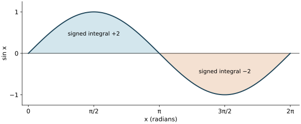
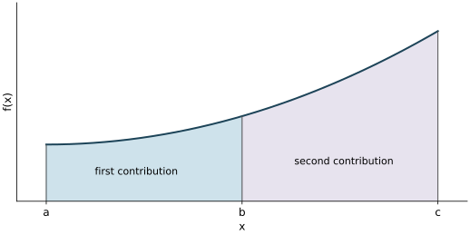

First fundamental theorem of calculus

MIT 18.01, Fall 2006 — Lecture 19

A definite integral accumulates signed contributions over an interval. The fundamental theorem turns that accumulation into an endpoint calculation. This lesson develops how to evaluate it, interpret its sign, combine intervals, obtain bounds and change variables without losing the endpoints.

Reading route. Read the core in order and try Q1–Q5 where they occur. Use a [hint](#hints) when needed; the [complete solutions](#solutions) are grouped separately afterwards. Q6 is a later retrieval and mixed application. The six questions are newly written practice, not MIT examination questions. The worked lecture examples are identified below.

Starting point. You can differentiate powers, sine, cosine and exponentials; use the chain rule; and find their elementary antiderivatives. Basic algebra, inequalities and signed velocity are assumed. The local explanations below supply the conditions and connections needed here. All trigonometric arguments are in radians.

<a name="core"></a>
1. An accumulation from two endpoint values

An antiderivative of $`f`$ is a function $`F`$ whose derivative is $`f`$: $`F'(x)=f(x)`$. The definite integral $`\int_a^b f(x)\,dx`$ is a number for fixed endpoints; the indefinite integral $`\int f(x)\,dx=F(x)+C`$ describes a family of functions. The constant $`C`$ is arbitrary.

For the theorem used here, $`f`$ must be continuous throughout the closed interval between the endpoints. At an interior point $`c`$, continuity means $`\lim_{x\to c}f(x)=f(c)`$: the values approached from both sides agree with the value actually assigned there. At an endpoint, use the approach from within the interval. Thus a jump, a hole or a vertical asymptote in that interval prevents this continuity hypothesis from being met. Polynomials, sine, cosine and the exponential are continuous for every real input; a quotient of continuous functions is continuous wherever its denominator is nonzero. These facts give usable checks in the examples.

The antiderivative-evaluation form of the fundamental theorem is called FTC1 in this MIT lecture. For $`a\lt b`$, if $`f`$ is continuous on $`[a,b]`$ and $`F`$ is an antiderivative there, then

```math
\int_a^b f(x)\,dx=F(b)-F(a).
```

Here an antiderivative on the closed interval means that $`F`$ is continuous on $`[a,b]`$ and $`F'=f`$ in its interior; the familiar antiderivatives used below are differentiable at the endpoints as well. The theorem is supplied as the governing result. The accumulation explanation below gives its meaning rather than replacing a proof of the theorem.

Read the lower endpoint as the starting point and the upper endpoint as the finishing point. Find an antiderivative, evaluate it at the finish, then subtract its value at the start. A useful notation is

```math
[F(x)]_a^b
=
\left.F(x)\right|_{x=a}^{x=b}
=
F(b)-F(a).
```

The vertical bar or brackets instruct you to evaluate the entire enclosed expression twice. They do not mean multiplication by an endpoint. To construct the bracket from a calculation, put the antiderivative inside and place the original starting and finishing inputs below and above it.

For example, since $`(x^3/3)'=x^2`$ and $`x^2`$ is continuous, the lecture's power example becomes

```math
\int_a^b x^2\,dx
=
\left[\frac{x^3}{3}\right]_a^b
=
\frac{b^3}{3}-\frac{a^3}{3}.
```

Both terms use the same antiderivative. Adding the same constant to it changes neither difference:

```math
(F(b)+C)-(F(a)+C)=F(b)-F(a).
```

The lecture's second power example is

```math
\int_0^1 x^5\,dx
=
\left[\frac{x^6}{6}\right]_0^1
=
\frac16.
```

Checking the derivative $`(x^6/6)'=x^5`$ verifies the antiderivative choice. The nonnegative integrand and forward interval make the positive result plausible.

<a name="q1"></a>
Q1. Let $`F(x)=x^3/3+7`$. Use $`F`$ to evaluate $`\int_{-1}^{2}x^2\,dx`$. State why the theorem applies and explain why the constant 7 does not affect the answer. A complete response includes the derivative check, the endpoint subtraction and the value.

[Hint Q1](#h1) · [Solution Q1](#s1)

2. Why accumulation measures a change

Let $`s(t)`$ be position along a line and $`v(t)=s'(t)`$ its signed velocity. Positive velocity means motion in the chosen positive direction; negative velocity means motion the other way. Speed is $`|v(t)|`$, a nonnegative quantity.

For continuous velocity, FTC1 states

```math
\int_a^b v(t)\,dt=s(b)-s(a).
```

The right side is displacement: final position minus initial position. To connect it to accumulated readings, divide a forward time interval into $`n`$ equal pieces of duration $`\Delta t=(b-a)/n`$. A velocity sample $`v(t_i^*)`$ in piece $`i`$ gives an approximate position change $`v(t_i^*)\Delta t`$. The star just marks a chosen sample time within that piece. Adding gives

```math
\sum_{i=1}^n v(t_i^*)\,\Delta t
\approx s(b)-s(a).
```

As the pieces become sufficiently short, continuity makes velocity nearly constant within each piece, and the rectangle sums approach the integral. Actual successive position changes add by cancellation of intermediate positions: the end of one piece is the start of the next. This is the rate-to-change interpretation of the theorem.

If velocity is measured in metres per second and time in seconds, the product has units of metres. More generally an integral has the product of the integrand's units and the integration variable's units; an integration variable can also be dimensionless.

An odometer adds distance travelled, so it accumulates speed. Over forward time,

```math
\text{displacement}=\int_a^b v(t)\,dt,
\qquad
\text{distance travelled}=\int_a^b |v(t)|\,dt.
```

When motion reverses, negative velocity contributions subtract in the first expression but still add positively in the second. Zero displacement can therefore describe a round trip with substantial distance. The lecture's odometer analogy must be read with this distinction: position differences are not generally odometer differences.

The same distinction appears on an ordinary graph. For forward limits, a region above the axis contributes positively to the integral; a region below it contributes negatively. Geometric area adds the sizes of both.

The lecture uses one hump of $`\sin x`$. The function is continuous and $`(-\cos x)'=\sin x`$, so

```math
\int_0^\pi \sin x\,dx
=
[-\cos x]_0^\pi
=
-\cos\pi-(-\cos0)
=
1-(-1)=2.
```

The integrand is nonnegative on that interval, so 2 is also the geometric area. On the next half-cycle,

```math
\int_\pi^{2\pi}\sin x\,dx
=
[-\cos x]_\pi^{2\pi}
=
-1-1=-2.
```

The lecture's full-cycle calculation gives

```math
\int_0^{2\pi}\sin x\,dx
=
[-\cos x]_0^{2\pi}
=
-1-(-1)=0.
```



Figure 1. The first shaded region has signed integral $`+2`$ and the second $`-2`$. Their geometric areas are each 2. The integral over both is 0, while their combined geometric area is 4. The figure combines the two sine views in the lecture; the sign belongs to the contribution, not to the size of a geometric area.

A worked motion example makes the split explicit. Suppose $`v(t)=t-1`$ metres per second for $`0\le t\le2`$. The velocity is negative before $`t=1`$ and positive after it. An antiderivative is $`t^2/2-t`$. The signed changes on the two intervals are

```math
\int_0^1(t-1)\,dt=-\frac12,
\qquad
\int_1^2(t-1)\,dt=\frac12.
```

Displacement is their sum, 0 metres. Distance is the sum of their magnitudes, 1 metre. For more complicated velocity functions, find the zeros, check the sign between them, and split where the sign changes before accumulating distance.

<a name="q2"></a>
Q2. A particle moves along a line with signed velocity $`v(t)=2t-2`$ metres per second for $`0\le t\le3`$, where $`t`$ is time in seconds. Find its displacement and total distance travelled. A complete response identifies when the direction changes, explains which integrals represent the two quantities, and gives units.

[Hint Q2](#h2) · [Solution Q2](#s2)

3. Joining intervals and reversing direction

For $`a\lt b\lt c`$, the interval from $`a`$ to $`c`$ consists of the interval from $`a`$ to $`b`$ followed by the one from $`b`$ to $`c`$. Adding their signed accumulations gives

```math
\int_a^b f(x)\,dx+\int_b^c f(x)\,dx
=
\int_a^c f(x)\,dx.
```

For a continuous $`f`$ with antiderivative $`F`$, the same statement follows by substituting the endpoint differences:

```math
(F(b)-F(a))+(F(c)-F(b))=F(c)-F(a).
```

The intermediate value $`F(b)`$ cancels. This cancellation is why joining intervals works even when the graph crosses the axis.



Figure 2. The first shaded contribution corresponds to $`\int_a^b f(x)\,dx`$; the second to $`\int_b^c f(x)\,dx`$. Joining them gives the integral from $`a`$ to $`c`$. This positive-curve picture illustrates the lecture's interval diagram; the cancellation argument also handles negative contributions.

To keep endpoint evaluation consistent when the starting input is larger than the finishing input, define

```math
\int_b^a f(x)\,dx=-\int_a^b f(x)\,dx,
\qquad
\int_a^a f(x)\,dx=0.
```

Indeed $`F(a)-F(b)=-(F(b)-F(a))`$. “Lower” and “upper” refer to where a limit is written on the integral sign, not to which number is smaller. For example,

```math
\int_2^1 x^2\,dx
=
\left[\frac{x^3}{3}\right]_2^1
=
\frac13-\frac83=-\frac73.
```

The function is positive throughout the interval; the negative answer comes from reversed orientation. Consequently the phrase “above-axis area minus below-axis area” describes forward limits. Reverse limits negate that signed value.

The interval-addition formula remains valid for $`a,b,c`$ in any order, provided the integrals exist. For the continuous functions here, each endpoint expression is defined on the whole interval joining the three points, and the same cancellation proves it. As an explicit out-of-order case,

```math
\int_0^2 x^2\,dx+\int_2^1 x^2\,dx
=
\frac83-\frac73=\frac13
=
\int_0^1 x^2\,dx.
```

The trip from 0 to 2 then back to 1 leaves exactly the oriented contribution from 0 to 1.

<a name="q3"></a>
Q3. A continuous function $`f`$ satisfies $`\int_a^c f(x)\,dx=7`$ and $`\int_b^c f(x)\,dx=10`$, where $`a\lt b\lt c`$. Determine $`\int_a^b f(x)\,dx`$, $`\int_c^b f(x)\,dx`$ and $`\int_c^a f(x)\,dx`$. Explain why the first answer is possible even though $`a\lt b`$. Your reasoning should use interval addition and orientation, without inventing a formula for $`f`$.

[Hint Q3](#h3) · [Solution Q3](#s3)

4. Bounding an integral before evaluating it

Suppose $`a\lt b`$ and continuous functions satisfy $`f(x)\le g(x)`$ at every point of $`[a,b]`$. Then

```math
\int_a^b f(x)\,dx\le\int_a^b g(x)\,dx.
```

The comparison concerns every input in the interval, not just its endpoints. One justification uses $`g(x)-f(x)\ge0`$: its forward rectangle sums are nonnegative, and so is their limiting integral. Integrating the difference term by term gives $`\int_a^b g-\int_a^b f\ge0`$, which is the stated inequality. This argument does not require either original function to be positive.

Reversing the limits negates both integrals. Multiplying an inequality by $`-1`$ reverses its direction:

```math
\int_b^a f(x)\,dx\ge\int_b^a g(x)\,dx.
```

The lecture illustrates comparison by finding lower bounds on the number $`e=e^1`$. Since the exponential increases and $`e^0=1`$, we have $`e^x\ge1`$ for $`x\ge0`$. Integrate from 0 to 1:

```math
1=\int_0^1 1\,dx
\le
\int_0^1 e^x\,dx
=
[e^x]_0^1=e-1.
```

Adding 1 yields $`e\ge2`$. A stronger lower curve gives a stronger result. To establish the lecture's inequality $`1+x\le e^x`$ for $`x\ge0`$, set $`h(x)=e^x-1-x`$. Then $`h(0)=0`$ and $`h'(x)=e^x-1\ge0`$ on that half-line. The derivative sign makes $`h`$ nondecreasing there, so $`h(x)\ge0`$, exactly the desired inequality.

Now integrate that inequality:

```math
\int_0^1(1+x)\,dx
=
\left[x+\frac{x^2}{2}\right]_0^1
=
\frac32
\le e-1.
```

Hence $`e\ge5/2`$. Both bounds are deductions from comparison; neither is asserted to be an exact value of $`e`$. The linear lower curve captures more area than the constant lower curve on this interval.

<a name="q4"></a>
Q4. Use the established inequality $`1+x\le e^x`$ for $`x\ge0`$ to obtain a lower bound for $`e^2`$ by integrating from 0 to 2. Then write the correct comparison between $`\int_2^0(1+x)\,dx`$ and $`\int_2^0 e^x\,dx`$. Explain the direction of each comparison; a bound without its warrant is incomplete.

[Hint Q4](#h4) · [Solution Q4](#s4)

5. Changing the variable and its endpoints

Substitution is the chain rule read backwards. Let $`u=u(x)`$ be a differentiable inner function and let $`G'(u)=g(u)`$. The chain rule gives

```math
\frac{d}{dx}G(u(x))=g(u(x))u'(x).
```

Thus the product $`g(u(x))u'(x)`$ has antiderivative $`G(u(x))`$. The differential notation $`du=u'(x)\,dx`$ records this required factor; changing a variable changes the whole integrand and differential together, not just a symbol.

For the definite-integral rule below, assume $`u`$ has a continuous derivative on the interval joining $`x_1`$ and $`x_2`$, and $`g`$ is continuous on an interval containing every value of $`u`$ reached there. “Continuous derivative” means that $`u'(x)`$ exists and itself has no discontinuity on that interval, with one-sided interpretation at endpoints. Polynomials such as the example below meet this condition.

Endpoint evaluation then gives

```math
\begin{aligned}
\int_{x_1}^{x_2}g(u(x))u'(x)\,dx
&=G(u(x_2))-G(u(x_1))\\
&=\int_{u(x_1)}^{u(x_2)}g(u)\,du.
\end{aligned}
```

On the right, $`u`$ is the integration variable. Its starting value is $`u(x_1)`$ and its finishing value is $`u(x_2)`$. This equality follows from the same endpoint difference on both sides. It does not require sorting the new bounds into increasing order or assuming the inner function is increasing.

To build a substitution, identify an inner expression and check whether its derivative appears as a factor, allowing a constant multiple. Rewrite the entire integrand with the new differential; then calculate both new endpoint values. When the answer is expressed in $`u`$, evaluate it at $`u`$-values. An equally valid alternative is to return completely to $`x`$ and then use the original $`x`$-values. Mixing a $`u`$-antiderivative with $`x`$-bounds evaluates the wrong expression.

The lecture's example is

```math
I=\int_1^2(x^3+2)^4x^2\,dx.
```

Choose $`u=x^3+2`$ because its derivative is $`3x^2`$ and the remaining factor is $`x^2\,dx`$. Both the inner polynomial and the outer fourth power have the needed continuity. Now

```math
du=3x^2\,dx,\qquad x^2\,dx=\frac{du}{3}.
```

The starting input $`x=1`$ gives $`u=3`$; the finishing input $`x=2`$ gives $`u=10`$. Therefore

```math
I
=
\frac13\int_3^{10}u^4\,du
=
\left[\frac{u^5}{15}\right]_3^{10}
=
\frac{10^5-3^5}{15}.
```

The factor $`1/15`$ consists of $`1/3`$ from the differential and $`1/5`$ from integrating the fourth power. Directly differentiating $`(x^3+2)^5/15`$ gives $`(x^3+2)^4x^2`$, an independent check of the conversion. Expanding the polynomial and integrating term by term would also work; substitution keeps the composite structure intact.

A decreasing inner function shows why orientation matters. For

```math
K=\int_0^1(2-x)^2\,dx,
```

take $`u=2-x`$. Then $`du=-dx`$, and the endpoints become 2 and 1, in that order:

```math
K=-\int_2^1u^2\,du
=-\left[\frac{u^3}{3}\right]_2^1
=-\left(\frac13-\frac83\right)
=\frac73.
```

The negative differential factor and the reversed bounds have distinct sources. If you reorder the bounds to 1 and 2, the orientation rule adds another minus sign, giving $`+\int_1^2u^2\,du`$. Keeping only one of these sign changes would incorrectly make a positive forward integral negative.

<a name="q5"></a>
Q5. Consider these two integrals:

```math
A=\int_0^1 x(1+x^2)^3\,dx,
\qquad B=\int_0^1(1+x^2)^3\,dx.
```

Which one does $`u=1+x^2`$ immediately turn into a constant multiple of $`\int u^3\,du`$? Evaluate that integral with changed bounds. Explain the missing factor that prevents the same immediate replacement in the other integral. No evaluation of the other integral is required.

[Hint Q5](#h5) · [Solution Q5](#s5)

<a name="q6"></a>
6. Return to the ideas later

After a break, perhaps the next day, use Q6 to distinguish recalling the rule from applying it to a changed problem. Adjust that timing to your study needs; it is a suggestion, not an optimal schedule.

Q6. On a later revisit, first close the lesson and state the antiderivative-evaluation theorem with its hypotheses and endpoint order. Then reopen it and consider $`f(x)=x(x^2-1)`$ on $`[0,2]`$. Find $`I=\int_0^2 f(x)\,dx`$, the geometric area between its graph and the axis over that interval, and $`J=\int_2^0 f(x)\,dx`$. Choose and justify an efficient exact method. Include a sign analysis, the necessary interval split and an explanation of why the geometric area differs from $`I`$. Distinguish what you recalled without looking from what you reconstructed after reopening the lesson.

[Hint Q6](#h6) · [Solution Q6](#s6)

This finishes the core. The next group contains hints only. Complete solutions follow in their own group.

<a name="hints"></a>
Hints

<a name="h1"></a>
Hint Q1. Differentiate the proposed $`F`$ first. In the subtraction $`F(2)-F(-1)`$, write the negative endpoint in parentheses. Keep the two copies of 7 visible until they cancel.

[Return to Q1](#q1)

<a name="h2"></a>
Hint Q2. Solve $`2t-2=0`$, then check the sign on either side. The antiderivative $`t^2-2t`$ gives each signed contribution; distance reverses the sign of a negative contribution before adding it.

[Return to Q2](#q2)

<a name="h3"></a>
Hint Q3. Let the missing first integral be $`X`$. Additivity gives $`X+10=7`$. For the other two quantities, compare their endpoints with those of the supplied integrals.

[Return to Q3](#q3)

<a name="h4"></a>
Hint Q4. Compare $`[x+x^2/2]_0^2`$ with $`[e^x]_0^2`$. When both limits are reversed, both numerical values are negated, so track what multiplying by a negative number does to an inequality.

[Return to Q4](#q4)

<a name="h5"></a>
Hint Q5. Compute $`du=2x\,dx`$. Look for the whole factor $`x\,dx`$, not just the inner expression. The new endpoint values are obtained by putting $`x=0`$ and $`x=1`$ into $`1+x^2`$.

[Return to Q5](#q5)

<a name="h6"></a>
Hint Q6. For the theorem, check the integrand's continuity, an antiderivative relation and “finish minus start.” In the application, the zeros of $`x(x^2-1)`$ locate candidates for splitting. Expanding the product or recognising the derivative of $`x^2-1`$ both offer short exact routes. Compute the signed pieces before converting them to geometric area.

[Return to Q6](#q6) · [Complete solutions](#solutions)

<a name="solutions"></a>
Complete solutions

<a name="s1"></a>
Solution Q1. The integrand $`x^2`$ is a polynomial and is continuous on $`[-1,2]`$. Also $`F'(x)=x^2`$, since the derivative of 7 is zero. FTC1 therefore gives

```math
\int_{-1}^{2}x^2\,dx
=
F(2)-F(-1)
=
\left(\frac83+7\right)
-
\left(-\frac13+7\right)
=
3.
```

The constant cancels because the same antiderivative is evaluated at both endpoints. Forgetting the parentheses around the starting value is a possible sign error: subtracting $`-1/3`$ adds $`1/3`$.

[Return to Q1](#q1) · [Hints](#hints)

<a name="s2"></a>
Solution Q2. The velocity vanishes at $`t=1`$. It is negative for $`0\le t\lt1`$ and positive for $`1\lt t\le3`$, so the particle reverses direction there. Continuity and the antiderivative $`t^2-2t`$ give the signed changes

```math
\int_0^1(2t-2)\,dt=[t^2-2t]_0^1=-1,
\qquad
\int_1^3(2t-2)\,dt=[t^2-2t]_1^3=4.
```

Displacement adds these signed changes: $`-1+4=3`$ metres. Equivalently, $`[t^2-2t]_0^3=3`$. Distance integrates speed, so the first part contributes $`1`$ metre and the second $`4`$ metres, giving $`5`$ metres. Taking only the magnitude of the final displacement would lose the backtracking and would not give distance.

[Return to Q2](#q2) · [Hints](#hints)

<a name="s3"></a>
Solution Q3. Interval addition gives

```math
\int_a^b f(x)\,dx
=
\int_a^c f(x)\,dx-\int_b^c f(x)\,dx
=
7-10=-3.
```

Reversing endpoints then gives

```math
\int_c^b f(x)\,dx=-10,
\qquad
\int_c^a f(x)\,dx=-7.
```

A forward interval does not require a nonnegative integral: that also depends on the integrand. On $`[a,b]`$, a net signed integral of $`-3`$ means the below-axis contribution outweighs the above-axis contribution by 3. It does not establish that $`f`$ is negative everywhere.

[Return to Q3](#q3) · [Hints](#hints)

<a name="s4"></a>
Solution Q4. The inequality holds at every point of the forward interval $`[0,2]`$, and both functions are continuous. Comparison and endpoint evaluation give

```math
\left[x+\frac{x^2}{2}\right]_0^2
=
4
\le
[e^x]_0^2
=
e^2-1.
```

Adding 1 gives $`e^2\ge5`$. Reversing both limits negates the integrals, so

```math
\int_2^0(1+x)\,dx
=
-4
\ge
\int_2^0e^x\,dx
=
1-e^2.
```

The reversed comparison is equivalent to the same bound, not a contradictory upper bound. An unchanged inequality direction after negating both sides would be an error.

[Return to Q4](#q4) · [Hints](#hints)

<a name="s5"></a>
Solution Q5. For $`u=1+x^2`$, $`du=2x\,dx`$, so $`x\,dx=du/2`$. Integral $`A`$ contains this entire factor. The starting and finishing $`u`$-values are 1 and 2, respectively. Hence

```math
A
=
\frac12\int_1^2u^3\,du
=
\left[\frac{u^4}{8}\right]_1^2
=
\frac{16-1}{8}
=
\frac{15}{8}.
```

The polynomials satisfy the continuity conditions. Differentiating $`(1+x^2)^4/8`$ gives $`x(1+x^2)^3`$, checking both the factor and power.

Integral $`B`$ contains $`dx`$ without the factor $`x`$. Replacing its $`dx`$ by $`du/2`$ would falsely use $`du=2\,dx`$. Thus it does not immediately become a constant multiple of $`\int u^3\,du`$ under this substitution. This is a limitation of that immediate simplification, not a claim that $`B`$ cannot be integrated: expanding its polynomial is a valid alternative.

[Return to Q5](#q5) · [Hints](#hints)

<a name="s6"></a>
Solution Q6. A complete recalled statement is: if $`f`$ is continuous on $`[a,b]`$ with $`a\lt b`$, and $`F`$ is continuous there with $`F'=f`$ in its interior, then $`\int_a^b f(x)\,dx=F(b)-F(a)`$. With the oriented-integral convention, the same endpoint order works for reversed limits; equal endpoints give zero. The endpoints refer to starting and finishing inputs. Compare your initial statement with these conditions and record any condition you supplied only after reopening the lesson; there is no single prescribed personal recall report.

For the application, $`f(x)=x^3-x`$ is a continuous polynomial. Expansion is efficient because it leaves only two powers:

```math
F(x)=\frac{x^4}{4}-\frac{x^2}{2},
\qquad F'(x)=x^3-x=f(x).
```

The endpoint values are $`F(0)=0`$, $`F(1)=-1/4`$ and $`F(2)=2`$. Therefore

```math
I=F(2)-F(0)=2,
\qquad
J=-I=-2.
```

To find geometric area, inspect signs rather than replacing $`I`$ by its magnitude. For $`0\lt x\lt1`$, the factor $`x`$ is positive and $`x^2-1`$ is negative, so $`f(x)\lt0`$. For $`1\lt x\le2`$, both factors are positive. The zero at 0 is an endpoint; the sign-changing zero inside the interval is 1. The signed pieces are

```math
\int_0^1 f(x)\,dx=F(1)-F(0)=-\frac14,
\qquad
\int_1^2 f(x)\,dx=F(2)-F(1)=\frac94.
```

The geometric area is $`1/4+9/4=5/2`$. The signed integral subtracts the first region's size and is $`-1/4+9/4=2`$. Reversing limits changes the integral's sign, but does not change the size of the geometric region.

A valid alternative method is $`u=x^2-1`$, $`du=2x\,dx`$. For the full forward integral, $`u`$ goes from $`-1`$ to 3 and

```math
I=\frac12\int_{-1}^{3}u\,du
=\left[\frac{u^2}{4}\right]_{-1}^{3}
=\frac{9-1}{4}=2.
```

For area that route must still respect the sign change at $`u=0`$, corresponding to $`x=1`$. Either method is acceptable when the sign split and endpoint interpretation are justified. Accurate recall of the theorem and successful transfer to this mixed task are distinct evidence.

[Return to Q6](#q6) · [Core](#core) · [Hints](#hints)

Source and scope

This lesson follows [MIT OpenCourseWare, 18.01 Single Variable Calculus, Fall 2006, Lecture 19: First Fundamental Theorem of Calculus](https://ocw.mit.edu/courses/18-01-single-variable-calculus-fall-2006/817a2c46ddc23e2efda247a79ddeed34_lec19.pdf). The PDF has a cover and four numbered lecture pages. Printed page 1 supplies FTC1 and the power and positive-sine examples; page 2 supplies the rate interpretation and full sine cycle; page 3 supplies interval addition and reversed limits; page 4 supplies comparison, bounds on $`e`$ and substitution. The explanations of conditions, the derivative argument for the linear exponential bound, the additional worked motion and decreasing-substitution cases, and Q1–Q6 are teaching additions. Figures are newly drawn to express the source's signed-area and interval relationships. This document teaches the antiderivative-evaluation result and its uses; it does not claim a formal proof of FTC.

