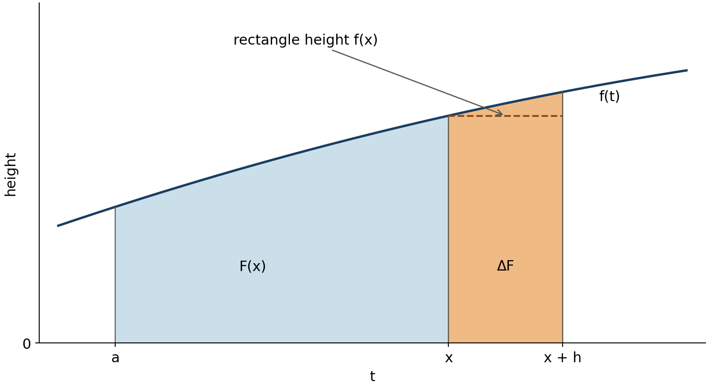
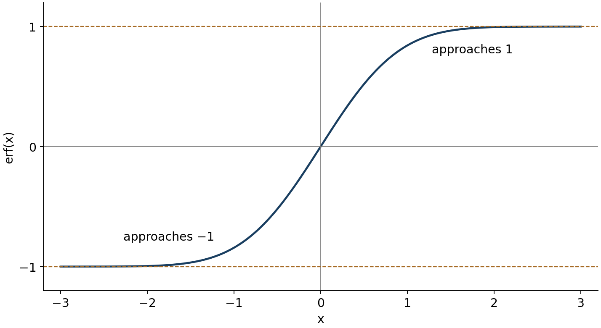

Lecture 20: an integral can define an antiderivative

Read sections 1–7 in order. Try Q1 when it appears and Q2–Q4 after the main explanation. Q5 is a later recall and application opportunity. [Hints](#hints) are grouped separately from [complete solutions](#solutions); open only the help you need. All exercises here are generated for this lesson. The worked Fresnel derivative retains the lecture's homework example.

The aim is to read an integral-defined function, differentiate it with the correct conditions and endpoint factors, explain both fundamental theorems, and distinguish an integral estimate from an exact count. You can use the usual derivative, chain rule, elementary antiderivatives, signed areas and algebra from the supplied starting knowledge. The new connections are developed here.

<a name="section1"></a>
1. Fixing a starting point and moving the endpoint

An antiderivative of a function $`f`$ is a function whose derivative is $`f`$. The familiar evaluation rule says that if $`F'=f`$ and $`f`$ is continuous on the interval, then

```math
\int_a^b f(t)\,dt=F(b)-F(a).
```

This lecture calls that rule FTC 1. It starts with an antiderivative and evaluates an integral. Its notation $`[F(t)]_a^b`$ also means $`F(b)-F(a)`$. An indefinite integral denotes the family $`F(t)+c`$; the constant disappears in this difference.

But how can we know that an antiderivative exists when no familiar formula comes to mind? Instead of finding a formula first, fix a number $`a`$ and define an output for each allowed input $`x`$:

```math
F(x)=\int_a^x f(t)\,dt.
```

Here $`f`$ is the given height function, $`a`$ is the fixed start, $`x`$ is the selected endpoint and input to $`F`$, and $`t`$ is the integration variable. To obtain $`F(3)`$, set the upper limit to 3 and accumulate heights $`f(t)`$ over the interval from $`a`$ to 3. Renaming the internal variable changes nothing: $`\int_a^x f(u)\,du`$ is the same number. The differential identifies the variable being integrated; it does not make $`x`$ another integration variable.

The integral is signed area, obtained as a limit of signed rectangle sums. Below-axis contributions are negative. We also use the orientation convention

```math
\int_a^a f(t)\,dt=0,\qquad
\int_a^x f(t)\,dt=-\int_x^a f(t)\,dt\quad(x<a).
```

Thus $`F(a)=0`$, and an input below the starting point is permitted when $`f`$ is defined on the intervening interval. To construct the function that accumulates a rate $`r`$ starting at 2, write $`A(x)=\int_2^x r(t)\,dt`$. An initial accumulated value of 7 would instead give $`7+A(x)`$. That added constant changes accumulated values but cannot change their derivative.

Continuity is a condition on the height function $`f`$: at a point $`x`$, its nearby values $`f(t)`$ approach the actual value $`f(x)`$ as $`t`$ approaches $`x`$. There is no jump, hole or blow-up there. More operationally, every chosen tolerance for the height difference can be met by keeping $`t`$ sufficiently close to $`x`$. On a closed interval this includes approaching an endpoint from inside. Polynomials, exponentials, sine and cosine are continuous for real inputs; their compositions are continuous, and quotients are continuous where the denominator is nonzero. For a piecewise formula, check that the left limit, right limit and assigned value agree at a join. A continuous function has a well-defined finite signed integral over every finite closed subinterval; we use this existence result in making the definition above.

FTC 2 states: for $`f`$ continuous on an interval containing the fixed base $`a`$ and the inputs in question, the function $`F(x)=\int_a^x f(t)\,dt`$ satisfies

```math
F'(x)=f(x)
```

at interior points of that interval. An endpoint has the corresponding one-sided statement if only one side is in the domain. This goes from an accumulated integral to a derivative. The conclusion is a value of $`f`$, not a derivative of $`f`$.

For example, take $`f(t)=2t-2`$ and $`a=0`$. The known evaluation rule gives $`F(x)=x^2-2x`$. Its derivative is $`2x-2=f(x)`$, exactly as FTC 2 predicts. At $`x=1`$, the accumulated signed value is $`-1`$ but the current rate is zero. The height at the endpoint controls the local change; the entire interval controls the accumulated value. This elementary calculation checks the new statement in one case; the general justification follows in section 2.

<a name="q1"></a>
Q1. Let $`A(x)=\int_1^x(t^2-1)\,dt`$, for real $`x`$. Find $`A(1)`$, $`A'(0)`$ and $`A(0)`$. Explain why $`A(0)`$ and $`A'(0)`$ can have different signs. Your response should distinguish an accumulated value, a local rate and reversed limits. [Hint Q1](#h1) · [Solution Q1](#s1)

<a name="section2"></a>
2. Why a thin strip gives the derivative

Keep $`x`$ fixed and change the endpoint by a nonzero amount $`h`$. The change in the accumulated value is $`\Delta F=F(x+h)-F(x)`$. Integral additivity, which follows by joining the rectangle sums on adjacent intervals, gives

```math
F(x+h)-F(x)=\int_x^{x+h}f(t)\,dt.
```

For positive $`h`$ the old part cancels, leaving the newly added strip. The next figure shows a positive curve only to make the areas easy to see; the signed-integral argument also handles negative heights.



Figure 1. The horizontal coordinate is the integration variable $`t`$. The orange strip has width $`h`$. When $`h`$ is small and $`f`$ is continuous, the strip is close to a rectangle of height $`f(x)`$. The picture suggests $`\Delta F\approx h f(x)`$; the approximation by itself is not yet a proof about a derivative.

Divide the exact change by $`h`$:

```math
\frac{F(x+h)-F(x)}{h}
=\frac1h\int_x^{x+h}f(t)\,dt.
```

For $`h\gt 0`$, the right side is the average value of $`f`$ on that small interval: total signed area divided by interval length. Why does the average approach $`f(x)`$? If every height differs from $`f(x)`$ by less than a positive tolerance $`\varepsilon`$, all rectangle-sum averages lie between $`f(x)-\varepsilon`$ and $`f(x)+\varepsilon`$. Passing to the integral preserves these bounds. Equivalently, the possible area error is at most width times height tolerance, so division by width bounds the average error by that same tolerance.

Continuity supplies precisely this control on all heights in a sufficiently small interval next to $`x`$. It works for any positive tolerance, however small. Therefore the average tends to $`f(x)`$ as $`h`$ tends to zero from the right.

The left side of the point must also be checked. If $`h\lt 0`$, reverse the integral and the sign of its denominator together:

```math
\frac1h\int_x^{x+h}f(t)\,dt
=\frac1{-h}\int_{x+h}^{x}f(t)\,dt.
```

This is again an average over an interval of positive length, now $`-h`$, on the left of $`x`$. The same continuity bound applies. Both sides give the same limit, and the definition of the derivative now yields $`F'(x)=f(x)`$. No prior antiderivative was used in this proof. In particular, continuity guarantees an antiderivative by providing one explicitly as an accumulation function.

Continuity matters locally. For instance, if a height jumps from 1 on the left of zero to 3 on the right, the small-strip average approaches 1 from one side and 3 from the other. There is no single derivative there. Q2 asks you to compute this failure directly. This does not say that every discontinuity destroys every derivative; it shows why the continuous-function theorem cannot be applied indiscriminately.

<a name="section3"></a>
3. Recovering FTC 1 from FTC 2

Suppose $`f`$ is continuous on $`[a,b]`$ and $`P`$ is any antiderivative of $`f`$ there. Define the particular accumulation function $`G(x)=\int_a^x f(t)\,dt`$. FTC 2 gives $`G'=f`$, so

```math
(P-G)'=P'-G'=f-f=0.
```

The remaining bridge is why a zero derivative makes a function constant on an interval. We use the mean value theorem: for a function $`H`$ continuous on $`[u,v]`$ and differentiable between its endpoints, there is some interior point $`c`$ such that

```math
H(v)-H(u)=H'(c)(v-u).
```

It says that at least one tangent slope equals the secant slope. Differentiable means that the finite derivative limit exists at each point in question. This theorem is introduced here as a standard result, not proved from the area picture. If $`H'=0`$ throughout the interval, its right-hand side is zero for every choice of endpoints, so all its values agree. Apply this to $`H=P-G`$. Both functions are differentiable inside and continuous at the relevant endpoints, and therefore $`P(x)-G(x)=k`$ for a constant $`k`$.

Now $`G(a)=0`$ makes $`P(a)=k`$, and $`G(b)=P(b)-k`$. Hence

```math
\int_a^b f(t)\,dt=G(b)=P(b)-P(a).
```

This is FTC 1. Distinguish the roles: $`G`$ is fixed by the chosen base and has value zero there; $`P`$ can be any antiderivative. For a concrete example use $`f(t)=\cos t`$, $`a=0`$, $`G(x)=\sin x`$ and $`P(x)=\sin x+21`$. Differentiating both gives cosine, and $`P(b)-P(a)=\sin b-\sin a`$ because the 21 cancels. The original lecture switches between sine and cosine in this example; cosine is the integrand consistent with these displayed antiderivatives. For sine instead, use $`-\cos x+k`$.

<a name="section4"></a>
4. New functions do not need elementary antiderivative formulas

A formula built from familiar powers, exponentials, logarithms and trigonometric functions is not the only way to specify a function. For example,

```math
E(x)=\int_0^x e^{-t^2}\,dt
```

specifies one unique real number for each real $`x`$. The integrand is continuous. FTC 2 gives $`E'(x)=e^{-x^2}`$ and the definition gives $`E(0)=0`$. Thus we can know the derivative and initial value without first finding an elementary formula for the integral. Numerical rectangle or trapezium sums can approximate its values if needed.

The same construction works for the lecture's other examples on intervals where their integrands are continuous: $`t^{1/2}e^{-t^2}`$ for nonnegative $`t`$; $`\sin t/t`$ on intervals avoiding zero; and $`\sin(t^2)`$ or $`\cos(t^2)`$ for all real $`t`$. The quotient $`\sin t/t`$ as written is undefined at zero. If its value there is defined to be 1, the known limit $`\sin t/t\to1`$ makes that extended function continuous through zero. An integral definition is a valid answer even when a familiar finite expression is unavailable.

The error function

The lecture scales $`E`$ to define

```math
\operatorname{erf}(x)=\frac2{\sqrt\pi}\int_0^x e^{-t^2}\,dt,
\qquad
\operatorname{erf}'(x)=\frac2{\sqrt\pi}e^{-x^2}.
```

The factor is constant and remains outside differentiation. This is the standard [error-function normalization](https://dlmf.nist.gov/7.2#E1). Its derivative is positive for every finite real input, so it increases, and it passes through the origin. The integrand is even. Substituting $`t=-u`$ and using reversed limits gives $`\int_0^{-x}e^{-t^2}dt=-\int_0^x e^{-u^2}du`$. Hence $`\operatorname{erf}(-x)=-\operatorname{erf}(x)`$.

The horizontal levels in the figure require more than just a derivative tending to zero. The normal density supplied in the starting knowledge is $`e^{-z^2/2}/\sqrt{2\pi}`$ and has total integral 1. Substitute $`z=\sqrt2\,t`$ in that normalization. Its differential contributes $`\sqrt2`$, giving $`\int_{-\infty}^{\infty}e^{-t^2}dt=\sqrt\pi`$. Symmetry then gives $`\int_0^\infty e^{-t^2}dt=\sqrt\pi/2`$. Here an infinite-endpoint integral means the limit of finite-endpoint integrals. Consequently

```math
\lim_{x\to\infty}\operatorname{erf}(x)=1,
\qquad
\lim_{x\to-\infty}\operatorname{erf}(x)=-1.
```



Figure 2. The vertical coordinate is $`\operatorname{erf}(x)`$. The curve becomes flatter away from zero because its derivative shrinks. The normalization argument establishes the limiting levels. The positive remaining tail area means the upper level is approached but never reached at a finite positive input. Differentiating again gives $`\operatorname{erf}''(x)=-4x e^{-x^2}/\sqrt\pi`$: its gradient increases for negative inputs and decreases for positive ones, producing the bend at zero. This integral connection is why the function is useful for normal probabilities.

Fresnel functions

In this lecture's convention the two functions used in optics are

```math
C(x)=\int_0^x\cos(t^2)\,dt,\qquad
S(x)=\int_0^x\sin(t^2)\,dt.
```

Their integrands are continuous, so $`C'(x)=\cos(x^2)`$ and $`S'(x)=\sin(x^2)`$. For the lecture's requested $`C'`$, the operation is to evaluate the integrand at the endpoint. There is no factor $`2x`$ in $`C'`$: differentiating $`\cos(x^2)`$ would instead compute $`C''`$. Some references insert $`\pi/2`$ in the integrand; we retain the explicitly displayed MIT convention rather than mixing normalizations.

A different kind of integral-defined function

The order-zero Bessel function is another example, used in circularly symmetric problems. For real $`x`$ its standard representation is

```math
J_0(x)=\frac1\pi\int_0^\pi\cos(x\sin\theta)\,d\theta.
```

For each fixed input $`x`$, integrate with respect to $`\theta`$ from 0 to $`\pi`$. Here $`x`$ changes the integrand; neither limit moves. It is not the form to which $`\frac d{dx}\int_a^x f(t)dt=f(x)`$ applies directly. A rule for differentiating parameter-dependent integrals would need separate justification. We do not need that rule to evaluate at zero: $`\cos(0\sin\theta)=1`$, so $`J_0(0)=\pi/\pi=1`$. The lecture prints $`1/(2\pi)`$ on this same interval, which would give $`1/2`$. The [standard Bessel integral](https://dlmf.nist.gov/10.9#E1) uses $`1/\pi`$; the factor of two is corrected here.

<a name="section5"></a>
5. A slowly varying integrand and a prime-count estimate

The lecture defines, for $`x\gt1`$,

```math
\operatorname{Li}(x)=\int_2^x\frac{dt}{\ln t}.
```

The notation $`dt/\ln t`$ means $`(1/\ln t)\,dt`$. On any interval entirely above 1 the denominator is nonzero, so the integrand is continuous and $`\operatorname{Li}'(x)=1/\ln x`$. Also $`\operatorname{Li}(2)=0`$. We do not cross 1: $`\ln1=0`$ produces a singularity. This lower-limit-2 convention differs by a constant from other logarithmic-integral conventions, with the same derivative and interval differences.

A separate number-theoretic result motivates using $`\operatorname{Li}(x)`$ as an approximation to the number of primes below a large $`x`$; it is not an identity or a consequence of FTC 2. We use this approximation as an introduced application, without proving the prime number theorem. [NIST's prime asymptotics](https://dlmf.nist.gov/27.12) records the logarithmic-integral connection. Subtracting endpoint estimates leads to

```math
\text{estimated prime count between }A\text{ and }B
\ \approx\ \operatorname{Li}(B)-\operatorname{Li}(A)
=\int_A^B\frac{dt}{\ln t}.
```

Prime numbers are whole numbers greater than 1 with no positive divisors except 1 and themselves. Exactly $`d`$ decimal digits means $`10^{d-1}\le n\lt10^d`$. Thus the lecture's interval from $`10^{200}`$ to $`10^{201}`$ concerns 201-digit numbers, not 200-digit numbers. The endpoints are powers of ten and are not prime, so their inclusion has no effect on this count.

On that interval the logarithm ranges from $`200\ln10`$ to $`201\ln10`$, approximately 460.52 to 462.82 using $`\ln10\approx2.302585`$. Replacing it by 500 is a deliberately coarse estimate. Since the integral of a constant $`c`$ is a rectangle of height $`c`$ and width $`B-A`$,

```math
\int_{10^{200}}^{10^{201}}\frac{dt}{\ln t}
\ \approx\ \frac{10^{201}-10^{200}}{500}
=\frac{9\cdot10^{200}}{500}
=1.8\cdot10^{198}.
```

That last number rounds to $`2\cdot10^{198}`$ at one significant figure; $`10^{198}`$ is only a rough scale description. The lower endpoint in the lecture's logarithm-range sentence should also be $`10^{200}`$, not 200.

For the stated 200-digit example, use the corrected interval instead:

```math
\int_{10^{199}}^{10^{200}}\frac{dt}{\ln t}
\ \approx\ \frac{9\cdot10^{199}}{500}
=1.8\cdot10^{197}.
```

A more informative check keeps the endpoint logarithms. Because $`\ln t`$ increases and stays positive on $`1\lt A\lt B`$, reciprocals reverse the order, giving

```math
\frac{B-A}{\ln B}\le\int_A^B\frac{dt}{\ln t}
\le\frac{B-A}{\ln A}.
```

These bounds concern the integral exactly; they do not bound the separate error in replacing an actual prime count by that integral. For $`A=10^{199}`$, $`B=10^{200}`$, they place the integral between approximately $`1.954\cdot10^{197}`$ and $`1.964\cdot10^{197}`$. The example illustrates a huge number of available primes. It does not by itself establish the security of an encryption system: a count of possible values supplies no bound on the work needed by an attack exploiting additional structure. The lecture's banking story is motivation, not a security conclusion derived by this calculation.

<a name="section6"></a>
6. When the endpoint itself is a function

FTC 2 can combine with the familiar chain rule. Let $`K(u)=\int_a^u f(t)dt`$, and let $`g(x)`$ be a differentiable endpoint lying in the interval where $`f`$ is continuous. The function $`W(x)=K(g(x))`$ first computes the endpoint and then the accumulation. Therefore

```math
\frac d{dx}\int_a^{g(x)}f(t)\,dt
=K'(g(x))g'(x)=f(g(x))g'(x).
```

For example $`W(x)=\int_1^{x^2}\cos(t^2)dt`$ equals $`K(x^2)`$ with $`K'(u)=\cos(u^2)`$. Substitute the endpoint into the integrand and then multiply by its rate:

```math
W'(x)=\cos((x^2)^2)\,2x=2x\cos(x^4).
```

The extra factor comes from the moving endpoint, not from differentiating the integrand. If both limits move, use a fixed base $`a`$ to subtract accumulations:

```math
\int_{p(x)}^{q(x)} f(t)dt=K(q(x))-K(p(x)),
\qquad
\frac d{dx}\int_{p(x)}^{q(x)} f(t)dt
=f(q(x))q'(x)-f(p(x))p'(x).
```

The minus sign comes from removing the lower accumulation. This identity holds with oriented limits even when their order reverses, provided both endpoints and their connecting intervals remain in the continuous domain. For example, with $`f(t)=t`$, $`p(x)=x`$ and $`q(x)=2x`$, it gives $`(2x)2-x=3x`$. Direct integration gives $`\int_x^{2x}t\,dt=3x^2/2`$, whose derivative confirms the result for positive and negative $`x`$.

<a name="section7"></a>
7. The next lecture's starting point, and practice

The original lecture ends by proposing $`L(x)=\int_1^x dt/t`$ for $`x\gt0`$. Since $`1/t`$ is continuous on this domain, $`L'(x)=1/x`$ and $`L(1)=0`$. These match the derivative and value of $`\ln x`$. Their difference has zero derivative, so the constant-difference reasoning of section 3 gives $`L(x)=\ln x`$ on the positive interval. This identifies the accumulated function using the logarithm already in your starting knowledge; a development of logarithm laws beginning with this integral is the next lecture's project.

<a name="q2"></a>
Q2. Let $`f(t)=1`$ for $`t\lt0`$ and $`f(t)=3`$ for $`t\ge0`$, and let $`B(x)=\int_0^x f(t)dt`$. Find $`B(x)`$ for $`x\lt0`$ and $`x\ge0`$. Compare the left and right difference quotients at zero, and decide whether $`B'(0)=f(0)`$. Identify the missing FTC 2 hypothesis. Use the two one-sided calculations, not only the hypothesis name. [Hint Q2](#h2) · [Solution Q2](#s2)

<a name="q3"></a>
Q3. Let $`H(x)=\int_{-x}^{x^2}e^{-t^2}dt`$, for real $`x`$. Find $`H'(x)`$, $`H(0)`$ and $`H'(0)`$. Show a fixed-base difference of two accumulation functions and explain every chain-rule factor and sign. Do not try to find an elementary antiderivative. [Hint Q3](#h3) · [Solution Q3](#s3)

<a name="q4"></a>
Q4. Use the lecture's prime-count approximation: the estimated number of primes between $`A`$ and $`B`$ is $`\int_A^Bdt/\ln t`$. Set up the estimate for exactly three decimal digits. Using $`\ln100=4.605`$ and $`\ln1000=6.908`$, bound that integral above and below by constant-height rectangles. Give numerical bounds to the nearest integer and explain why they are bounds for the integral rather than certified bounds for the actual prime count. No prime-count table is needed. [Hint Q4](#h4) · [Solution Q4](#s4)

<a name="q5"></a>
Q5. On a later study session, first set the notes aside and state the two FTC directions with their hypotheses and roles. Then reopen them for this changed task. Suppose $`f`$ is continuous on the real line, $`f(2)=-1`$ and $`f(4)=3`$, and $`R(x)=\int_x^{2x}f(t)dt`$. Find $`R'(2)`$. Can $`R(2)`$ be determined from just the given values? Justify your answer, using two possible continuous functions or a reason explaining what interval information is missing. State which part of your response is recall and which applies the result in a changed setting. The goal is a justified decision, not a recalled number. A later session is an adjustable study suggestion, not a prescribed optimum interval. [Hint Q5](#h5) · [Solution Q5](#s5)

<a name="hints"></a>
Hints

These give a next step without the complete answers. The complete solutions are in a separate group below.

<details>
<summary>Open hints Q1–Q5</summary>

<a name="h1"></a>
Hint Q1. Start with the zero-width interval for $`A(1)`$. The derivative uses the height at 0. For $`A(0)`$, reverse the interval to run from 0 to 1 and put a minus sign outside; the height is nonpositive on that interval. [Return to Q1](#q1)

<a name="h2"></a>
Hint Q2. For a negative endpoint, write $`B(x)=-\int_x^0 1\,dt`$. For a positive endpoint, use the height 3. In each case divide $`B(h)-B(0)`$ by $`h`$ before taking the appropriate limit. A single endpoint value contributes no area. [Return to Q2](#q2)

<a name="h3"></a>
Hint Q3. With $`E(u)=\int_0^u e^{-t^2}dt`$, write $`H(x)=E(x^2)-E(-x)`$. The second term has both a subtraction sign and an endpoint derivative of $`-1`$. [Return to Q3](#q3)

<a name="h4"></a>
Hint Q4. Three-digit numbers start at 100 and end just before 1000. The interval length is 900. Since the logarithm increases, $`1/\ln1000`$ is the smaller rectangle height. [Return to Q4](#q4)

<a name="h5"></a>
Hint Q5. The derivative rule uses $`f(2x)`$ and $`f(x)`$, weighted by the rates of their endpoints. An accumulated value needs information between the endpoints too. To investigate nonuniqueness, compare the straight line through the two specified values with that line plus a multiple of $`(t-2)(t-4)`$. That added term vanishes at both specified endpoints. [Return to Q5](#q5)

</details>

<a name="solutions"></a>
Complete solutions

<details>
<summary>Open complete solutions Q1–Q5</summary>

<a name="s1"></a>
Solution Q1. The zero-width integral gives $`A(1)=0`$. The polynomial integrand is continuous for real inputs, so FTC 2 gives $`A'(x)=x^2-1`$ and $`A'(0)=-1`$. For the accumulated value,

```math
A(0)=-\int_0^1(t^2-1)dt
=-\left[\frac{t^3}{3}-t\right]_0^1
=-\left(\frac13-1\right)=\frac23.
```

This is positive because the area from 0 to 1 is negative and the integral runs in reverse. The derivative is negative because the endpoint height is negative. A value and its local rate answer different questions, so their differing signs are consistent. An anticipated mistake would use the entire signed area as the derivative; FTC 2 uses only the endpoint height. [Return to Q1](#q1)

<a name="s2"></a>
Solution Q2. For $`x\lt0`$, $`B(x)=-\int_x^0 1dt=-(-x)=x`$. For $`x\ge0`$, $`B(x)=\int_0^x3dt=3x`$, including $`B(0)=0`$. The assigned value at the single point zero changes no rectangle-sum area: its possible contribution has zero width. Thus

```math
\frac{B(h)-B(0)}h=
\begin{cases}
1,&h<0,\\
3,&h>0.
\end{cases}
```

The two limits disagree, so $`B'(0)`$ does not exist and cannot equal $`f(0)=3`$. The integrand is not continuous at zero: the left-hand limit 1 differs from the right-hand limit and assigned value 3. This example has a well-defined accumulation function but no two-sided derivative at the jump. Away from zero each constant branch gives the expected derivative. [Return to Q2](#q2)

<a name="s3"></a>
Solution Q3. With $`E(u)=\int_0^u e^{-t^2}dt`$, integral additivity gives $`H(x)=E(x^2)-E(-x)`$. The exponential integrand is continuous on the real line, so $`E'(u)=e^{-u^2}`$. The chain rule gives

```math
H'(x)=E'(x^2)(2x)-E'(-x)(-1)
=2x e^{-x^4}+e^{-x^2}.
```

The $`2x`$ is the derivative of the upper endpoint. The lower endpoint has derivative $`-1`$, which cancels the subtraction sign. At zero the two integration limits coincide, so $`H(0)=0`$; substitution in the derivative gives $`H'(0)=1`$. A zero integral at one input does not make its local rate zero. No elementary primitive was needed. [Return to Q3](#q3)

<a name="s4"></a>
Solution Q4. Exactly three digits means $`100\le n\lt1000`$, so the integral estimate is $`I=\int_{100}^{1000}dt/\ln t`$. The positive logarithm increases across this interval. Therefore

```math
\frac{900}{\ln1000}\le I\le\frac{900}{\ln100}.
```

Using the supplied rounded logarithms gives approximate endpoint values $`900/6.908\approx130.28`$ and $`900/4.605\approx195.44`$. Reported to the nearest integer these rectangle estimates are 130 and 195. Those rounded numbers summarize the sizes; preserve the unrounded expressions above for the actual inequality. In particular, rounding an upper bound down to 195 is not a proof that $`I\le195`$. The rectangles bound the integral because their heights bound its integrand. The number of primes is only approximated by that integral, with no prime-count error bound supplied here. Therefore the calculation does not certify that the actual count lies between these numbers. [Return to Q4](#q4)

<a name="s5"></a>
Solution Q5. For recall, FTC 1 evaluates $`\int_a^b f(t)dt=P(b)-P(a)`$ when $`f`$ is continuous on the interval and $`P'=f`$. FTC 2 says that for continuous $`f`$, a fixed-base accumulation $`G(x)=\int_a^x f(t)dt`$ has $`G'(x)=f(x)`$ at interior points. The first uses an antiderivative; the second constructs one.

For the changed application, the two endpoint rates are 2 and 1, so

```math
R'(x)=2f(2x)-f(x),\qquad R'(2)=2f(4)-f(2)=2(3)-(-1)=7.
```

However, $`R(2)=\int_2^4f(t)dt`$ depends on heights throughout that interval. For example, both $`f_1(t)=2t-5`$ and $`f_2(t)=2t-5+(t-2)(t-4)`$ are continuous and have the required endpoint values. The first integral is $`[t^2-5t]_2^4=2`$. The added term in the second has integral

```math
\int_2^4(t-2)(t-4)dt
=\left[\frac{t^3}{3}-3t^2+8t\right]_2^4
=-\frac43.
```

Thus the second gives $`2-4/3=2/3`$, while both give the same derivative 7 at the specified input. Either this pair or a clear explanation that endpoint values do not determine the intervening area establishes why $`R(2)`$ is undetermined. Stating the theorems tests recall; choosing which interval information the new value and derivative need is transfer to a changed inference. [Return to Q5](#q5)

</details>

Source and conventions

The assigned source is [MIT OpenCourseWare, 18.01 Single Variable Calculus, Fall 2006, Lecture 20: Second Fundamental Theorem](https://ocw.mit.edu/courses/18-01-single-variable-calculus-fall-2006/3cd98c68cec64e9214c8c9003f6cf983_lec20.pdf), all five PDF pages including the cover. The lecture's FTC numbering, lower-limit-2 logarithmic integral, and unscaled Fresnel functions are retained. The sine/cosine, digit-range, rounding and Bessel normalization discrepancies are explained at their uses. Figures are newly drawn for these notes. The continuity proof, moving-endpoint cases and generated exercises supply the route needed to use the source material independently.
